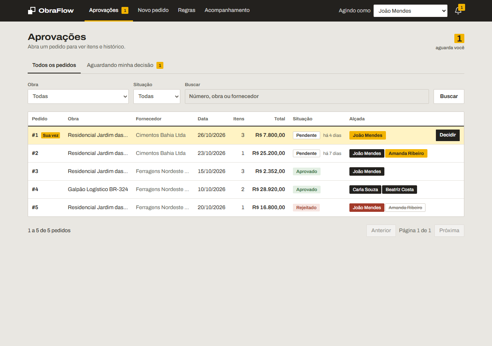
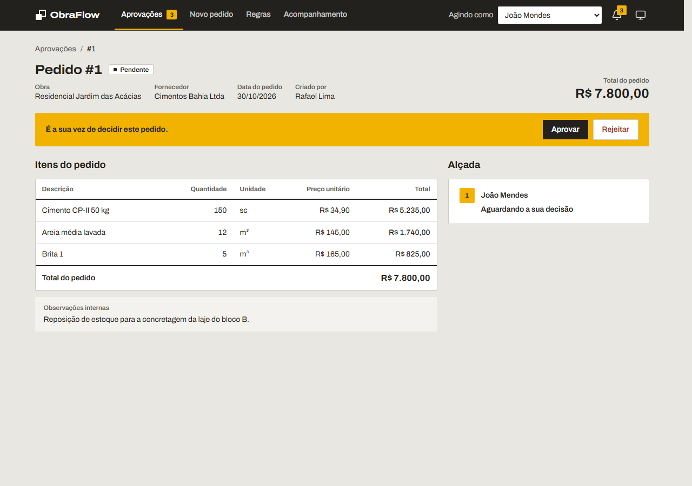
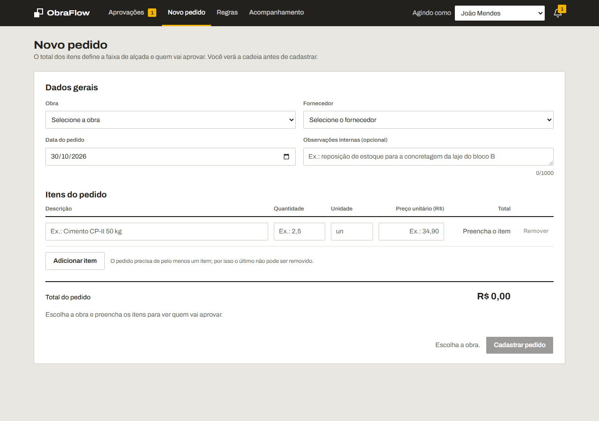
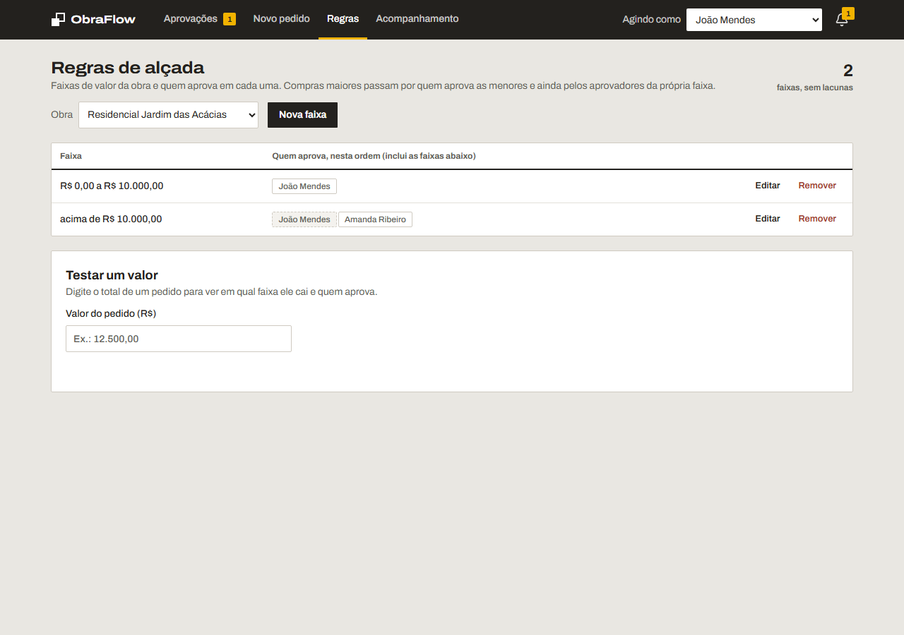
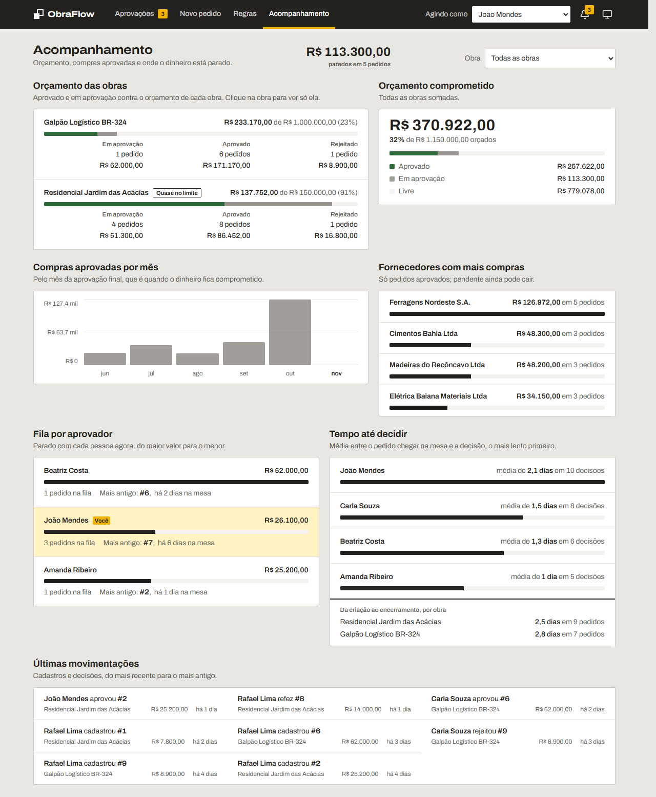
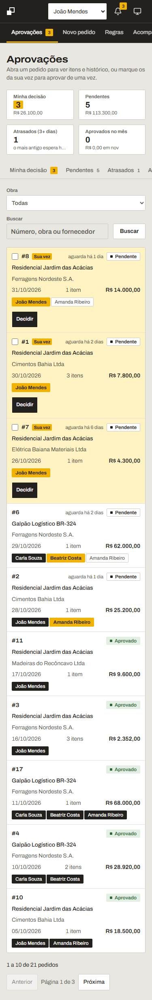
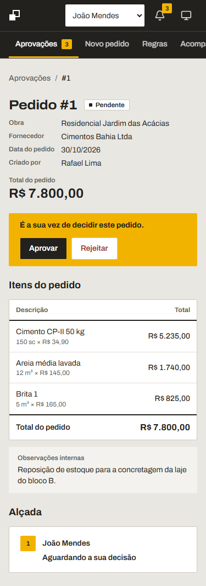
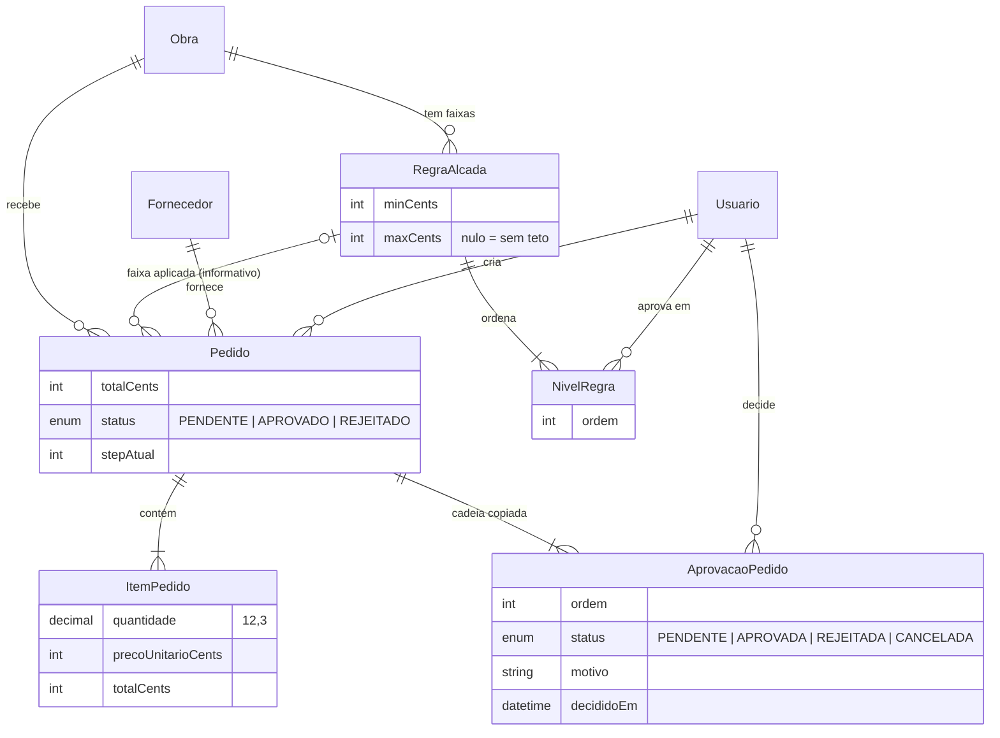
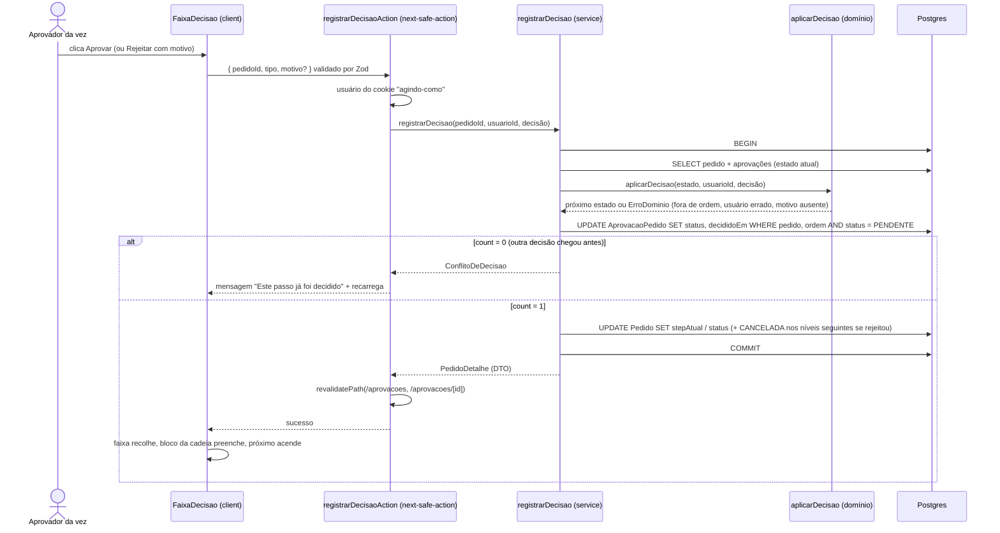

# ObraFlow — Dokimos (pedidos de compra com aprovação por alçada)

[](https://github.com/jphillipe/obraflow-case/actions/workflows/ci.yml)

**Demo publicada:** https://obraflow-theta.vercel.app (Vercel + Postgres na Neon, com os dados de demonstração do seed; escolha quem você é em "Agindo como").

## Telas

Capturas da demo publicada, agindo como João Mendes (aprovador do pedido #1). O amarelo aparece só onde ele precisa agir.

| Aprovações: lista com filtros, a linha "Sua vez" e a cadeia de cada pedido            | Detalhe do pedido: faixa de decisão, itens e timeline da alçada                                                       |
| ------------------------------------------------------------------------------------- | --------------------------------------------------------------------------------------------------------------------- |
|                        |                                                              |
| **Novo pedido**: itens em tabela, total e cadeia que será aplicada antes de cadastrar | **Regras de alçada**: faixas por obra, aprovadores herdados e simulador                                               |
|                               |                                                               |
| **Acompanhamento**: por obra, fila por aprovador e tempo até decidir                  | **Celular (375px)**: lista em blocos e detalhe com itens compactos                                                    |
|                         |   |

## Como rodar

Pré-requisitos: Node 24+, Docker.

```bash
cp .env.example .env
npm install
npm run db:up        # sobe o Postgres (docker compose)
npm run db:migrate   # aplica as migrations e gera o client (Prisma 7 não gera sozinho no migrate)
npm run db:seed      # dados de demonstração
npm run dev          # http://localhost:3000
```

Outros scripts: `npm run check` (lint + prettier + tsc + testes), `npm run format`, `npm test`, `npm run db:studio`, `npm run db:down`.

A cada commit, um hook `pre-commit` (husky) roda `lint-staged`: ESLint com `--fix` e Prettier só nos arquivos em stage. Se o lint falhar, o commit não acontece.

### Deploy (Vercel + Neon)

A demo em https://obraflow-theta.vercel.app roda na Vercel, ligada ao branch `main` deste repositório (cada push publica), com o Postgres na Neon (região `sa-east-1`, funções da Vercel em `gru1`). A única diferença para o ambiente local é a variável `DATABASE_URL`. Para reproduzir:

1. Crie um banco Postgres (Neon, Supabase, RDS) e copie a connection string.
2. Na Vercel, importe o repositório, defina `DATABASE_URL` e o comando de build `prisma generate && next build` (o client do Prisma é gerado no build porque `src/generated/prisma` não vai para o git).
3. Aplique as migrations e o seed no banco remoto a partir da sua máquina, apontando a variável só para esses comandos:

```bash
DATABASE_URL="postgresql://..." npx prisma migrate deploy
DATABASE_URL="postgresql://..." npx prisma db seed
```

Não há secret além da `DATABASE_URL`: sem autenticação, o "Agindo como" é um cookie.

Em cada push na `main` e em cada pull request, o GitHub Actions (`.github/workflows/ci.yml`) roda o mesmo `npm run check` do dia a dia: `next typegen` (os tipos globais `PageProps`/`LayoutProps` que o `tsc` precisa em um clone limpo), lint, Prettier, `tsc` e os testes do domínio. O `next build` fica com a Vercel, porque ele prerenderiza páginas com `"use cache"` e precisa de banco.

## Tecnologias e motivos

| Dependência                                                                                                                               | Por quê                                                                                                                                                                                                                                                     |
| ----------------------------------------------------------------------------------------------------------------------------------------- | ----------------------------------------------------------------------------------------------------------------------------------------------------------------------------------------------------------------------------------------------------------- |
| Next.js 16 (App Router, RSC)                                                                                                              | Front e back no mesmo projeto. Server Components para listagens, server actions para mutações, `loading.tsx`/`error.tsx` por rota.                                                                                                                          |
| Tailwind v4 + shadcn/ui                                                                                                                   | Componentes acessíveis copiados para o repositório (`src/components/ui`), sem lib de UI como dependência fechada. O CLI `shadcn` fica em devDependencies.                                                                                                   |
| Prisma 7 + PostgreSQL                                                                                                                     | Schema declarativo, migrations versionadas e transações. Postgres por ser o banco que uma empresa usaria em produção.                                                                                                                                       |
| `@prisma/adapter-pg`                                                                                                                      | O Prisma 7 exige um driver adapter; este é o adapter oficial para Postgres (usa `pg` por baixo).                                                                                                                                                            |
| Zod                                                                                                                                       | Um único schema de validação compartilhado entre formulário (client) e server action/API (server).                                                                                                                                                          |
| react-hook-form + `@hookform/resolvers`                                                                                                   | `useFieldArray` resolve a lista de N itens do pedido; o resolver liga o Zod ao formulário.                                                                                                                                                                  |
| Vitest                                                                                                                                    | Testes unitários apenas em `src/domain` (regras de alçada são funções puras).                                                                                                                                                                               |
| `next-safe-action`                                                                                                                        | Toda server action passa por ele: valida com o mesmo Zod do formulário, um middleware injeta o usuário "Agindo como", e `handleServerError` decide o que chega ao client (mensagem de domínio em pt-BR ou erro genérico).                                   |
| `@next-safe-action/adapter-react-hook-form`                                                                                               | `useHookFormAction` liga action + `useForm` e devolve os erros de validação do servidor para os campos certos. Funciona com `zodResolver` e `useFieldArray`.                                                                                                |
| `ky`                                                                                                                                      | Cliente HTTP fino sobre `fetch` (≈4 kB) usado só em client components para leituras interativas em `/api` (`prefix`, `retry`, timeout, `.json<T>()`). Axios não se integra ao `fetch` do Next e é muito maior; o server nunca chama a própria API por HTTP. |
| `sonner`, `lucide-react`, `@base-ui/react`, `class-variance-authority`, `cn`, `tw-animate-css`                                            | Trazidos pelo shadcn/ui (toasts, ícones, primitivos acessíveis, variantes de classe, animações).                                                                                                                                                            |
| Base do scaffold: `react`, `react-dom`, `typescript`, `tailwindcss`, `@tailwindcss/turbopack`, `eslint`, `eslint-config-next`, `@types/*` | Vêm do `create-next-app`. TypeScript estrito e as regras do Next para React Hooks e Core Web Vitals.                                                                                                                                                        |
| Prettier + `prettier-plugin-tailwindcss`                                                                                                  | Formatação única para todo o time; o plugin ordena as classes Tailwind, o que mantém o JSX legível.                                                                                                                                                         |
| `eslint-config-prettier`                                                                                                                  | Desliga as regras de estilo do ESLint que conflitariam com o Prettier; o ESLint fica só com regras de correção.                                                                                                                                             |
| `tsx`                                                                                                                                     | Executa `prisma/seed.ts` em TypeScript sem passo de build (`prisma db seed`). Só devDependency; o Node puro não resolve os imports sem extensão do client gerado pelo Prisma.                                                                               |
| husky + lint-staged                                                                                                                       | Hook `pre-commit` que lint-a e formata apenas os arquivos em stage. Garante que nada entra no histórico fora do padrão.                                                                                                                                     |

Sem autenticação por escopo do desafio: o usuário atual é simulado por um seletor "Agindo como" no header, persistido em cookie.

## Design

A identidade visual "Canteiro" está documentada em tokens (paleta, tipografia, raio, estados da cadeia de alçada) e também em um arquivo Figma gerado **a partir do app**, não o contrário:

**[Figma: ObraFlow — Dokimos](https://www.figma.com/design/P8bpSTcaDVS25sia62cPqN)**

- **Tokens:** paleta com as 14 cores como variáveis da coleção "Canteiro", escala tipográfica (Archivo), forma (raio 2px, bordas, botões de 38px, linhas de tabela de 46px) e os seis estados do bloco da cadeia de alçada, badges de situação e as três faixas de decisão.
- **Telas 1280 e Telas 375:** as cinco telas mais o detalhe de um pedido rejeitado, em cada largura, importadas do DOM renderizado do app (agindo como João Mendes, com o seed) pelo conector MCP do Figma; textos, cores e layout são os do produto.
- O que ficou diferente do browser está anotado na página Tokens: a Archivo do Figma não tem o eixo de largura (wordmark e títulos aparecem na largura normal), o campo de data vira texto e o rodapé fixo do formulário no celular aparece no fluxo.

As regras que o Figma documenta valem para o código: amarelo só onde o usuário atual precisa agir, status sempre com texto, sem sombra e sem decoração, movimento só em resposta a uma ação.

## Como a alçada é modelada, calculada e persistida

**Modelada.** Uma regra de alçada é uma faixa de valor de uma obra (`RegraAlcada`: `minCents` inclusivo, `maxCents` nulo = sem teto) com níveis ordenados (`NivelRegra`: posição e aprovador). Faixas da mesma obra não se sobrepõem e uma pessoa não aparece em duas faixas da mesma obra (`validarFaixas`, no domínio, antes de gravar).

**Calculada.** Na criação do pedido, o total dos itens (centavos, calculado no server) escolhe a faixa aplicável da obra (`resolverRegra`); sem faixa, o pedido é recusado com a obra e o valor na mensagem. A cadeia é acumulada (`montarCadeia`): aprovadores das faixas com mínimo abaixo da aplicável, em ordem crescente de valor, e por fim os da própria faixa. Tudo em `src/domain`, sem banco, com testes.

**Persistida.** A cadeia é copiada para o pedido (`AprovacaoPedido`, uma linha por aprovador, `status` e `decididoEm`), e `Pedido.stepAtual` aponta para a próxima posição pendente. Editar ou apagar a regra depois não muda pedidos existentes: o histórico é o snapshot. Cada decisão roda em uma transação que recarrega o pedido, aplica a regra (`aplicarDecisao`) e grava com `updateMany ... where status = PENDENTE`; se nenhuma linha mudou, outra pessoa decidiu antes e a resposta é 409.





## Decisões técnicas

1. **Dinheiro em centavos (`Int`), quantidade em `Decimal` convertida para milésimos inteiros antes de multiplicar.** Total do item e do pedido calculados e persistidos no server; nada de ponto flutuante em dinheiro. Detalhe: [`src/domain/pedido/calcularTotais.ts`](src/domain/pedido/calcularTotais.ts).
2. **A cadeia de aprovação é um snapshot copiado para o pedido na criação.** Editar ou apagar a regra depois não altera pedidos existentes: é a trilha de auditoria. Detalhe: [`AprovacaoPedido` em `prisma/schema.prisma`](prisma/schema.prisma) e [`criarPedido`](src/server/services/pedidos.ts).
3. **Cadeia acumulada: compras maiores passam por quem aprova as menores e ainda pela própria faixa.** Por isso uma pessoa não pode estar em duas faixas da mesma obra. Detalhe: [`montarCadeia.ts`](src/domain/alcada/montarCadeia.ts) e [`validarFaixas.ts`](src/domain/alcada/validarFaixas.ts).
4. **Decisão em transação com lock otimista.** Recarrega o pedido, aplica a regra e grava com `updateMany ... where status = PENDENTE`; se nenhuma linha mudou, outra pessoa decidiu antes e a resposta é 409. Detalhe: [`registrarDecisao`](src/server/services/decisoes.ts).
5. **Três canais de comunicação, uma regra para escolher.** Página carrega → Server Component chama o service; usuário muda algo → server action (`next-safe-action`) com Zod e `revalidatePath`; leitura interativa no client → `ky` chamando `GET /api/...`, o mesmo endpoint documentado abaixo. Detalhe: [`src/server/actions`](src/server/actions) e [`src/app/api`](src/app/api).
6. **Domínio puro, testado sem banco.** `src/domain` não importa Next nem Prisma; as regras de alçada e as métricas do acompanhamento são funções que recebem e devolvem dados simples, cobertas por 108 testes Vitest. Services são a única camada que escreve. Detalhe: [`src/domain`](src/domain).
7. **DTOs na fronteira.** `Decimal` e `Date` nunca chegam ao client: os services devolvem tipos serializáveis (`quantidade: string`, datas ISO, `*Cents: number`), os mesmos da UI e da API. Detalhe: [`src/lib/dto.ts`](src/lib/dto.ts) e [`src/server/dto.ts`](src/server/dto.ts).
8. **Valor sem faixa aplicável bloqueia a criação, no front e no back, com obra e valor na mensagem.** A tela de regras mostra as lacunas entre faixas antes de alguém ser bloqueado. Detalhe: [`resolverRegra.ts`](src/domain/alcada/resolverRegra.ts) e [`encontrarLacunas.ts`](src/domain/alcada/encontrarLacunas.ts).
9. **Sem autenticação por escopo: o usuário atual é o seletor "Agindo como", persistido em cookie e lido no server.** A API recebe o usuário no corpo porque não tem cookie. Em produção isso vira sessão autenticada, como descrito em [O que mudaria em produção](#o-que-mudaria-em-produção). Detalhe: [`src/server/usuario-atual.ts`](src/server/usuario-atual.ts).
10. **O Figma foi gerado a partir do app, não o contrário.** O desenho nasceu em código e tokens; o arquivo Figma é documentação importada do DOM renderizado e regenerável. Detalhe: seção [Design](#design).

## O que mudaria em produção

O que está aqui é o recorte do desafio. Em produção, dentro do ERP, eu mudaria nesta ordem:

1. **Autenticação e autorização.** O "Agindo como" vira sessão autenticada (SSO da empresa) e o `usuarioId` deixa de vir do cookie ou do corpo da API: as actions e os route handlers leem o usuário da sessão. Permissões por papel (quem cria pedido, quem edita regra, quem só consulta) e por obra, com o domínio continuando a decidir quem é o aprovador da vez.
2. **Multiempresa.** Obra, usuário, fornecedor, regra e pedido ganham `empresaId`, com índice e filtro em toda consulta; o cache de cadastros (`cacheTag("cadastros")`) passa a ser por empresa.
3. **Notificação de verdade.** O sino por polling vira fila: cada decisão publica um evento (`PedidoAguardandoDecisao`, `PedidoAprovado`, `PedidoRejeitado`) consumido por e-mail, push e integrações do ERP (compras, financeiro). O contrato já existe: é o mesmo DTO da API.
4. **Auditoria e retenção.** Além do snapshot da cadeia, uma tabela de eventos imutável (quem, quando, de onde, o quê) para alçada, regras e pedidos, com retenção definida pelo financeiro. Edição de regra passa a gerar versão, não sobrescrita.
5. **Operação.** Migrations por pipeline (`prisma migrate deploy` no deploy, nunca da máquina de alguém), backups e restauração testados no Postgres gerenciado, observabilidade (logs estruturados com `requestId`, métricas de tempo de decisão que o Acompanhamento já calcula, alertas de erro 5xx e de fila parada), rate limit e proteção na API pública.
6. **Escala das leituras.** Lista e acompanhamento com volume real saem das consultas em memória para agregações no banco ou views materializadas, sem mudar o domínio; o preview da alçada ganha cache curto por obra.
7. **Qualidade.** Testes de integração dos services contra um Postgres descartável e um fluxo ponta a ponta (criar → aprovar → rejeitar) no CI, além dos testes de domínio que já existem; o `next build` entra no pipeline com um banco de CI.
8. **Produto.** Anexos no pedido (cotações, notas), delegação de alçada em férias com registro de quem decidiu por quem, limites por período além de por pedido, e fuso horário por empresa em vez do fixo em Brasília.

## API REST

Mesmos services das telas, expostos como JSON. Dinheiro sempre em centavos inteiros; quantidade como texto decimal (`"2,5"` ou `"2.5"`); datas `AAAA-MM-DD`.

| Método e rota                     | O que faz                                                                                                                                                                                                                       | Respostas                                   |
| --------------------------------- | ------------------------------------------------------------------------------------------------------------------------------------------------------------------------------------------------------------------------------- | ------------------------------------------- |
| `GET /api/obras`                  | Lista obras.                                                                                                                                                                                                                    | 200                                         |
| `GET /api/usuarios`               | Lista usuários (possíveis aprovadores e criadores).                                                                                                                                                                             | 200                                         |
| `GET /api/fornecedores`           | Lista fornecedores.                                                                                                                                                                                                             | 200                                         |
| `GET /api/regras?obraId=1`        | Faixas da obra com seus níveis, ordenadas por valor.                                                                                                                                                                            | 200, 400                                    |
| `POST /api/regras`                | Cria faixa. Corpo: `{ obraId, minCents, maxCents (null = sem teto), aprovadores: [{ usuarioId }] }`.                                                                                                                            | 201, 400, 404, 409 sobreposição, 422        |
| `PUT /api/regras/{id}`            | Edita a faixa (mesmo corpo).                                                                                                                                                                                                    | 200, 400, 404, 409, 422                     |
| `DELETE /api/regras/{id}`         | Remove a faixa. Pedidos antigos mantêm o snapshot.                                                                                                                                                                              | 204, 404                                    |
| `GET /api/regras/aplicavel`       | `?obraId=1&valorCents=1250000` → qual faixa e cadeia este valor cairia; `faixa: null` se nenhuma.                                                                                                                               | 200, 400, 404                               |
| `GET /api/acompanhamento`         | Onde os pedidos estão e com quem: totais por obra e situação, fila por aprovador (quanto está parado com cada pessoa e desde quando) e tempo médio até decidir. O mesmo DTO da tela `/acompanhamento`.                          | 200                                         |
| `GET /api/pedidos`                | Lista (resumo: totais, `totalItens`, cadeia `aprovacoes` e aprovador da vez). Filtros opcionais: `status`, `obraId`, `busca`, `pendentesPara` (id do aprovador da vez; com `status` diferente de PENDENTE devolve lista vazia). | 200, 400                                    |
| `POST /api/pedidos`               | Cria pedido. Corpo: `{ obraId, fornecedorId, dataPedido, observacoes?, itens: [...], criadoPorId }`.                                                                                                                            | 201, 400, 404, 422 sem faixa / valor        |
| `GET /api/pedidos/{id}`           | Detalhe com itens e cadeia de aprovação.                                                                                                                                                                                        | 200, 404                                    |
| `POST /api/pedidos/{id}/decisoes` | `{ usuarioId, tipo: "APROVAR" }` ou `{ usuarioId, tipo: "REJEITAR", motivo }`.                                                                                                                                                  | 200, 400 sem motivo, 404, 409 fora de ordem |

Item de pedido: `{ descricao, quantidade: "150", unidade: "sc", precoUnitarioCents: 3490 }`. Os totais são calculados no servidor e devolvidos em `itens[].totalCents` e `totalCents`.

Exemplos (PowerShell ou bash, servidor em `localhost:3000`):

```bash
curl -s "http://localhost:3000/api/regras/aplicavel?obraId=1&valorCents=1250000"
```

```bash
curl -s -X POST http://localhost:3000/api/pedidos -H "Content-Type: application/json" -d "{\"obraId\":1,\"fornecedorId\":1,\"dataPedido\":\"2026-10-28\",\"criadoPorId\":5,\"itens\":[{\"descricao\":\"Cimento CP-II\",\"quantidade\":\"150\",\"unidade\":\"sc\",\"precoUnitarioCents\":3490}]}"
```

```bash
curl -s -X POST http://localhost:3000/api/pedidos/1/decisoes -H "Content-Type: application/json" -d "{\"usuarioId\":1,\"tipo\":\"APROVAR\"}"
```

Erro, sempre no mesmo formato:

```json
{
  "erro": {
    "codigo": "SEM_FAIXA_APLICAVEL",
    "mensagem": "A obra \"Residencial Jardim das Acácias\" não tem faixa de alçada que cubra o valor R$ 7.000,00. Ajuste as regras da obra ou o valor do pedido."
  }
}
```
