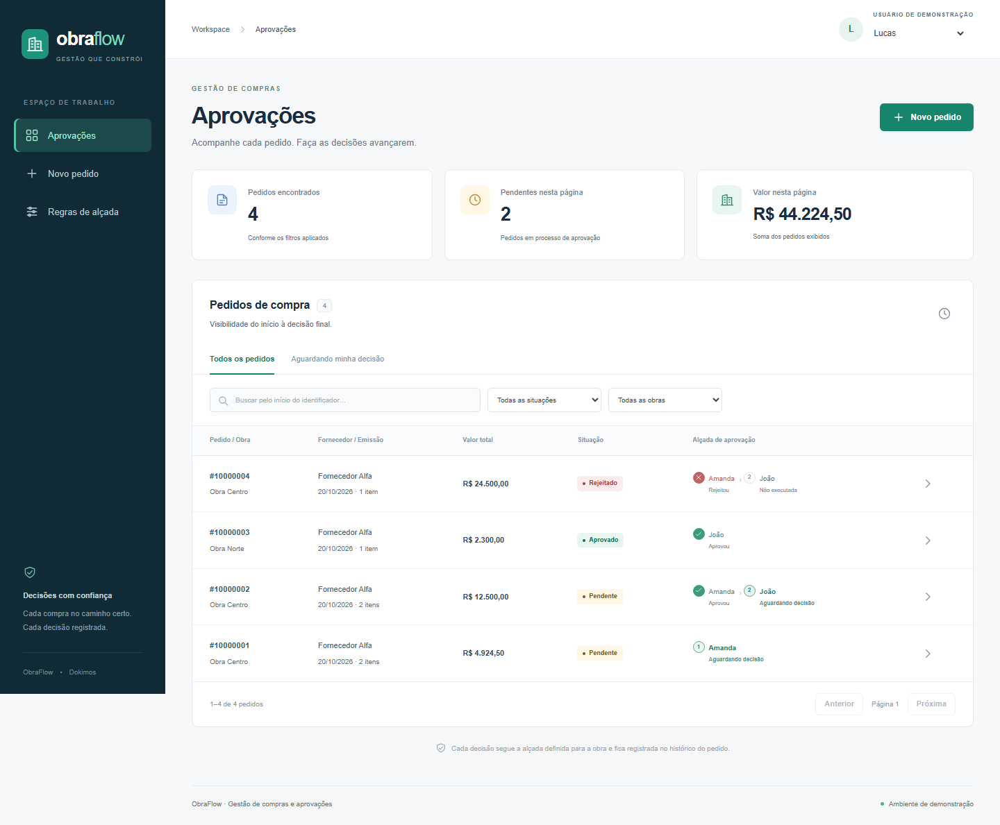
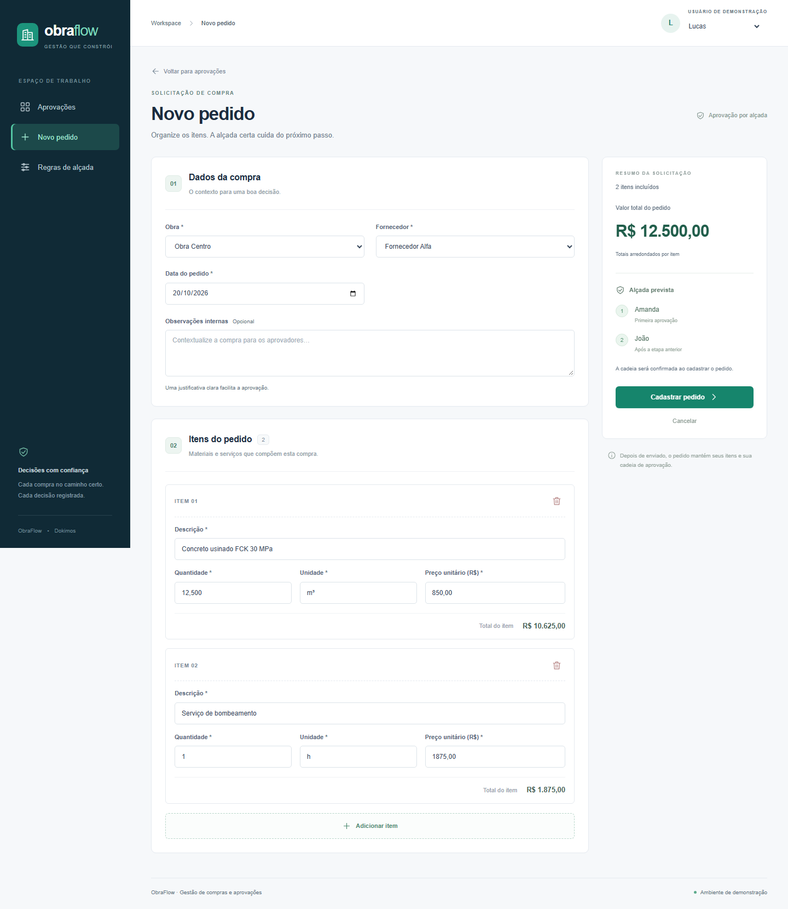
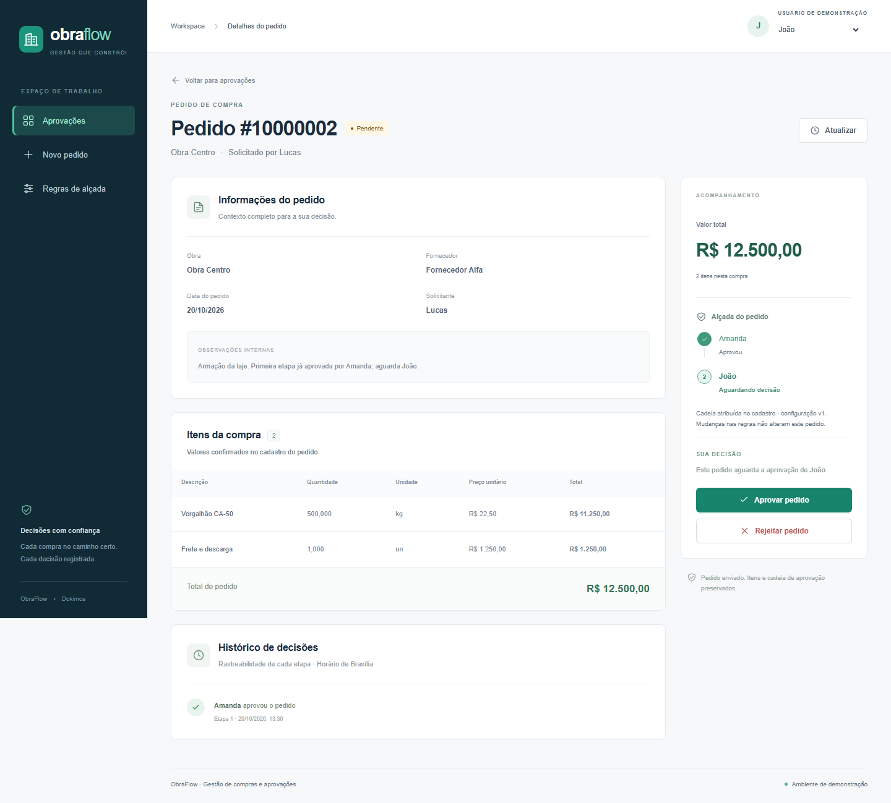
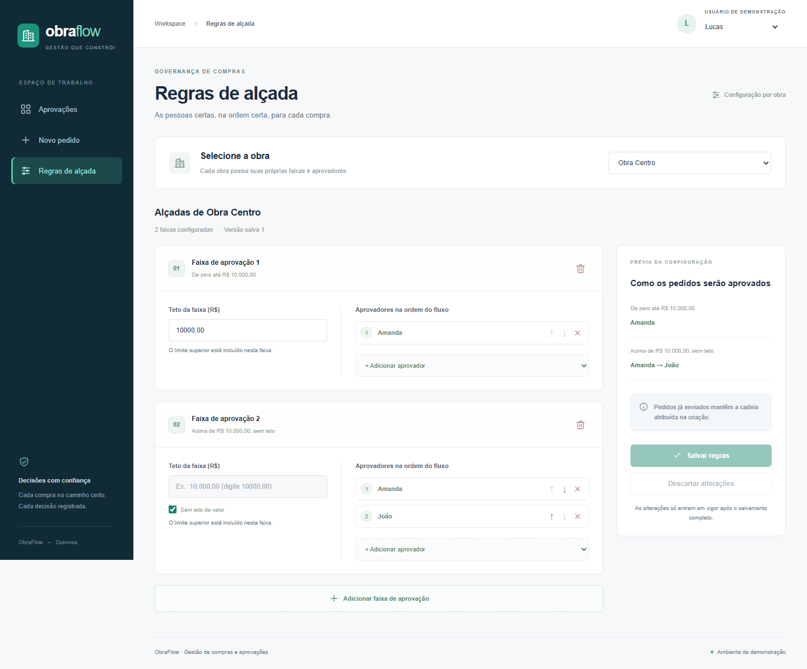
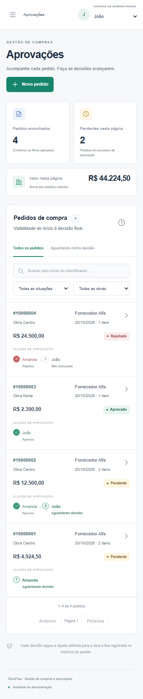

<div align="center">

# ObraFlow

**Dokimos · Pedidos de compra e aprovações por alçada**

Uma aplicação full-stack para solicitar compras, configurar responsáveis e acompanhar cada decisão.

[Executar](#executar) · [Telas](#telas) · [Demonstração](#demonstração) · [Decisões técnicas](#decisões-técnicas) · [Testes](#testes) · [API](#api)

</div>

---

## Sobre o projeto

O Dokimos organiza a aprovação de pedidos de compra conforme a **obra** e o **valor total**. Cada pedido recebe uma cadeia de aprovadores, que decidem em sequência até a aprovação final ou a rejeição.

A entrega reúne três fluxos:

- **Solicitar uma compra:** incluir vários itens, acompanhar os totais e visualizar a alçada prevista antes do envio.
- **Aprovar e acompanhar:** consultar itens e histórico, aprovar a etapa atual ou rejeitar com justificativa.
- **Configurar alçadas:** definir faixas por obra e adicionar, remover ou reordenar aprovadores.

Inclui busca por identificador, fila pessoal de aprovações, interface responsiva e tratamento de carregamento, listas vazias e falhas de comunicação.

O [enunciado original](docs/challenge.md) está preservado na documentação.

## Executar

### Com Docker — caminho recomendado

**Pré-requisitos:** Docker Engine ativo e Docker Compose. As portas **3000** e **5432** precisam estar disponíveis.

Na raiz do projeto:

```sh
docker compose up --build --wait
```

| Acesso             | Endereço                                                             |
| ------------------ | -------------------------------------------------------------------- |
| Aplicação          | [http://localhost:3000](http://localhost:3000)                       |
| Prontidão do banco | [http://localhost:3000/api/health](http://localhost:3000/api/health) |

O comando inicia o PostgreSQL, aplica as migrations, carrega os dados de demonstração e aguarda a aplicação ficar pronta. **Não é necessário configurar contas externas ou serviços pagos.**

Para parar os serviços e preservar os dados:

```sh
docker compose down
```

<details>
<summary><strong>Desenvolvimento com Node.js no host</strong></summary>

Use **Node.js 24.11 ou superior da linha 24** e **npm 11**.

Na primeira execução, copie `.env.example` para `.env`. Se o arquivo já estiver configurado, preserve seus valores.

```sh
npm ci
docker compose up -d db
npm run db:generate
npm run db:migrate
npm run db:seed
npm run dev
```

As credenciais de demonstração estão em `.env.example`: usuário `obraflow`, senha `obraflow_local` e banco `obraflow`.

Configuração de portas, logs e diagnóstico estão em [Desenvolvimento e operação](docs/development.md).

</details>

## Telas

### Aprovações

Lista de pedidos com obra, fornecedor, situação e andamento da cadeia. Os filtros permitem consultar todos os pedidos ou apenas os que aguardam a decisão do usuário selecionado.



<details>
<summary><strong>Novo pedido · itens, totais e prévia da alçada</strong></summary>

Cadastro com inclusão de vários itens, cálculo dos valores e identificação dos responsáveis pela aprovação.



</details>

<details>
<summary><strong>Detalhes do pedido · decisões e histórico</strong></summary>

Itens da compra, etapas concluídas, responsável atual e registro das decisões com autor, horário e justificativa.



</details>

<details>
<summary><strong>Regras de alçada · faixas e ordem dos aprovadores</strong></summary>

Configuração independente por obra, com prévia dos intervalos e confirmação antes de salvar as alterações.



</details>

<details>
<summary><strong>Versão móvel</strong></summary>



</details>

## Demonstração

O seed prepara **duas obras, três usuários, dois fornecedores e quatro pedidos**: dois pendentes em etapas diferentes, um aprovado e um rejeitado.

### Regras iniciais

| Obra        | Valor do pedido       | Cadeia de aprovação                   |
| ----------- | --------------------- | ------------------------------------- |
| Obra Centro | Até R$ 10.000,00      | Amanda                                |
| Obra Centro | Acima de R$ 10.000,00 | Amanda → João                         |
| Obra Norte  | Até R$ 5.000,00       | João                                  |
| Obra Norte  | Acima de R$ 5.000,00  | Sem cobertura; o cadastro é bloqueado |

### Roteiro de avaliação

1. Como **Lucas**, cadastre um pedido acima de R$ 10.000,00 na Obra Centro.
2. Confira os itens, o total e a cadeia **Amanda → João** nos detalhes.
3. Selecione **João** e observe que a decisão ainda pertence a Amanda.
4. Troque para **Amanda** e aprove a primeira etapa. Depois, selecione **João** e conclua a aprovação.
5. Em outro pedido, rejeite com uma justificativa e confira o encerramento do fluxo.
6. Altere uma regra e crie um novo pedido: os pedidos anteriores mantêm suas cadeias originais.

O seletor de usuário permite percorrer a demonstração; ele **não representa autenticação de produção**.

<details>
<summary><strong>Executar o seed novamente</strong></summary>

Com o ambiente Docker preparado:

```sh
docker compose run --rm seed
```

Para execução pelo Node.js, com `.env` configurado:

```sh
npm run db:seed
```

O seed adiciona os cenários ausentes. Repetir o comando não duplica os pedidos de demonstração nem desfaz decisões ou configurações já alteradas.

</details>

## Decisões técnicas

### Tecnologias

| Tecnologia                            | Papel e motivo da escolha                                                                |
| ------------------------------------- | ---------------------------------------------------------------------------------------- |
| **Next.js e React**                   | Interface e API HTTP no mesmo projeto, simplificando a execução e a implantação.         |
| **TypeScript**                        | Contratos explícitos e verificação estática entre componentes, rotas e serviços.         |
| **PostgreSQL**                        | Persistência relacional com transações, chaves estrangeiras e restrições de integridade. |
| **Prisma**                            | Acesso tipado ao banco e evolução do schema por migrations versionadas.                  |
| **Tailwind CSS e componentes locais** | Consistência visual e adaptação das telas sem fontes ou serviços externos.               |
| **Zod**                               | Validação dos dados recebidos pela API em tempo de execução.                             |
| **Vitest e Playwright**               | Testes de domínio, integração com PostgreSQL e jornadas no navegador.                    |
| **Docker Compose**                    | Preparação reproduzível da aplicação, do banco e dos dados de demonstração.              |

### Arquitetura e comunicação

A aplicação é um **monólito modular**, organizado por capacidades de negócio: cadastros, regras de alçada e pedidos.

```text
Interface React
     ↓ HTTP / JSON
Route Handlers do Next.js
     ↓
Serviços e regras de negócio
     ↓
Prisma → PostgreSQL
```

As rotas validam a requisição e traduzem os resultados para HTTP. Os serviços coordenam as operações e suas transações. A interface consome a API, apresenta erros por campo e consulta novamente o estado após uma alteração.

### Modelagem e cálculo das alçadas

Cada obra possui faixas com **teto inclusivo** e uma lista ordenada de aprovadores. A faixa aplicável é a de menor teto que comporte o total do pedido; a última pode ser ilimitada. Sem uma faixa compatível, o pedido não é criado.

No cadastro, o backend calcula os itens, seleciona a faixa e persiste o pedido com uma **cópia da cadeia**, o teto escolhido e a versão da configuração. As etapas pertencem ao pedido: editar ou remover a regra depois não altera um fluxo em andamento.

Dinheiro é calculado com aritmética decimal no servidor. Cada item é arredondado para centavos com **HALF_UP**, e o total do pedido é a soma dos itens arredondados. A prévia da interface usa inteiros de precisão fixa; o backend sempre recalcula os valores.

### Consistência e integridade

- **Criação atômica:** cabeçalho, itens, etapas e registro de idempotência são confirmados juntos ou revertidos.
- **Configuração coerente:** alterar regras e criar pedidos bloqueiam a mesma obra durante a transação, evitando uma cadeia montada com configurações parciais.
- **Decisões em ordem:** o servidor verifica o aprovador atual, a versão e a situação antes de registrar uma decisão.
- **Concorrência:** uma atualização condicional por versão e a unicidade da decisão por etapa impedem gravações duplicadas.
- **Rejeição rastreável:** exige motivo, encerra o fluxo e preserva o registro de quem decidiu e quando.
- **Repetição segura:** a criação usa uma chave de idempotência para recuperar o resultado após falha de rede sem gerar outro pedido.
- **Leituras consistentes:** consultas compostas usam um mesmo snapshot do banco. FKs, CHECKs e índices únicos complementam a validação da aplicação.

O [registro de decisões](docs/decisions.md) detalha os custos e limites dessas escolhas.

## Testes

| Camada     | Quantidade | Cobertura principal                                                                             |
| ---------- | ---------: | ----------------------------------------------------------------------------------------------- |
| Unitários  |     **62** | Validações, limites, cálculos, normalização e equivalência dos totais entre cliente e servidor. |
| Integração |     **23** | Transações, constraints, snapshots, idempotência, concorrência e seed atômico no PostgreSQL.    |
| Navegador  |      **7** | Cadastro, aprovação, rejeição, resposta perdida, edição de regras e responsividade.             |

Para executar os checks, use Node.js/npm, instale as dependências e configure `.env` a partir de `.env.example`:

```sh
npm ci
npm run check
```

`check` executa geração do Prisma Client, formatação, lint, tipos, testes unitários e build de produção.

<details>
<summary><strong>Testes de integração e jornadas no navegador</strong></summary>

Com o PostgreSQL ativo, crie o banco de testes uma única vez, caso ainda não exista:

```sh
docker compose exec -T db createdb -U obraflow obraflow_test
```

Confirme `TEST_DATABASE_URL` em `.env`, conforme o exemplo do projeto. Depois:

```sh
npm run test:integration
npx playwright install chromium
npm run test:e2e
```

Os runners verificam o isolamento antes de aplicar migrations. O banco deve terminar em `_test` e ser diferente do banco de desenvolvimento.

E2E prepara os dados, gera o build e inicia um servidor temporário na porta **3100**. Execute integração e E2E em sequência quando usarem o mesmo banco. Traces e diagnósticos ficam em `test-results/`.

</details>

O workflow de CI executa os checks com PostgreSQL efêmero e Chromium. Os cenários e limites da validação estão no [relatório de verificação](docs/verification.md).

## API

A comunicação usa **HTTP e JSON**. Os endpoints de negócio recebem `X-Demo-User-Id` com o UUID do usuário de demonstração. Valores monetários e quantidades são enviados como strings decimais.

| Método        | Endpoint                                                       | Finalidade                                                        |
| ------------- | -------------------------------------------------------------- | ----------------------------------------------------------------- |
| `GET`, `POST` | `/api/projects`, `/api/users`, `/api/suppliers`                | Listar e cadastrar obras, usuários e fornecedores.                |
| `GET`         | `/api/projects/{id}`, `/api/users/{id}`, `/api/suppliers/{id}` | Consultar um cadastro.                                            |
| `GET`, `PUT`  | `/api/projects/{id}/approval-rules`                            | Consultar e salvar a configuração completa de alçadas.            |
| `GET`, `POST` | `/api/orders`                                                  | Listar e criar pedidos.                                           |
| `GET`         | `/api/orders/{id}`                                             | Consultar itens, etapas, permissões e histórico.                  |
| `POST`        | `/api/orders/{id}/decisions`                                   | Aprovar ou rejeitar a etapa atual.                                |
| `GET`         | `/api/health`                                                  | Verificar prontidão da aplicação e do banco, sem identidade demo. |

<details>
<summary><strong>Exemplo de consulta em PowerShell</strong></summary>

```powershell
$headers = @{ 'X-Demo-User-Id' = '66666666-6666-4666-8666-666666666666' }
Invoke-RestMethod 'http://localhost:3000/api/orders?page=1&pageSize=20' -Headers $headers
```

O UUID do exemplo corresponde a Lucas no seed. Para criar pedidos, envie também o header `Idempotency-Key` com um UUID gerado para a solicitação.

</details>

Payloads, paginação, filtros e respostas de erro estão no [contrato da API](docs/api-contract.md).

## Evolução para produção

Antes de disponibilizar a aplicação em produção, as principais mudanças seriam:

- Substituir a identidade demo por autenticação e autorização com papéis definidos.
- Definir isolamento por empresa, caso o produto atenda múltiplas organizações.
- Gerenciar segredos e conexões, automatizar backups e testar a restauração.
- Adicionar métricas, alertas e migrations compatíveis com a estratégia de deploy.
- Definir retenção para histórico e chaves de idempotência.
- Medir consultas e volume antes de introduzir cache ou separar serviços. Notificações assíncronas exigiriam jobs e uma estratégia de entrega confiável.

## Documentação

| Documento                                         | Conteúdo                                             |
| ------------------------------------------------- | ---------------------------------------------------- |
| [Desenvolvimento e operação](docs/development.md) | Ambiente, variáveis, portas, comandos e diagnóstico. |
| [Contrato da API](docs/api-contract.md)           | Endpoints, exemplos de payloads e erros.             |
| [Negócio e modelo](docs/domain-contract.md)       | Invariantes, estados, limites e transações.          |
| [Decisões técnicas](docs/decisions.md)            | Escolhas de arquitetura e suas consequências.        |
| [Verificação](docs/verification.md)               | Cenários testados e limites da avaliação.            |
| [Enunciado original](docs/challenge.md)           | Requisitos do desafio.                               |
