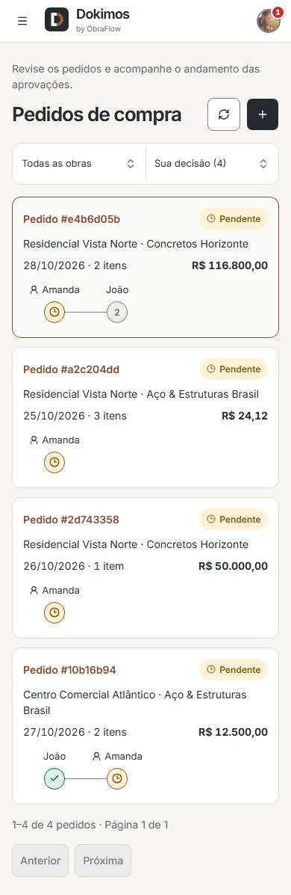
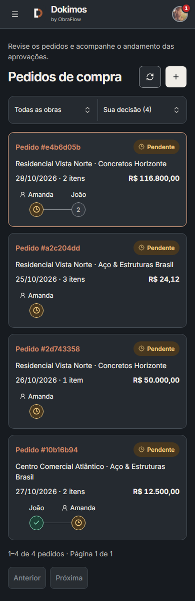
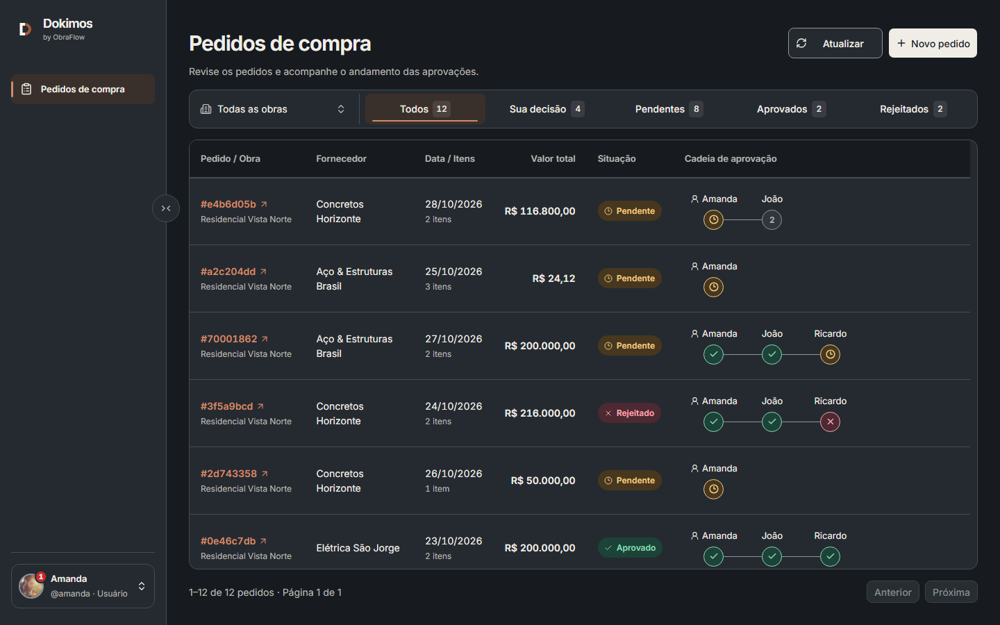
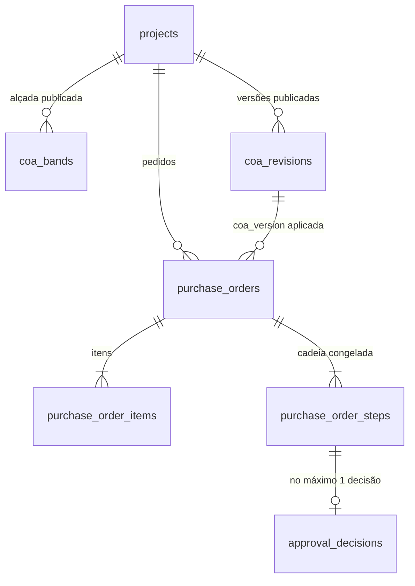
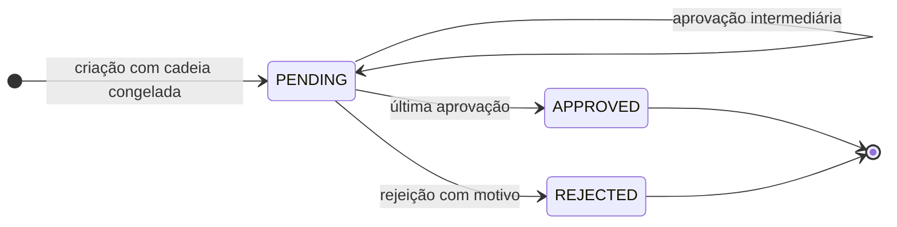
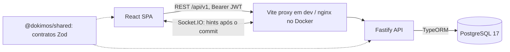

<p align="center">
  
</p>

<h1 align="center">Dokimos</h1>

<p align="center">
  Implementação do <a href="challenge/README.md">desafio técnico do ObraFlow</a> · Pedidos de compra com alçadas configuráveis por obra, decisões sequenciais e histórico auditável.<br />
  Fastify · React · PostgreSQL 
</p>

<p align="center">
  <a href="#como-rodar-e-testar">Rodar e testar</a> ·
  <a href="#roteiro-de-avaliação-em-5-minutos">Roteiro</a> ·
  <a href="#screenshots">Screenshots</a> ·
  <a href="#cobertura-do-desafio">Cobertura</a> ·
  <a href="#decisões-técnicas">Decisões técnicas</a> ·
  <a href="#api">API</a> ·
  <a href="#o-que-mudaria-em-produção">Produção</a> ·
  <a href="#contato">Contato</a>
</p>

<p align="center">
  <strong>Demo ao vivo:</strong> <a href="https://dokimoschallenge.mattediworks.com">dokimoschallenge.mattediworks.com</a>
</p>


O desafio pede [três telas](challenge/README.md#o-que-você-vai-construir) e um fluxo de aprovação. O objetivo vai além de registrar quem aprovou uma compra: é garantir que **o aprovador certo decida, na ordem certa, segundo a regra aplicável ao pedido**, sem perder a rastreabilidade quando usuários, obras ou alçadas mudam. O projeto se apoia em quatro regras:

- O back-end é a única autoridade sobre valores, permissões e estado do fluxo.
- Dinheiro é decimal exato, do input ao banco. Um centavo a mais pode trocar a cadeia de aprovadores.
- Cada pedido congela a própria cadeia na criação. Publicar outra alçada depois nunca reescreve o passado.
- Race conditions são tratadas com transactions, locks e constraints, e testadas contra um PostgreSQL real.

> [!IMPORTANT]
> Três leituras do [enunciado](challenge/README.md) foram decisões nossas e estão explicadas abaixo: a [alçada é cumulativa](#interpretação-adotada-alçada-cumulativa-por-obra), com um aprovador por nível e sem lista própria por faixa; [aprovar e rejeitar acontecem no detalhe](#decisões-de-produto-e-trade-offs), não na lista; e o nível atual é derivado das etapas e decisões persistidas, sem coluna própria.

## Como rodar e testar

### Demo ao vivo

O caminho mais rápido, sem instalar nada: abra [dokimoschallenge.mattediworks.com](https://dokimoschallenge.mattediworks.com) e entre com uma das [personas](#credenciais-de-demonstração). O ambiente é compartilhado, então os pedidos do seed podem já ter avançado. O demo roda no Stackport ([saiba mais](https://github.com/vtmattedi/Stackport)).

### Localmente com Docker

Só precisa de **Docker** (Compose v2). Nada de serviço pago, credencial externa ou `.env` para preencher. Os avatares vêm de um serviço público e, sem internet, caem nas iniciais do usuário.

```sh
docker compose -f compose.review.yaml up --build
```

Abra **http://localhost:8080**, entre com uma das [personas](#credenciais-de-demonstração) e siga o [roteiro de avaliação](#roteiro-de-avaliação-em-5-minutos).

Esse comando builda a API e o frontend, sobe um PostgreSQL próprio, aplica as migrations, popula o seed e serve tudo atrás de um nginx. O stack não compartilha dados com o `npm run dev`.

| Situação                             | Comando                                                                |
| -------------------------------------- | ---------------------------------------------------------------------- |
| Tenho Node e quero rodar em background | `npm run review`                                                     |
| Quero hot reload, sem buildar imagens  | `npm ci` e `npm run review:dev` (web em `http://localhost:5173`) |
| Parar                                  | `npm run review -- down`                                             |
| Porta 8080 ocupada (bash)              | `REVIEW_PORT=8090 npm run review`                                    |
| Porta 8080 ocupada (PowerShell)        | `$env:REVIEW_PORT=8090; npm run review`                              |
| Zerar os dados e voltar ao seed        | `docker compose -f compose.review.yaml down -v`                      |

### Credenciais de demonstração

A tela de login oferece **Explore o fluxo de aprovação**, com perfis prontos, e o painel da conta tem **Trocar perfil**. Por baixo é login normal com senha: não existe bypass nem impersonation. As senhas são valores públicos de demo.

| Usuário    | Senha               | Papel na demo                                                              |
| ----------- | ------------------- | -------------------------------------------------------------------------- |
| `admin`   | `demo-admin-2026` | ADMIN: configura tudo, lê tudo, **não** fura a fila de aprovação |
| `joao`    | `demo-user-2026`  | Aprova nas duas obras                                                      |
| `amanda`  | `demo-user-2026`  | Aprova nas duas obras                                                      |
| `ricardo` | `demo-user-2026`  | Aprova o último nível da Vista Norte                                     |
| `carlos`  | `demo-user-2026`  | Cria pedidos na Vista Norte                                                |
| `beatriz` | `demo-user-2026`  | Cria pedidos na Atlântico                                                 |

### O que o seed cria

| Obra                        | Solicitante | Até          | Aprovadores, em ordem      |
| --------------------------- | ----------- | ------------- | -------------------------- |
| Centro Comercial Atlântico | Beatriz     | R$ 10.000,00  | João                      |
|                             |             | acima         | João → Amanda            |
| Residencial Vista Norte     | Carlos      | R$ 50.000,00  | Amanda                     |
|                             |             | R$ 150.000,00 | Amanda → João            |
|                             |             | acima         | Amanda → João → Ricardo |

Além disso: 3 fornecedores e **6 pedidos por obra**, cobrindo pendente no início da cadeia, pendente no último nível, aprovado, rejeitado, valor exatamente no limite e quantidades fracionadas com rounding por linha. O seed passa pelos mesmos serviços de cálculo e decisão da API, então nenhum estado é fabricado. Detalhes em [docs/demo-data.md](docs/demo-data.md).

## Roteiro de avaliação em 5 minutos

1. **Beatriz** → **Novo pedido** na Centro Comercial Atlântico, com Concretos Horizonte. Inclua `25 m³ × R$ 450,00` de concreto e `2 h × R$ 625,00` de bombeamento: o total é **R$ 12.500,00**, e o painel lateral mostra a cadeia João → Amanda antes do envio. Confirme na revisão final.
2. **João** → aba **Sua decisão** → abra o pedido e aprove. O pedido segue pendente, agora na etapa de Amanda.
3. **Beatriz** → abra o mesmo pedido. Beatriz é membro da obra, mas a etapa atual não é sua: os botões aparecem desabilitados, com a explicação. **Carlos** não é membro dessa obra, então o pedido nem aparece.
4. **Amanda** → rejeite. O motivo é obrigatório, a validação acontece antes do submit, o fluxo termina e a decisão de João continua no histórico.
5. **admin** → **Obras** → abra a obra. A alçada fica nessa página. Clique em **Editar**, arraste um limite, reordene aprovadores e publique. A versão sobe, mas os pedidos antigos continuam com a cadeia e a versão originais.
6. **admin** → **Auditoria**: filtre por tipo, obra e período e abra o detalhe de um evento.

> [!TIP]
> O JWT fica em `sessionStorage`, então cada aba aberta do zero tem sua própria sessão. Deixe João em uma e Beatriz em outra para ver a notificação em tempo real chegar quando o pedido for criado.

> [!NOTE]
> No stack Docker, o nginx limita o login a 21 tentativas imediatas por IP, com recuperação de uma a cada 2 segundos. Trocar de persona muito rápido retorna `429`. A sessão expira em 30 minutos e não há refresh token.

## Screenshots

A lista de pedidos, com filtros na URL, contadores por visão e a cadeia completa de cada pedido, está no topo deste README. As imagens vêm do seed, e a [galeria completa](docs/assets/screenshots) tem 226 capturas, em tema claro e escuro, no desktop e no mobile ([índice](docs/assets/screenshots/manifest.md)).

### Novo pedido

Total calculado com decimal exato e prévia dos aprovadores enquanto o usuário preenche.


### Detalhe e decisão

Itens, histórico e ações. A aprovação acontece aqui, com o contexto completo à vista.


| Cadeia concluída: ações desabilitadas, com explicação                                                                                               | Rejeição exige motivo, validado antes do submit                                                                                                         |
| -------------------------------------------------------------------------------------------------------------------------------------------------------- | --------------------------------------------------------------------------------------------------------------------------------------------------------- |
|  |  |

### Regras da alçada

Fica em **Obras** → obra, só para ADMIN. Mostra a alçada publicada, com a faixa exata e a cadeia efetiva de cada nível, as versões anteriores e um simulador que testa valores sem publicar nem criar pedido.


### Editor da alçada

Limites arrastáveis, reordenação de aprovadores e publicação explícita. Nada entra em vigor antes de publicar.


### Auditoria

Histórico de pedidos, decisões, alçadas, obras, membros, usuários e fornecedores.


### Mobile

<p>
  
  
</p>

### Estados e recuperação

Os estados de falha foram gerados interceptando requests no browser.

| Validação no campo                                                                                                                                              | Carregando                                                                                                              |
| ----------------------------------------------------------------------------------------------------------------------------------------------------------------- | ----------------------------------------------------------------------------------------------------------------------- |
|  |  |

| API fora do ar: erro com retry                                                                                                              | Resultado incerto: nada é reenviado sozinho                                                                                                               |
| ------------------------------------------------------------------------------------------------------------------------------------------- | ---------------------------------------------------------------------------------------------------------------------------------------------------------- |
|  |  |

| Conflito de versão: o rascunho é preservado                                                                                                                                 | Tema escuro                                                                                         |
| ----------------------------------------------------------------------------------------------------------------------------------------------------------------------------- | --------------------------------------------------------------------------------------------------- |
|  |  |

## Cobertura do desafio

Cada requisito abaixo leva ao trecho correspondente do [enunciado](challenge/README.md).

### Telas e backend

| Requisito                                                                                                               | Status | Como foi resolvido                                                                                                          |
| ----------------------------------------------------------------------------------------------------------------------- | ------ | --------------------------------------------------------------------------------------------------------------------------- |
| [Cadastro de pedido com N itens](challenge/README.md#itens-do-pedido)                                                    | ✅     | Página dedicada, começa com um item em branco; adiciona, edita e remove                                                   |
| [Total calculado e não editável](challenge/README.md#itens-do-pedido)                                                  | ✅     | Prévia no client com decimal exato; o valor autoritativo vem do servidor                                                   |
| [Botão só disponível com dados válidos](challenge/README.md#totalização-e-envio)                                   | ✅     | **Cadastrar pedido** fica desabilitado e **Verificar campos** leva ao primeiro erro                             |
| [Persistir cabeçalho, itens, total e cadeia](challenge/README.md#totalização-e-envio)                                 | ✅     | Tudo na mesma transaction                                                                                                   |
| [Lista com identificador, obra, fornecedor, data, itens, valor, situação e alçada](challenge/README.md#2-aprovação) | ✅     | Tabela no desktop, cards no mobile; filtros e paginação server-side                                                       |
| [Ações de aprovar/rejeitar na lista](challenge/README.md#2-aprovação)                                                | ⚠️   | **Divergência assumida:** as ações ficam no detalhe. Motivo em [trade-offs](#decisões-de-produto-e-trade-offs)     |
| [Detalhe com itens e histórico](challenge/README.md#2-aprovação)                                                      | ✅     | Com versão da alçada aplicada e timeline de decisões                                                                     |
| [Rejeição exige motivo e interrompe o fluxo](challenge/README.md#2-aprovação)                                        | ✅     | Validado no client, na API e por `CHECK` no banco                                                                         |
| [Decisão fora de ordem bloqueada](challenge/README.md#backend-e-persistência)                                          | ✅     | Só o aprovador atual decide; o ADMIN não tem override                                                                     |
| [Regras da alçada por obra](challenge/README.md#3-regras-da-alçada)                                                    | ⚠️   | **Divergência assumida:** em **Obras** → obra, cada nível tem um aprovador. Adicionar, remover e reordenar valem para a alçada inteira, não por faixa. Motivo em [interpretação adotada](#interpretação-adotada-alçada-cumulativa-por-obra) |
| [Cadastro de obras, usuários, fornecedores](challenge/README.md#backend-e-persistência)                                | ✅     | Telas de ADMIN completas, além do mínimo exigido                                                                          |
| [Seed com 2+ obras, usuários, regras e pedidos](challenge/README.md#backend-e-persistência)                            | ✅     | 2 obras, 6 usuários, 3 fornecedores, 12 pedidos                                                                            |

### Validações e estados exigidos

A lista vem da [tabela de validações e erros](challenge/README.md#validações-e-erros-exigidos) do enunciado.

| Situação                                                 | Comportamento                                                          |
| ---------------------------------------------------------- | ---------------------------------------------------------------------- |
| Quantidade ou preço inválido, negativo ou não numérico | Erro no item correspondente, com mensagem clara; não envia            |
| Pedido sem itens                                           | A última linha não pode ser removida, então o formulário sempre tem um item. A API também exige ao menos 1 |
| Campos obrigatórios vazios                                | Erro no campo correspondente; não envia                               |
| Nenhuma obra cadastrada                                    | Empty state com orientação, distinto de "filtro sem resultado"       |
| API fora do ar / 500                                       | Estado de erro com **Tentar novamente**                          |
| Rejeitar sem motivo                                        | Validação antes do submit                                            |
| Cadeia já concluída                                      | **Aprovar** e **Rejeitar** desabilitados, com explicação |
| Loading em lista                                           | Presente em todas as listas                                            |

### Além do que foi pedido

Essas telas [não são obrigatórias](challenge/README.md#dados-gerais), mas a área administrativa existe para o sistema ser **demonstrável de ponta a ponta pela própria interface**: dá para criar usuários, associá-los a uma obra, publicar uma alçada e acompanhar um pedido real sem montar nada via API.

Também entraram: autenticação com Argon2id e JWT, autorização por obra, arquivamento e reativação de obras, desativação lógica com bloqueios, simulador de alçada, auditoria, notificações via Socket.IO, tema claro/escuro/sistema, scans de acessibilidade com axe e CI.

## Nomenclatura

A interface e este README usam português brasileiro; código, API, banco e documentação técnica usam inglês. Assim a linguagem de negócio fica com quem usa o sistema, e cada conceito tem um nome só em todas as camadas. O [glossário completo](docs/README.md#glossary) está na documentação.

| Interface     | Código e API            | Significado                                                          |
| ------------- | ------------------------ | -------------------------------------------------------------------- |
| Obra          | project                  | Agrupa membros, pedidos e a alçada                                  |
| Alçada       | CoA (chain of approval)  | Regra de aprovação da obra: versionada e cumulativa                |
| Nível        | band                     | Um aprovador e um limite superior; faixa é só o intervalo de valor |
| Cadeia, etapa | approval steps           | Aprovadores que **um pedido** precisa, congelados na criação |
| Versão       | revision, `coaVersion` | Uma alçada publicada, guardada no histórico                        |
| Pedido        | purchase order (PO)      | Solicitação ao fornecedor, com N itens                             |

## Decisões técnicas

Cada decisão relevante tem um ADR em [docs/decisions](docs/README.md#decision-register). Aqui vai o resumo.

### Tecnologias e motivos

| Camada     | Escolha                                          | Por quê                                                                                                                                                                                                                                                                         |
| ---------- | ------------------------------------------------ | -------------------------------------------------------------------------------------------------------------------------------------------------------------------------------------------------------------------------------------------------------------------------------- |
| Linguagem  | TypeScript em monorepo com npm workspaces        | Compartilha contratos entre front e back sem publicar pacotes. TypeScript foi escolha de familiaridade e produtividade; Go foi considerado para o back.                                                                                                                          |
| API        | Fastify 5, monolito modular                      | Leve, com Pino integrado. Monolito porque mantém o fluxo rastreável, as transactions locais e o deploy simples; microservices só adicionariam transação distribuída                                                                                                        |
| Web        | React 19 + Vite                                  | SPA autenticada, sem necessidade de SEO: SSR não agregaria nada aqui                                                                                                                                                                                                            |
| Roteamento | React Router (Declarative)                       | Padrão de mercado. Filtros e paginação na URL, compartilháveis                                                                                                                                                                                                               |
| Banco      | PostgreSQL 17                                    | Row locks, isolation levels, partial unique indexes e `CHECK`. SQLite também atenderia ao desafio. Pesaram a familiaridade, o Compose já presente no projeto e o modelo de concorrência. O custo é operar um serviço a mais                                               |
| ORM        | TypeORM + migrations escritas à mão            | Boa integração com locks. `synchronize: false` porque o schema depende de coisas que o ORM não declara: índices `DESC` e parciais, `CHECK` e FKs compostas. SQL direto só nas projeções de leitura (detalhe, lista, obras e auditoria), onde a query inteira é mais clara |
| Contratos  | Zod 4 em `@dokimos/shared`                     | O mesmo schema valida no client e no server; o tipo vem de graça e o contrato não diverge                                                                                                                                                                                      |
| Dinheiro   | `decimal.js` + `NUMERIC`                     | Precisão exata. Detalhes [abaixo](#cálculo-decimal-exato)                                                                                                                                                                                                                       |
| Auth       | `@fastify/jwt` + Argon2id                      | Não era [exigido](challenge/README.md#backend-e-persistência), mas aprovação sem identidade validada não prova nada, e o custo de implementar é baixo                                                                                                                       |
| Realtime   | Socket.IO                                        | Extra. Reaproveita o JWT e fica atrás de uma interface pequena                                                                                                                                                                                                                  |
| UI         | shadcn/ui com Base UI, Tailwind v4 e CSS Modules | Comportamento acessível pronto, com o código dos componentes dentro do repositório. Detalhes em [Design e UI](#design-e-ui)                                                                                                                                                    |
| Testes     | `node:test`, Playwright, axe                   | Regras de negócio contra PostgreSQL real, comportamento no browser real, sem framework grande                                                                                                                                                                                   |
| Qualidade  | ESLint e Prettier                                | Código legível e menos discussão de estilo                                                                                                                                                                                                                                    |
| Infra      | Docker Compose, nginx, GitHub Actions            | O avaliador roda tudo com um comando; o CI valida lint, build, tipos e o tier rápido de testes                                                                                                                                                                                  |

**O que deixamos de fora de propósito:**

- **TanStack Query, Redux/Zustand e React Hook Form.** O app tem URL state, hooks por feature e um contexto de auth estreito, e forms simples com um hook pequeno resolvem. O custo é coordenar cancelamento e reconciliação à mão. Reavaliaríamos se aparecesse repetição real de cache ou de campos dinâmicos, ou se a complexidade da aplicação crescesse muito.
- **Polling.** A leitura acontece ao abrir a tela e no refresh explícito. O tempo real é só um aviso por cima disso. Com mais tempo, poderíamos usar um sistema de notificação mais robusto para novos registros.
- **Better Auth, passkeys, MFA e rotação de token.** Ampliariam a superfície de autenticação sem melhorar o [problema central do desafio](challenge/README.md).

### Como a regra de alçada é modelada, calculada e persistida

#### Interpretação adotada: alçada cumulativa por obra

Modelamos **uma única alçada por obra**, composta por níveis ordenados por limite de valor. Cada nível adiciona um aprovador aos anteriores: até R$ 10.000, João; acima desse valor, João → Amanda. A **alçada** é a regra da obra, e a **cadeia** é a sequência de aprovadores que um pedido específico precisa. Escolhemos essa interpretação porque o [exemplo do desafio](challenge/README.md#contexto) exige a aprovação de João antes da de Amanda para um pedido de R$ 12.500, embora a configuração apresentada associe Amanda à faixa superior.

**Consequência:** editar ou reordenar um nível pode afetar a sequência efetiva das faixas superiores, e não há cadeias independentes por faixa. A leitura literal de [&#34;aprovadores em cada faixa&#34;](challenge/README.md#3-regras-da-alçada) pede uma lista por faixa, que também atende ao exemplo. Nosso modelo é mais restrito: `até R$ 10.000: Amanda → João`, ou dois aprovadores novos na mesma faixa, não podem ser configurados. A UI mostra a cadeia efetiva de cada faixa para o admin enxergar o impacto da edição. Se o negócio precisar de cadeias independentes, o modelo de dados precisa mudar ([ADR-006](docs/decisions/ADR-006-cumulative-approval-escalation.md)).

Toda alçada publicada cobre de R$ 0 até um último nível sem limite superior, com um aprovador por nível.

#### Valor sem regra aplicável

O [enunciado](challenge/README.md#3-regras-da-alçada) pede que esse comportamento seja definido e documentado. Com uma alçada publicada, esse caso não existe: o último nível é sempre ilimitado, então todo valor tem cadeia. O que pode faltar é a própria alçada, e nesse caso o pedido é **bloqueado**:

- **UI:** a obra aparece como "sem alçada" no seletor, com um aviso orientando a pedir a configuração ao administrador, e o envio fica desabilitado.
- **API:** `409 PROJECT_COA_NOT_CONFIGURED`.

O mesmo erro vale se um aprovador selecionado deixou de estar disponível. Isso é um envio negado, diferente de um `REJECTED`, e nenhum pedido é criado.

#### Modelagem



São três representações com responsabilidades diferentes, e essa separação é o centro do modelo:

| Tabela                   | Responsabilidade                                                                                                     |
| ------------------------ | -------------------------------------------------------------------------------------------------------------------- |
| `coa_bands`            | Alçada **publicada**: define os aprovadores de pedidos **futuros**                                      |
| `coa_revisions`        | Cópia completa e imutável de cada versão publicada: explica **por que** um pedido antigo exigiu quem exigiu |
| `purchase_order_steps` | Cadeia congelada na criação: define quem decide **este** pedido                                              |

Não existe coluna `current_step`. O aprovador atual é **derivado**: a primeira etapa sem decisão, enquanto o pedido estiver pendente. Essa é nossa leitura de [&#34;nível atual calculado e persistido pelo back-end&#34;](challenge/README.md#2-aprovação): os fatos persistidos são etapas e decisões, e o nível sai deles, sem cursor mutável para dessincronizar. O `status` do pedido é uma projeção persistida para filtro e índice, atualizada na mesma transaction da decisão e sem endpoint para alterá-la diretamente.

#### Cálculo: decimal exato

O `number` do JavaScript não representa `0.1` com exatidão. Aqui isso importa além da exibição: **o total persistido escolhe a cadeia**, então um centavo de erro em cima do limite muda quem precisa aprovar. Se a alçada for exigência regulatória, essa diferença deixa a aprovação incoerente com a regra registrada.

```text
total_item   = ROUND_HALF_UP(quantidade × preço unitário, 2)   // cada linha, isoladamente
total_pedido = soma dos total_item
```

- Valores trafegam como **string decimal** (`"12500.00"`) e são gravados em `NUMERIC`. Nada passa por `number`, nem na API nem na leitura do banco.
- O rounding é **por linha**, para a soma das linhas exibidas sempre bater com o total. Duas linhas de `0.5 × 0.01` dão `0.01 + 0.01 = 0.02`; arredondar só o agregado daria `0.01`. É uma convenção de negócio explícita.
- A escolha da cadeia usa o mesmo total persistido, nunca a prévia do browser.
- Precisão acima do suportado é rejeitada com `400`, sem deixar o `NUMERIC` arredondar em silêncio.

Depois disso, a cadeia é um prefixo dos níveis ([coa/service.ts](apps/api/src/modules/coa/service.ts)):

```ts
const match = bands.findIndex((band) => band.upperLimit === null || new Decimal(total).lte(band.upperLimit));
return bands.slice(0, match + 1).map((band) => band.approverId);
```

Os limites são **inclusivos**. Na Vista Norte:

| Total         | Cadeia                     |
| ------------- | -------------------------- |
| R$ 50.000,00  | Amanda                     |
| R$ 50.000,01  | Amanda → João            |
| R$ 150.000,00 | Amanda → João            |
| R$ 150.000,01 | Amanda → João → Ricardo |

Pedido de valor zero é válido e passa pela cadeia normal: não existe auto-aprovação.

#### Persistência e ciclo de vida

**Publicar uma alçada** envia todos os níveis com `expectedCoaVersion`. Na mesma transaction, o servidor troca os `coa_bands`, incrementa a versão e grava a cópia completa em `coa_revisions`. Reenviar conteúdo idêntico é no-op, sem nova versão.

**Criar um pedido** resolve a cadeia e grava, de forma atômica, cabeçalho, itens, total, `coa_version` e etapas. A partir daí, uma nova versão da alçada só afeta pedidos novos. Por isso publicar continua permitido com pedidos pendentes na obra: cada um deles já tem a própria cadeia.



`APPROVED` e `REJECTED` são terminais. Decisões são append-only: não há edição, cancelamento, reabertura nem reatribuição silenciosa. Etapas posteriores a uma rejeição aparecem como `SKIPPED` na leitura, sem fabricar registros de decisão.

### Como o front-end se comunica com o back-end



- **REST + JSON via `fetch`.** Um client pequeno em [lib/api.ts](apps/web/src/lib/api.ts) centraliza transporte, Bearer token e normalização de erros. Cada feature tem seu `api.ts`.
- **Mesma origem.** O browser só fala com `/api/v1`. Vite faz proxy em dev e o nginx em Docker, então não há CORS para configurar.
- **Contratos compartilhados.** `@dokimos/shared` exporta schemas Zod puros. O client valida para dar feedback imediato e o server valida de novo, porque é quem decide. Bodies rejeitam campos desconhecidos: enviar `total`, `status` ou um ator retorna `400`.
- **Leituras por tela, sem cache global.** Cada página cuida do próprio loading, erro e retry, com abort de requests obsoletos. Uma mutação confirmada invalida leituras antigas que poderiam sobrescrevê-la.
- **Menos requests, mesmo snapshot.** Os contadores das abas vêm em `distribution`, na própria resposta da lista, e o resumo de membros vem em `GET /projects`. Isso evita N+1 e contadores que não batem com a página exibida.
- **Erros com semântica.** O envelope é sempre o mesmo, e `items.0.quantity` vira erro no input certo. `409` recarrega o estado real e explica o conflito.
- **Resultado incerto é um estado próprio.** Queda de rede, `5xx` ou `2xx` com body ilegível não provam que o write falhou. A UI **nunca reenvia sozinha**: o usuário confere o estado atual antes de tentar de novo. Isso importa porque `POST /purchase-orders` não é idempotente.
- **Tempo real é só uma dica.** Após o commit, a API confere se o destinatário ainda pode ver o pedido e o Socket.IO avisa quem precisa agir. Isso gera toast e uma caixa local no browser, sem nunca liberar uma decisão: o estado sempre vem do REST.

### Como a consistência e a integridade são garantidas

A integridade não depende de um ponto só. Cada regra crítica é checada no service e, sempre que dá para expressar no schema, de novo no banco.

**1. Fronteira da API.** Zod em toda entrada. Ator, role e membership vêm do banco a cada request, nunca do payload nem das claims do token. O JWT carrega só a identidade.

**2. Transactions por serviço.** Cada service abre e fecha a própria transaction. Pedido e itens, publicação e versão, decisão e status: ou tudo commita, ou nada. Evento de auditoria que falha faz rollback da operação.

**3. Constraints no banco.** As regras que precisam valer mesmo com bug na aplicação estão no schema ([migration inicial](apps/api/src/db/migrations/InitialSchema2026102100000.ts)):

| Regra                                          | Mecanismo                                                        |
| ---------------------------------------------- | ---------------------------------------------------------------- |
| Uma decisão por etapa                         | `UNIQUE (step_id)` em `approval_decisions`                   |
| Rejeição tem motivo, aprovação não        | `CHECK rejection_reason_required`                              |
| Aprovador da alçada é membro da obra         | FK composta `(project_id, approver_id)` → `project_members` |
| Pedido aponta para uma versão publicada real  | FK composta `(project_id, coa_version)` → `coa_revisions`   |
| Um único nível sem limite, limites distintos | Partial unique indexes                                           |
| Valores válidos                               | `CHECK` de não negatividade, quantidade > 0, status e papel   |

**4. Concorrência.** A ideia não é travar tudo, e sim proteger as regras vulneráveis a requests concorrentes: locks pessimistas serializam writes, e a checagem otimista detecta decisão tomada sobre dados velhos. Todos os locks ficam em [db/locks.ts](apps/api/src/db/locks.ts), com a ordem de aquisição documentada para evitar deadlock.

| Corrida                                   | Mecanismo                                        | Resultado                                                                                 |
| ----------------------------------------- | ------------------------------------------------ | ----------------------------------------------------------------------------------------- |
| Dois usuários decidem a mesma etapa      | `FOR UPDATE` no pedido + `expectedStepIndex` | Uma vence; a outra recebe `409 APPROVAL_STEP_CONFLICT`                                  |
| Dois admins publicam a mesma alçada      | Lock na obra + `expectedCoaVersion`            | Uma vence; a outra recebe `409 COA_VERSION_CONFLICT` e mantém o draft para reconciliar |
| Pedido criado durante uma publicação    | Mesmo lock na obra                               | O pedido nunca vê limites de uma versão com o número de outra                          |
| Desativar aprovador durante publicação  | Lock de usuários em ordem de UUID               | Uma operação enxerga a outra e falha com `4xx`, sem meio-termo                        |
| Arquivar obra durante criação de pedido | Lock na obra                                     | Quem commitar primeiro define o `409` da outra                                          |
| Remover membro com etapa pendente         | Lock obra → usuário + checagem de bloqueios    | `409`, inclusive para etapas futuras                                                    |

**5. Leituras coerentes.** Lista (página, contagem e distribuição), auditoria, alçada e membros rodam em `REPEATABLE READ`. O detalhe é um único statement SQL, com os `NUMERIC` convertidos para texto dentro do JSONB para não virarem `number`. Assim uma resposta nunca mistura status de um commit com decisões de outro.

**6. Histórico preservado.** Nenhum registro de negócio é apagado. Usuário e fornecedor são desativados, e obra é arquivada e reativada com o mesmo ID. Remover um membro apaga só o vínculo com a obra, e o resultado fica na auditoria. Desativar um aprovador é bloqueado enquanto houver alçada publicada ou etapa pendente em seu nome, porque tirar alguém da cadeia automaticamente mudaria a autoridade financeira em silêncio. Arquivar exige que a obra não tenha pedido pendente. Já desativar um fornecedor só impede pedidos novos: os existentes seguem válidos. A auditoria compõe esses registros históricos em uma visão única para o ADMIN.

**7. Schema sob controle.** A API se recusa a rodar com migrations pendentes, e um teste compara cada entity com o banco migrado: colunas, tipos, constraints e índices.

### Design e UI

A interface usa o nome **Dokimos by ObraFlow**, como no [enunciado](challenge/README.md#contexto), com uma identidade visual própria desta implementação: industrial e neutra, em grafite e cobre. Cada tela parte de uma pergunta: o que esse usuário precisa decidir aqui?

- **Lista para triagem, detalhe para decisão.** A lista compara pedidos e mostra a cadeia inteira de relance. O detalhe concentra itens, histórico e ação.
- **Cor com significado fixo.** Grafite cria, cobre publica, verde aprova, vermelho rejeita ou desativa. Status e etapas da cadeia trazem texto ou ícone, então nunca dependem só da cor.
- **A regra aparece antes do erro.** O novo pedido mostra quem vai aprovar enquanto o valor é digitado, e o simulador da alçada testa valores sem publicar nem criar pedido.
- **Editor visual com valor exato.** A barra deixa os níveis fáceis de entender, mas não limita a precisão gravada: arrastar posiciona o limite, e o dialog de valor define cada centavo.
- **Estados com causa.** "Nenhum pedido cadastrado", "filtro sem resultado", "você ainda não tem obras" e "falha ao consultar" são estados diferentes, cada um com sua orientação.
- **Responsivo.** Sidebar colapsável no desktop. Abaixo de 900px, a navegação vai para um drawer e a conta abre pelo avatar, separada da navegação. Em telas estreitas, a tabela de pedidos vira cards.
- **Três camadas de estilo.** Tailwind v4 para layout e responsividade, CSS Modules para componentes complexos e animações, e tokens semânticos para cor, tipografia e estados. Os tokens mantêm os temas consistentes sem impor uma técnica só a todo componente.
- **Só pt-BR, com o idioma à vista.** Em um SaaS global, nascer com i18n compensa, porque traduzir depois significa revisitar cada texto. Aqui o público é brasileiro, e o custo real (catálogo para todas as strings, plurais, mensagens da API e testes por idioma) não entregaria valor agora. O risco diminui, mas não some, e o custo de migrar cresce com o produto. Por isso o idioma já aparece no painel da conta como campo somente leitura, marcando onde a preferência vai morar, e os códigos de erro em inglês já permitem traduzir mensagens no client ([ADR-002](docs/decisions/ADR-002-frontend-architecture.md)).
- **Acessibilidade.** Primitivos do Base UI, navegação por teclado (inclusive no editor), foco gerenciado em dialogs, `prefers-reduced-motion`, forced colors e temas claro, escuro e sistema.

### Decisões de produto e trade-offs

**Aprovação só no detalhe (divergência consciente).** O [desafio](challenge/README.md#2-aprovação) lista "aprovar ou rejeitar" entre as colunas da lista, e isso **não** foi implementado de forma literal. Aprovar é uma decisão financeira imutável, e a lista não mostra itens, preços nem histórico. Preferimos um único ponto de decisão, com contexto completo, a dois fluxos paralelos para manter consistentes em conflito, erro e mobile. A linha da lista leva ao detalhe com um clique, e a aba **Sua decisão** mostra o que está aguardando o usuário. Se virar requisito obrigatório, a decisão é reaberta ([ADR-010](docs/decisions/ADR-010-detail-first-purchase-order-decisions.md)).

**Administração, visibilidade e autoridade financeira são permissões diferentes.** O ADMIN lê e configura tudo, mas só cria pedido como membro da obra e só decide na própria etapa. Usuários comuns só veem as obras das quais são membros, e a auditoria é exclusiva do ADMIN.

**Quem cria pode aprovar, se for o aprovador da etapa.** A alçada define quem decide, não quem criou. Mesmo assim, nada é aprovado automaticamente: o criador só decide na própria etapa, com uma decisão explícita.

**Pedido não é editável.** Itens, total, versão da alçada e aprovadores são os fatos estabelecidos na criação. Editar depois de aprovações iniciadas exigiria uma política de revisão e reaprovação.

**Publicação explícita, sem autosave.** Mudar uma alçada altera autoridade financeira. O draft é local, passa por revisão e só vale depois de publicado. Em conflito ou resultado incerto, o draft é mantido para reconciliação.

**Sem idempotência na criação de pedidos.** Dois envios idênticos aceitos geram dois pedidos. O front mitiga com um marcador de envio que sobrevive a reload e bloqueia um novo envio até o usuário conferir a lista, mas isso reduz o risco sem eliminá-lo. A correção de verdade é uma `Idempotency-Key` no servidor, listada em [O que mudaria em produção](#o-que-mudaria-em-produção).

**Paginação no servidor só onde cresce.** Pedidos e auditoria são paginados e filtrados no back-end. Obras, usuários e fornecedores são listas de referência, com filtro no front.

**Pedido com data retroativa usa a alçada publicada no momento da criação.** `orderDate` é a data do documento e não escolhe uma versão antiga. A responsabilidade pela autorização nasce quando o pedido entra no sistema.

**Sem rascunho persistido.** Sair da página de novo pedido descarta os campos, e a tela avisa isso. O [desafio](challenge/README.md#1-cadastro-de-pedido-de-compra) não pede rascunho, e ele traria um estado extra para o ciclo de vida.

## API

Base: `http://localhost:8080/api/v1` no Docker e `http://localhost:4000/api/v1` em dev. Referência completa, com todos os payloads e erros, em [docs/api.md](docs/api.md).

- JSON em tudo, com `Authorization: Bearer <token>` exceto no login e no `/healthz`.
- Quantidades, preços, totais e limites são **strings decimais** com ponto. IDs são UUID. `orderDate` é `YYYY-MM-DD`.
- Recurso oculto e inexistente retornam o mesmo `404`, para não revelar o que existe em outra obra.

### Endpoints

| Operação                   | Endpoint                                                                                       | Acesso                 |
| ---------------------------- | ---------------------------------------------------------------------------------------------- | ---------------------- |
| Autenticar                   | `POST /auth/login`                                                                           | Público               |
| Listar e criar pedidos       | `GET`/`POST /purchase-orders`                                                              | Autenticado, por obra  |
| Consultar um pedido          | `GET /purchase-orders/:id`                                                                   | Leitor da obra         |
| Aprovar ou rejeitar          | `POST /purchase-orders/:id/decisions`                                                        | Aprovador atual        |
| Consultar e publicar alçada | `GET`/`PUT /projects/:id/coa`                                                              | Leitor da obra / ADMIN |
| Versões da alçada          | `GET /projects/:id/coa/revisions`                                                            | ADMIN                  |
| Obras                        | `GET`/`POST /projects`, `PATCH /projects/:id`, `POST .../archive` e `.../reactivate` | ADMIN para escrita     |
| Membros                      | `GET`/`POST /projects/:id/members`, `DELETE .../:userId`                                 | ADMIN para escrita     |
| Usuários                    | `GET`/`POST /users`, `DELETE /users/:id`                                                 | ADMIN para escrita     |
| Fornecedores                 | `GET`/`POST /suppliers`, `PATCH`/`DELETE /suppliers/:id`                               | ADMIN para escrita     |
| Auditoria                    | `GET /audit/events`                                                                          | ADMIN                  |

São 25 operações REST. `GET /healthz` fica fora do prefixo e checa a API e o banco. O Socket.IO fica em `/socket.io/`, só com transporte WebSocket.

### Consumindo a API

O fluxo abaixo roda em bash com `curl` e `jq`, com o seed intacto. Ele cria um pedido de R$ 12.500,00 na Atlântico como Beatriz e aprova como João.

```sh
API=http://localhost:8080/api/v1
login() {
  curl -s "$API/auth/login" -H 'Content-Type: application/json' \
    -d "{\"username\":\"$1\",\"password\":\"demo-user-2026\"}" | jq -r .accessToken
}
BEATRIZ=$(login beatriz); JOAO=$(login joao)

PROJECT=$(curl -s "$API/projects" -H "Authorization: Bearer $BEATRIZ" | jq -r '.data[0].id')
SUPPLIER=$(curl -s "$API/suppliers" -H "Authorization: Bearer $BEATRIZ" | jq -r '.data[0].id')

ORDER=$(curl -s "$API/purchase-orders" -H "Authorization: Bearer $BEATRIZ" -H 'Content-Type: application/json' -d '{
  "projectId": "'"$PROJECT"'",
  "supplierId": "'"$SUPPLIER"'",
  "orderDate": "2026-11-01",
  "notes": "Materiais para fundação",
  "items": [{ "description": "Concreto usinado C30", "quantity": "5", "unit": "m³", "unitPrice": "2500.00" }]
}' | jq -r .id)

curl -s "$API/purchase-orders/$ORDER/decisions" -H "Authorization: Bearer $JOAO" -H 'Content-Type: application/json' \
  -d '{ "expectedStepIndex": 0, "decision": "APPROVED" }' | jq '{status, total, currentApproval}'
```

### Payloads principais

O cliente nunca envia `total`, `status`, ator ou aprovadores: tudo isso é decidido no servidor. As duas escritas abaixo carregam uma guarda de concorrência, que protege contra tela desatualizada sem dar permissão para escolher outra etapa ou versão.

**`POST /purchase-orders/:id/decisions`** envia a etapa observada. Aprovar é `{ "expectedStepIndex": 0, "decision": "APPROVED" }`; rejeitar exige motivo:

```json
{ "expectedStepIndex": 1, "decision": "REJECTED", "reason": "Preço precisa ser renegociado." }
```

**`PUT /projects/:id/coa`** publica a alçada inteira, a partir da versão observada. `upperLimit: null` marca o último nível:

```json
{
  "expectedCoaVersion": 1,
  "bands": [
    { "upperLimit": "10000.00", "approverId": "84607431-…" },
    { "upperLimit": null, "approverId": "c4b9ccb6-…" }
  ]
}
```

<details>
<summary>Respostas de pedido: detalhe e lista</summary>

**`POST /purchase-orders`** responde `201` com o pedido calculado pelo servidor (resumido):

```json
{
  "id": "ead02eef-3d4e-4e41-a8a5-3ccdda9f4007",
  "status": "PENDING",
  "total": "12500.00",
  "coaVersion": 1,
  "items": [
    { "itemIndex": 0, "description": "Concreto usinado C30", "quantity": "5.000", "unit": "m³", "unitPrice": "2500.00", "lineTotal": "12500.00" }
  ],
  "steps": [
    { "stepIndex": 0, "approverId": "84607431-…", "approverName": "João", "decision": null },
    { "stepIndex": 1, "approverId": "c4b9ccb6-…", "approverName": "Amanda", "decision": null }
  ],
  "currentApproval": { "stepIndex": 0, "approverId": "84607431-…", "approverName": "João" }
}
```

**`GET /purchase-orders`** aceita `page`, `pageSize`, `status`, `projectId` e `actionableByMe=true`. Uma resposta traz a página, com o estado de cada etapa, e os contadores de todas as visões, no mesmo snapshot (linha resumida):

```json
{
  "data": [
    {
      "id": "6d110eee-…",
      "project": { "id": "c655f92a-…", "name": "Centro Comercial Atlântico" },
      "supplier": { "id": "2fbb4cf5-…", "name": "Concretos Horizonte", "isActive": true },
      "orderDate": "2026-11-01",
      "status": "PENDING",
      "total": "12500.00",
      "itemCount": 1,
      "coaVersion": 1,
      "currentApproval": { "stepIndex": 0, "approverId": "84607431-…", "approverName": "João" },
      "approvalSteps": [
        { "stepIndex": 0, "approverId": "84607431-…", "approverName": "João", "state": "CURRENT" },
        { "stepIndex": 1, "approverId": "c4b9ccb6-…", "approverName": "Amanda", "state": "UPCOMING" }
      ]
    }
  ],
  "pagination": { "page": 1, "pageSize": 20, "total": 6 },
  "distribution": {
    "total": 10,
    "byStatus": { "PENDING": 7, "APPROVED": 1, "REJECTED": 2 },
    "actionableByMe": 6
  }
}
```

</details>

### Erros

Sempre o mesmo envelope. `error.code` é estável, para uso programático; `message` é em português, para exibição.

```json
{
  "error": {
    "code": "VALIDATION_ERROR",
    "message": "Verifique os campos informados.",
    "details": [
      { "field": "items.0.quantity", "code": "INVALID_FIELD", "message": "Informe um decimal com ponto, dentro da precisão permitida." }
    ]
  }
}
```

| HTTP    | Quando                                               | Exemplos de `code`                                                                                                                  |
| ------- | ---------------------------------------------------- | ------------------------------------------------------------------------------------------------------------------------------------- |
| `400` | Entrada inválida                                    | `VALIDATION_ERROR`, `INVALID_REQUEST`, `INVALID_MEMBER`                                                                         |
| `401` | Sem identidade válida                               | `UNAUTHENTICATED`, `INVALID_CREDENTIALS`                                                                                          |
| `403` | Identificado, mas sem permissão                     | `FORBIDDEN` (decidir a etapa de outro usuário)                                                                                     |
| `404` | Inexistente ou fora da sua visibilidade              | `NOT_FOUND`                                                                                                                         |
| `409` | Requisição válida que conflita com o estado atual | `APPROVAL_STEP_CONFLICT`, `ORDER_ALREADY_DECIDED`, `COA_VERSION_CONFLICT`, `PROJECT_COA_NOT_CONFIGURED`, `PROJECT_ARCHIVED` |
| `429` | Rate limit de login no nginx                         | `RATE_LIMITED`                                                                                                                      |

## Desenvolvimento local

Requer **Node.js ≥ 22.12** e **Docker Compose v2**.

```sh
npm ci
npm run setup   # cria apps/api/.env, sobe o PostgreSQL, aplica migrations e popula o seed
npm run dev     # API em :4000 e web em http://localhost:5173
```

`npm run review:dev` faz os dois passos em um comando só. O `setup` é repetível: gera um `JWT_SECRET` aleatório na primeira vez e nunca sobrescreve um `.env` existente. O `dev` garante o PostgreSQL de pé, mas **não** roda migrations nem seed, e a API recusa subir com migration pendente.

| Comando                                | O que faz                                        |
| -------------------------------------- | ------------------------------------------------ |
| `npm run db:migrate -w @dokimos/api` | Aplica as migrations                             |
| `npm run db:seed -w @dokimos/api`    | Aplica migrations e popula o que faltar          |
| `npm run db:down -w @dokimos/api`    | Para o PostgreSQL de dev                         |
| `npm run build`                      | Builda shared, API e web                         |
| `npm run check`                      | ESLint e Prettier                                |
| `npm run typecheck`                  | Typecheck, incluindo os testes                   |
| `npm run bundle`                     | Builda e monta `dist/` para um host sem Docker |

**Seed.** Só adiciona o que falta e pode rodar várias vezes. Não reseta senhas, nomes, alçadas nem pedidos que já avançaram. Para recomeçar do zero: `docker compose down -v` e `npm run setup`. `SEED_ADMIN_PASSWORD` e `SEED_USER_PASSWORD` trocam as senhas no primeiro seed; nesse caso, os atalhos de persona deixam de funcionar e o login é manual.

**Porta do PostgreSQL.** O padrão é `6000` no host, restrito a `127.0.0.1`. Se estiver ocupada, exporte `POSTGRES_PORT` **antes** do primeiro `npm run setup` e mantenha a variável no shell ao rodar `npm run dev`, porque o `.env` já gerado não muda sozinho.

## Testes e qualidade

```sh
npx playwright install chromium   # uma vez
npm test                          # tier rápido: api, unit e e2e
npm test -- all                   # tudo, incluindo a regressão de browser (check local)
npm test -- api                   # uma suite: api, unit, e2e ou web
npm test -- web auth.spec.ts      # um arquivo
```

Cada execução cria um banco descartável `obraflow_test_*`, migra, popula e dropa no final, **mesmo em falha**. O banco de desenvolvimento não é tocado, e um guard recusa rodar contra qualquer banco sem esse marcador. O PostgreSQL precisa estar de pé e as portas 4100 e 5174 livres.

| Suite    | Cobre                                                                                                                                                     | Stack                  |
| -------- | --------------------------------------------------------------------------------------------------------------------------------------------------------- | ---------------------- |
| `api`  | Sequência de aprovação, publicação, rounding, autorização, bloqueios, auditoria, realtime e **concorrência com barreiras determinísticas** | PostgreSQL real        |
| `unit` | Módulos puros: dinheiro, limites, query strings, datas, notificações                                                                                   | Node                   |
| `e2e`  | Jornada completa do avaliador pela UI, sem mocks                                                                                                          | API + banco + Chromium |
| `web`  | Writes incertos e recuperação, conflitos, histórico do browser, estados de loading/empty/erro e scans WCAG A/AA com axe                                | Chromium               |

São cerca de 370 testes no total. Testamos concorrência contra PostgreSQL real porque locks, isolation e constraints **são** o comportamento sob teste, e um mock não exercita nada disso. Os testes de lock seguram linhas reais até os dois workflows aparecerem na cadeia de bloqueio do PostgreSQL, e só então liberam.

Fora do escopo por decisão: carga, regressão visual e browsers além do Chromium ([ADR-012](docs/decisions/ADR-012-test-strategy.md)).

O [CI](.github/workflows/checks.yml) roda `check`, `build`, `typecheck` e o tier rápido (`npm test`) em todo push e pull request, com PostgreSQL 17. A regressão de browser leva cerca de 9 minutos a mais, então fica como check local antes da entrega (`npm test -- all`).

## Estrutura do repositório

```text
apps/
  api/                 @dokimos/api: Fastify, TypeORM, Socket.IO
    src/
      auth/            JWT, guards e login
      db/              data source, migrations, locks e seed
      modules/         purchase-orders, coa, projects, users, suppliers, audit
      realtime/        hints via Socket.IO
    test/              integração contra PostgreSQL real
  web/                 @dokimos/web: React SPA
    src/
      features/        purchase-orders, coa, projects, users, suppliers, audit, notifications
      components/      apresentação compartilhada e primitivos de UI
      auth/, app/      sessão, login e shell
      lib/             client HTTP e utilitários transversais
    test/              unit, regressão de browser e jornada e2e
  shared/              @dokimos/shared: contratos Zod puros
docs/                  ADRs, API, arquitetura e dados de demo
scripts/               testes, stack de review, bundle e galeria de screenshots
docker/                Dockerfile, nginx e templates de deploy
stackport/             configuração do demo hospedado
compose.yaml           PostgreSQL de desenvolvimento
compose.review.yaml    aplicação completa em Docker
```

Para ler o código, estes são os pontos com mais decisão por linha:

| Tema                                   | Arquivo                                                                             |
| -------------------------------------- | ----------------------------------------------------------------------------------- |
| Criar e decidir pedidos                | [purchase-orders/service.ts](apps/api/src/modules/purchase-orders/service.ts)        |
| Resolver a cadeia e publicar a alçada | [coa/service.ts](apps/api/src/modules/coa/service.ts)                                |
| Cálculo de valores                    | [purchase-orders/money.ts](apps/api/src/modules/purchase-orders/money.ts)            |
| Locks e ordem de aquisição           | [db/locks.ts](apps/api/src/db/locks.ts)                                              |
| Constraints do domínio                | [migration inicial](apps/api/src/db/migrations/InitialSchema2026102100000.ts)        |
| Editor da alçada                      | [CoaWorkspace.tsx](apps/web/src/features/coa/editor/CoaWorkspace.tsx)                |
| Recuperação de envio incerto         | [newOrderSubmission.ts](apps/web/src/features/purchase-orders/newOrderSubmission.ts) |
| Transporte e erros no front            | [lib/api.ts](apps/web/src/lib/api.ts)                                                |

Na API, cada módulo segue o mesmo formato: `routes.ts` cuida só de HTTP, `service.ts` tem as regras e a transaction, `repository.ts` faz as queries e `entities.ts` mapeia as tabelas. No front, cada feature é dona das suas telas, estado e chamadas de API. O código compartilhado não importa features.

## O que mudaria em produção

O Dokimos resolve o [fluxo do desafio](challenge/README.md), sem pretender ser um ERP completo. O princípio foi deixar corretas e demonstráveis as regras de domínio que importam, mantendo a infraestrutura em volta proporcional ao escopo. Estas são as limitações conhecidas e o que mudaria em cada uma:

| Tema                          | Hoje                                                                                                                                                                                                          | Em produção                                                                                                                     |
| ----------------------------- | ------------------------------------------------------------------------------------------------------------------------------------------------------------------------------------------------------------- | --------------------------------------------------------------------------------------------------------------------------------- |
| **Sessão**             | JWT em `sessionStorage`, legível por JavaScript e exposto a XSS; 30 min, sem refresh nem revogação; logout só descarta o token no client                                                                | Cookie `HttpOnly` com CSRF, BFF ou IdP gerenciado; sessões revogáveis e CSP                                                   |
| **Identidade**          | Senhas de demo públicas, um único ADMIN do seed, contas criadas com senha inicial conhecida, sem troca ou recuperação de senha, sem promoção de papéis e sem reativação de usuários ou fornecedores | SSO/OIDC, MFA, onboarding com verificação e papéis mais granulares                                                             |
| **Rate limit**          | Só no login, por IP, em um nginx e sem estado compartilhado; em `npm run dev` não existe                                                                                                                  | Limite distribuído no gateway, lockout por conta e detecção de abuso                                                           |
| **Idempotência**       | `POST /purchase-orders` não deduplica                                                                                                                                                                      | `Idempotency-Key` e política de duplicidade                                                                                    |
| **Exceções do fluxo** | Sem cancelamento, reatribuição ou delegação; se um aprovador sair da empresa com etapa pendente, não dá para desativar a conta nem mover a etapa                                                        | Fluxo auditado de delegação, substituição e cancelamento, com caminho de emergência                                          |
| **Notificações**      | Best effort, só para conectados, sem replay; inbox no `localStorage`, com até 100 itens                                                                                                                   | Outbox transacional, broker, adapter para múltiplas instâncias, inbox durável e e-mail                                         |
| **Auditoria**           | Histórico no nível da aplicação; um DBA consegue alterar                                                                                                                                                  | Permissões restritas no banco, append-only imposto por trigger ou role, trilha com tamper-evidence e retenção definida         |
| **Dados pessoais**      | Sem hard delete, nem para usuários                                                                                                                                                                           | Política de retenção e anonimização para LGPD, mantendo a trilha válida                                                     |
| **Escala de leitura**   | Obras, usuários e fornecedores sem paginação no servidor                                                                                                                                                   | Paginação e busca server-side, com índices guiados por dados reais                                                             |
| **Domínio**            | Só BRL, sem impostos, anexos ou organizações                                                                                                                                                               | Multi-tenant, integração com o restante do ERP, anexos, centro de custo e, se o negócio pedir, cadeias independentes por faixa |
| **Idioma**              | Só pt-BR, com textos direto nos componentes, mensagens da API em português e sem biblioteca de i18n                                                                                                         | Catálogos de tradução, mensagens resolvidas no client a partir de `error.code` e formatação por locale em um ponto só     |
| **Operação**          | Uma instância da API em Docker Compose, logs do Pino, health check                                                                                                                                           | Secrets em cofre, TLS, backups com PITR testado, migrations no pipeline, métricas, tracing e alertas                             |
| **Qualidade**           | Sem teste de carga ou regressão visual, só Chromium                                                                                                                                                         | Testes de carga nos caminhos com lock, matriz de browsers e SLOs                                                                  |

## Documentação

| Documento                                                           | Conteúdo                                                             |
| ------------------------------------------------------------------- | --------------------------------------------------------------------- |
| [docs/README.md](docs/README.md)                                     | Índice, [glossário](docs/README.md#glossary) e registro de decisões |
| [docs/api.md](docs/api.md)                                           | Contrato completo da API                                              |
| [docs/architecture/overview.md](docs/architecture/overview.md)       | Visão geral da arquitetura                                           |
| [docs/architecture/persistence.md](docs/architecture/persistence.md) | Transactions, isolation e ordem de locks                              |
| [docs/architecture/frontend.md](docs/architecture/frontend.md)       | Fluxos do front e recuperação de erros                              |
| [docs/demo-data.md](docs/demo-data.md)                               | Usuários, alçadas e cenários do seed                               |
| [docs/architecture/realtime.md](docs/architecture/realtime.md)       | Notificações e seus limites                                         |
| [docs/decisions](docs/README.md#decision-register)                   | 12 ADRs com contexto, alternativas e consequências                   |
| [docs/deployment.md](docs/deployment.md)                             | Imagens Docker, bundle, configuração e limite de login              |
| [stackport/README.md](stackport/README.md)                           | Configuração do demo no Stackport                                   |
| [challenge/README.md](challenge/README.md)                           | Enunciado original do desafio                                         |

## Aviso sobre marcas

**ObraFlow** e **Dokimos** são nomes do [enunciado do desafio](challenge/README.md) e pertencem aos seus titulares. Este repositório é uma implementação independente, feita para o desafio técnico, e não é um produto oficial nem tem outro vínculo com o ObraFlow.

O ícone e a identidade visual foram criados para esta implementação e não são a identidade do ObraFlow. O ícone é um placeholder gerado com IA, porque o desafio não forneceu marca. Usuários, obras, fornecedores e pedidos do seed são fictícios.

## Contato

**Vítor Mattedi Carvalho**

- WhatsApp: [+55 71 99315-2789](https://wa.me/5571993152789)
- E-mail: [vmattedi.dev@gmail.com](mailto:vmattedi.dev@gmail.com) · [vtmattedi@gmail.com](mailto:vtmattedi@gmail.com)
- Portfólio: [vitor.mattediworks.com](https://vitor.mattediworks.com)
