# ObraFlow

Sistema de aprovação de pedidos de compra para obras, com aprovação definida por regras de alçada. É possível aprovar ou rejeitar pedidos, criar pedidos e faixas de alçada, e acompanhar pedidos em andamento ou finalizados. 

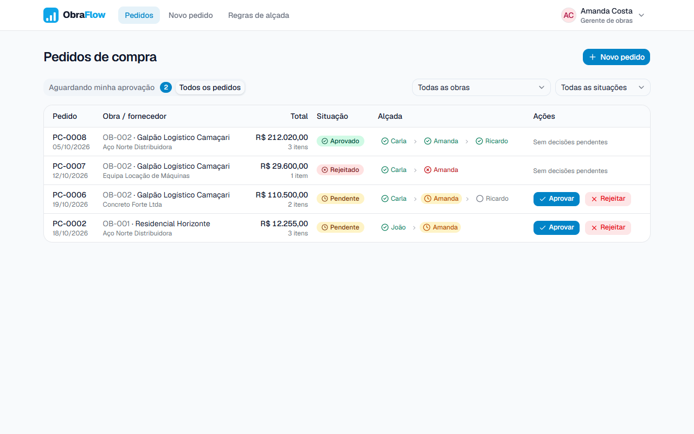

> O enunciado original do desafio está em [docs/DESAFIO.md](docs/DESAFIO.md).

## Sumário

- [Como rodar](#como-rodar)
- [Telas](#telas)
- [Dados de demonstração](#dados-de-demonstração)
- [Decisões técnicas](#decisões-técnicas)
  - [Tecnologias e motivos](#tecnologias-e-motivos)
  - [Como a regra de alçada é modelada, calculada e persistida](#como-a-regra-de-alçada-é-modelada-calculada-e-persistida)
  - [Como o front-end se comunica com o back-end](#como-o-front-end-se-comunica-com-o-back-end)
  - [Consistência e integridade dos dados](#consistência-e-integridade-dos-dados)
  - [Decisões de produto](#decisões-de-produto)
  - [Testes](#testes)
  - [O que mudaria em produção](#o-que-mudaria-em-produção)

---

## Como rodar

### Antes de tudo: a branch certa

O código da solução fica na branch `desafio/guilherme-barbosa`. A `main` tem só o enunciado do desafio, então rode os comandos abaixo nessa branch:

```bash
git clone https://github.com/guilhermebarbosa03/obraflow-case.git
cd obraflow-case
git checkout desafio/guilherme-barbosa
```

Se você já tem o repositório clonado, basta o `git checkout` (com um `git fetch` antes, se a branch ainda não aparecer).

### Opção 1: tudo no Docker (recomendado)

**Pré-requisito:** Docker.

```bash
docker compose up --build
```

Quando tudo estiver no ar, o log mostra **"ObraFlow pronto!"** com os links. Abra **http://localhost:8080** e escolha um usuário. O Swagger por padrão fica em **http://localhost:8080/api/docs**.

Sobem três containers:

| Container | O que faz |
|---|---|
| `db` | PostgreSQL 18 (também acessível em **127.0.0.1:5433**, para não conflitar com um possível Postgres local na 5432) |
| `api` | Aplica as migrations, carrega os dados de demonstração (se o banco estiver vazio) e inicia a API. |
| `web` | Front-end compilado, servido pelo nginx, que também encaminha `/api` para a API. |

As portas do banco e do app ficam abertas só para este computador (`127.0.0.1`). Como o app não tem login e o usuário do banco é superusuário com senha conhecida, nenhum dos dois deve ficar acessível pela rede local ou por VPN.

É possível restaurar os dados originais da demo com: `docker compose down -v` (apaga o volume do banco) e `docker compose up --build` de novo.

### Opção 2: desenvolvimento (com hot reload)

**Pré-requisitos:** Node.js 22+, pnpm 10+ e Docker (para o PostgreSQL).

**1. Banco de dados:**

```bash
docker compose up -d db
```

**2. API** (NestJS, porta 3000):

```bash
cd api
pnpm install
pnpm db:migrate
pnpm db:seed
pnpm start:dev
```

> O api/.env está versionado de propósito por questões de demonstração. Numa aplicação real, deveria estar no `.gitignore`.

**3. Front-end** (React + Vite, porta 5173), em outro terminal:

```bash
cd web
pnpm install
pnpm dev
```

Abra **http://localhost:5173**. O Swagger fica em **http://localhost:3000/api/docs**.

| Comando | Onde | O que faz |
|---|---|---|
| `pnpm db:seed` | `api/` | Apaga tudo e recria os dados de demonstração |
| `pnpm db:reset` | `api/` | Reaplica as migrations do zero e roda o seed |
| `pnpm test` | `api/` e `web/` | Testes unitários (Vitest) |
| `pnpm test:e2e` | `api/` | Testes ponta a ponta da API contra um banco `obraflow_test` (precisa do `db` no ar) |
| `pnpm lint` | `api/` e `web/` | Lint (oxlint) |

---

## Telas

### Escolha do usuário

Como não há autenticação no desafio, basta escolher o usuário desejado. O servidor grava a escolha em um cookie de sessão, e o usuário pode ser trocado a qualquer momento pelo menu do cabeçalho.
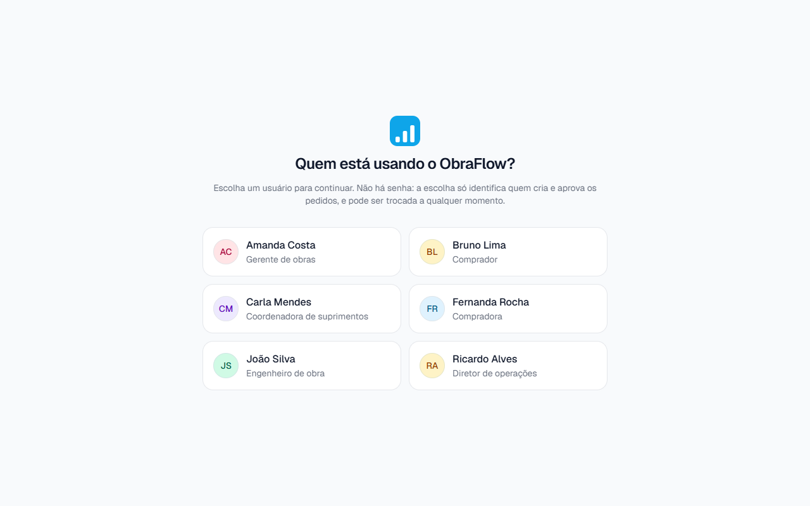

### 1. Aprovação: lista e detalhes

Cada usuário vê **só os pedidos de que participa**: os que criou e os que tem na sua cadeia de aprovação (veja [acesso aos pedidos](#acesso-aos-pedidos)). As listas podem ser ordenadas por data do pedido, obra ou fornecedor. Cada pedido mostra a alçada atual e os aprovadores. Botões Aprovar e Rejeitar aparecem se for a vez do usuário.

Nos detalhes há os itens, a cadeia de aprovação e o histórico completo.

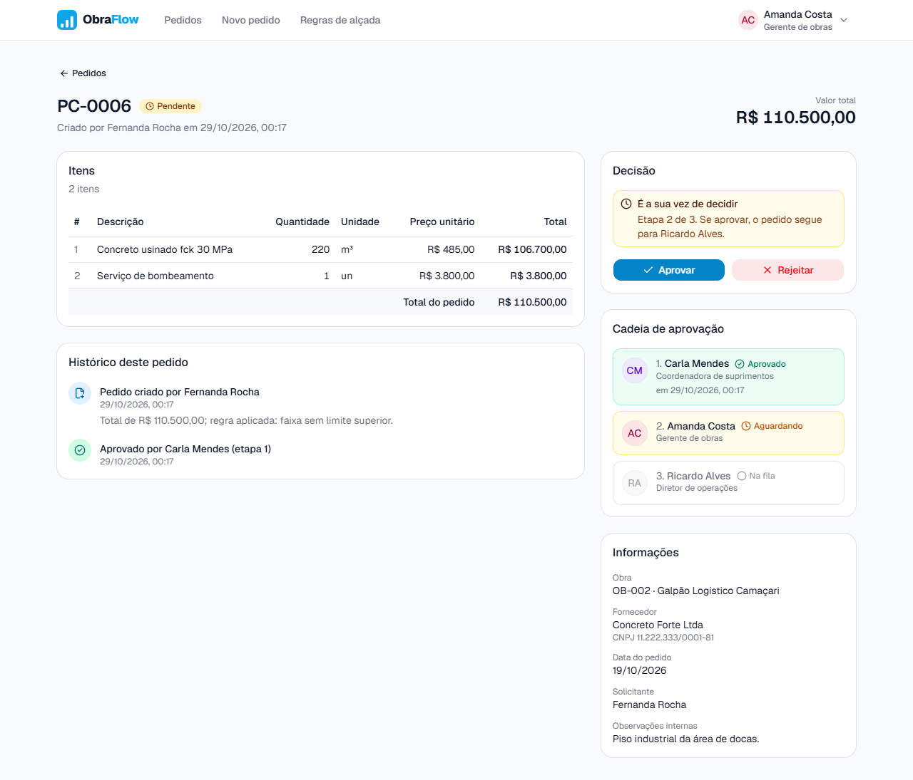

| Rejeitar sem motivo | Cadeia já concluída |
|---|---|
| 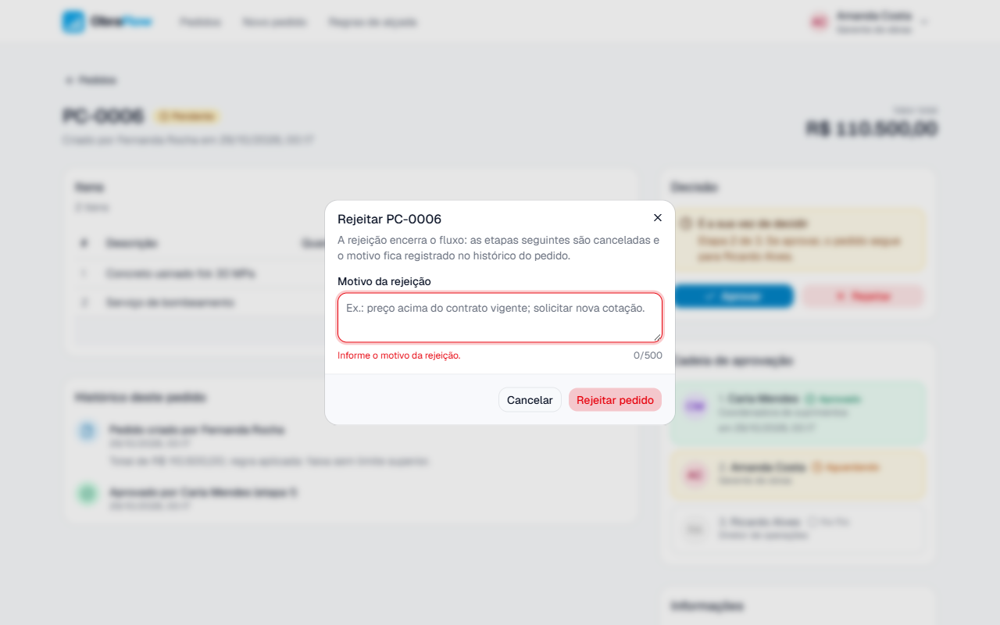 | 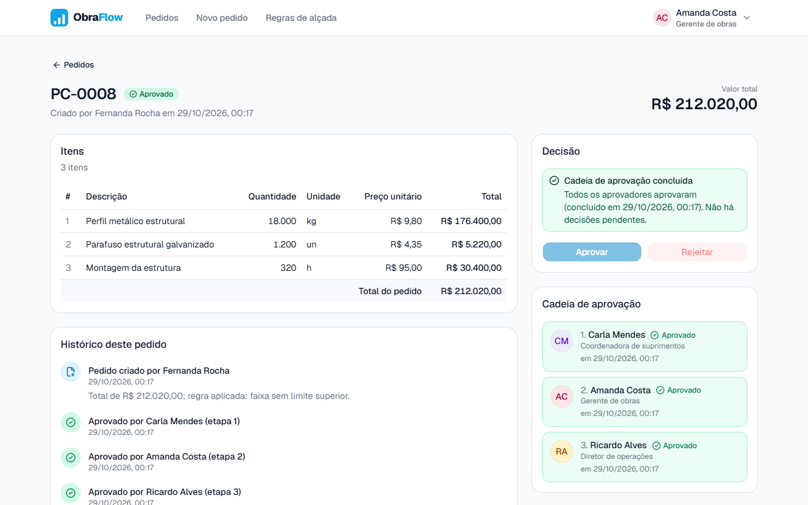 |
| O motivo é validado antes do envio. | Botões desabilitados, com a explicação. |

### 2. Cadastro de pedido

Começa com um item em branco; itens podem ser adicionados, editados e removidos. O total de cada item e o total do pedido são calculados na hora, com o mesmo arredondamento do servidor. Números seguem o padrão brasileiro: vírgula para decimais e ponto para milhares. Um ponto fora desse padrão, como `12.5`, é recusado em vez de ser adivinhado. O resumo mostra qual cadeia de aprovação vai valer para o total digitado, e o botão "Cadastrar pedido" habilita quando tudo está válido.

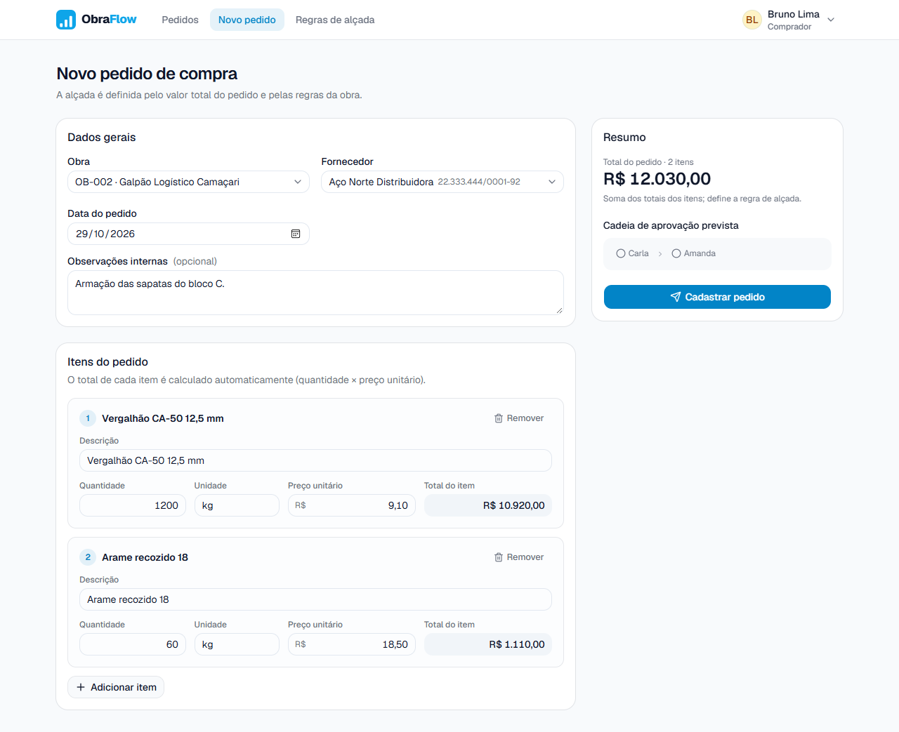

Os erros aparecem no campo e no item correspondentes. Quando nenhuma faixa da obra cobre o valor, o envio é bloqueado (veja [valores sem regra](#valores-sem-regra-aplicável)).

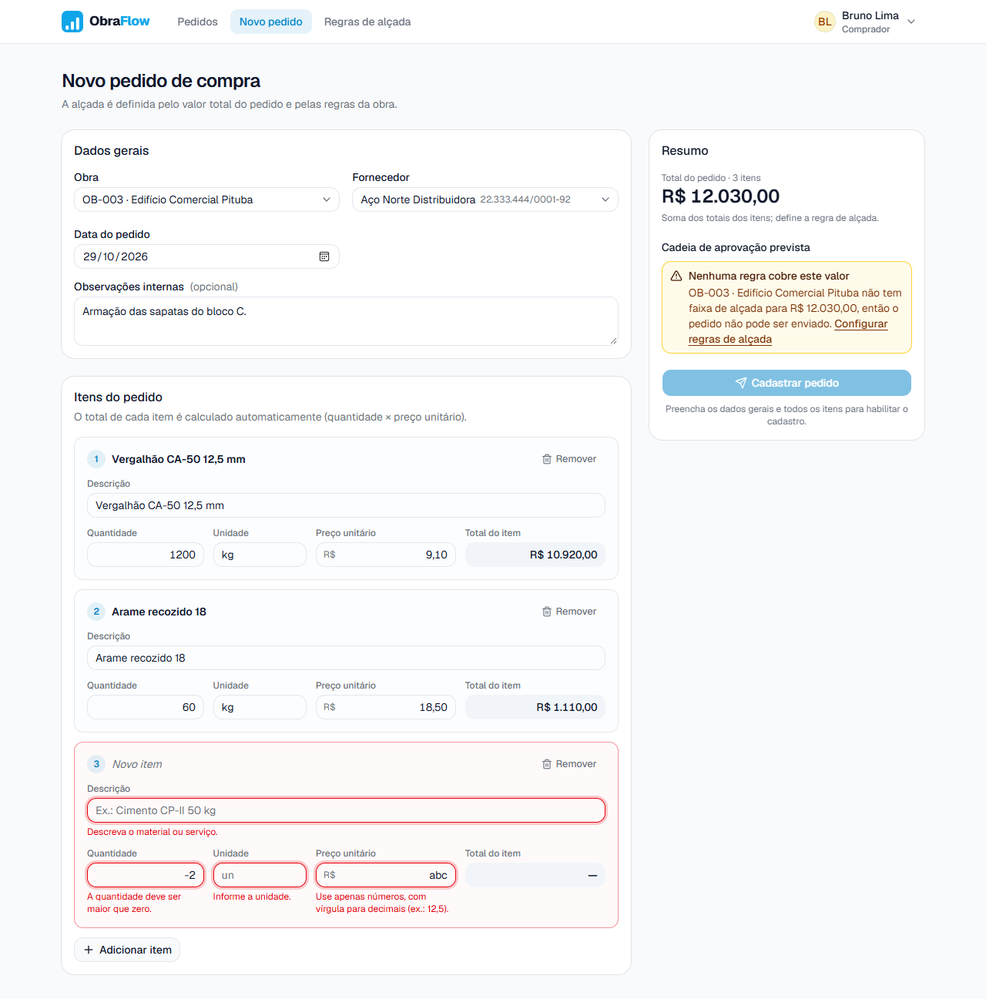

### 3. Regras de alçada

Para cada obra, as faixas aparecem como intervalos de valor derivados dos limites cadastrados, com os aprovadores na ordem do fluxo. Avisos explicam quando uma obra não tem faixas ou quando valores altos ficariam sem regra.

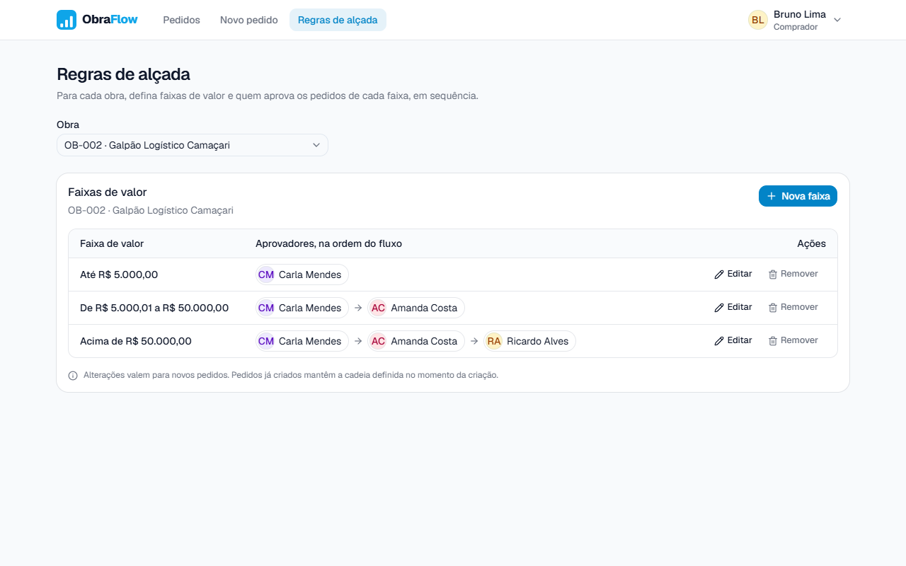

Na edição, os aprovadores são adicionados a partir da lista de usuários, removidos e reordenados com ↑ ↓ (funciona com teclado e toque). Limites duplicados são barrados antes do envio, e uma prévia mostra o intervalo e a cadeia resultante.

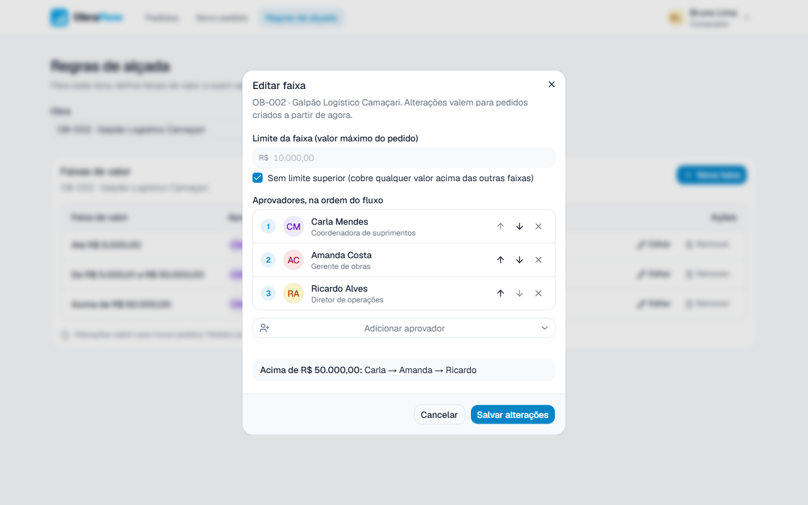

### Estados e responsividade

| API fora do ar | Celular |
|---|---|
| 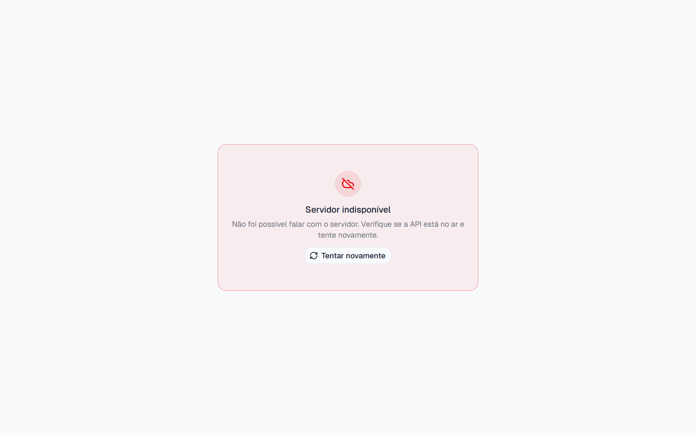 | 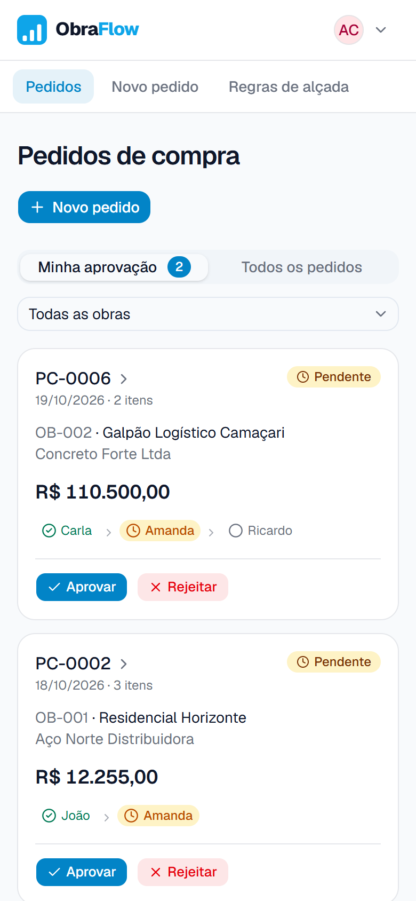 |

Toda lista tem loading (skeleton), empty state amigável e estado de erro com "Tentar novamente". Em telas pequenas, tabelas viram cartões.

---

## Dados de demonstração

O seed (`api/prisma/seed.ts`) cria tudo pelos mesmos services da API, com os payloads validados pelos mesmos DTOs da camada HTTP.

| Obra | Faixas de alçada |
|---|---|
| OB-001 Residencial Horizonte | até R$ 10.000 → João · acima → João → Amanda |
| OB-002 Galpão Logístico Camaçari | até R$ 5.000 → Carla · até R$ 50.000 → Carla → Amanda · acima → Carla → Amanda → Ricardo |
| OB-003 Edifício Comercial Pituba | nenhuma, de propósito (mostra o caso "sem regra") |

São 6 usuários e 8 pedidos: 4 pendentes (alguns no meio da cadeia), 2 aprovados e 2 rejeitados.

| Entre como | Para ver |
|---|---|
| **Amanda** | 2 pedidos aguardando ela (PC-0002 é a última etapa; PC-0006 segue para Ricardo) |
| **Carla** | PC-0005 aguardando; PC-0007, que ela aprovou e Amanda rejeitou |
| **João** | PC-0001 aguardando |
| **Ricardo** | "Aguardando Amanda (etapa 2 de 3)" no PC-0006 |
| **Bruno / Fernanda** | Compradores: criar pedidos (OB-003 mostra o bloqueio sem regra) |

---

## Decisões técnicas

### Tecnologias e motivos

| Camada | Escolha | Por quê |
|---|---|---|
| API | **NestJS** (TypeScript) | Módulos, injeção de dependência e pipes de validação dão uma estrutura clara para regras de negócio; mesma linguagem do front. |
| Persistência | **PostgreSQL** + **Prisma** | O domínio é relacional e precisa de transações, `Decimal` exato, constraints e índices únicos. Prisma dá tipos gerados e migrations versionadas. |
| Validação (API) | class-validator + `ValidationPipe` global | Todo payload é validado e campos desconhecidos são recusados (`forbidNonWhitelisted`). |
| Front-end | **React** + **Vite** + TypeScript | Stack conhecida, build rápido; o proxy do Vite (dev) deixa API e front na mesma origem. |
| Dados no front | **TanStack Query** | Loading, erro, retry e cache por query sem código manual; invalidação depois de cada decisão. É o que garante os estados exigidos em todas as listas. |
| Formulários | **React Hook Form** + **Zod** | `useFieldArray` para N itens; erros por campo e por item; `isValid` controla o botão de envio. |
| UI | **Tailwind** + **shadcn/ui** (Radix) | Componentes acessíveis e consistentes. Logo e paleta seguem o site do ObraFlow. |
| Testes | **Vitest** + Testing Library | Mesma ferramenta nos dois projetos. |

**Estrutura:** dois projetos independentes, sem monorepo, para manter a configuração simples.

```
api/                    NestJS + Prisma
  prisma/               schema, migrations e seed
  src/
    approval-tiers/     regras de alçada (CRUD e resolução da cadeia)
    purchase-orders/    pedidos: criação, listagem, aprovação e rejeição
    session/            sessão por cookie (escolha do usuário)
    construction-sites/ users/ suppliers/   cadastros base
web/                    React + Vite
  src/
    features/           orders, tiers, session, catalog (organizado por funcionalidade)
    components/         layout, estados (loading/empty/erro), componentes compartilhados
    lib/                cliente HTTP, dinheiro, formatação
docker-compose.yml      PostgreSQL, API e front-end (nginx)
```

Código em inglês; interface e documentação em português.

### Como a regra de alçada é modelada, calculada e persistida

#### Modelagem

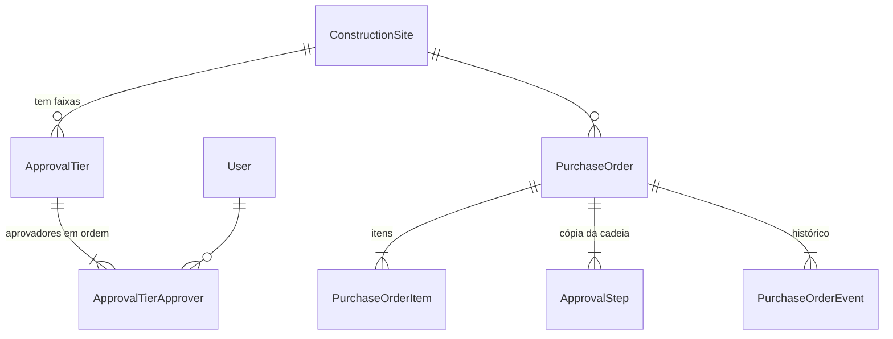

- **Uma faixa guarda só o limite superior** (`maxAmount`, inclusivo). `null` significa "sem limite superior". O limite inferior é derivado a partir do limite da faixa anterior. Assim, lacunas e sobreposições são impossíveis por construção.
- No banco: `UNIQUE (siteId, maxAmount) NULLS NOT DISTINCT` (no máximo uma faixa por limite, e no máximo uma "sem limite" por obra) e `CHECK (maxAmount > 0)`.
- **Aprovadores** ficam em `ApprovalTierApprover` com `position` (1, 2, 3...). `PRIMARY KEY (tierId, position)` e `UNIQUE (tierId, userId)`: a mesma pessoa não aparece duas vezes na faixa.

#### Cálculo

1. O total é sempre calculado pela API: cada item é `quantidade × preço unitário` arredondado para centavos (half up), e o total do pedido é a soma dos itens já arredondados. Tudo com `Decimal`.
2. A faixa aplicável é a de **menor limite que cobre o total**, ou a faixa sem limite. Uma única consulta:

   ```ts
   approvalTier.findFirst({
     where: { siteId, OR: [{ maxAmount: { gte: total } }, { maxAmount: null }] },
     orderBy: { maxAmount: { sort: 'asc', nulls: 'last' } },
   })
   ```

3. `GET /construction-sites/:id/approval-chain?amount=` expõe a mesma resolução, e o formulário usa para mostrar a cadeia prevista enquanto o usuário digita.

#### Persistência

Na mesma transação que salva um novo pedido, a cadeia da faixa é copiada para `ApprovalStep`. O pedido guarda `currentStep` e um evento `CREATED` com a faixa aplicada. Assim, editar ou apagar uma faixa não altera pedidos existentes.

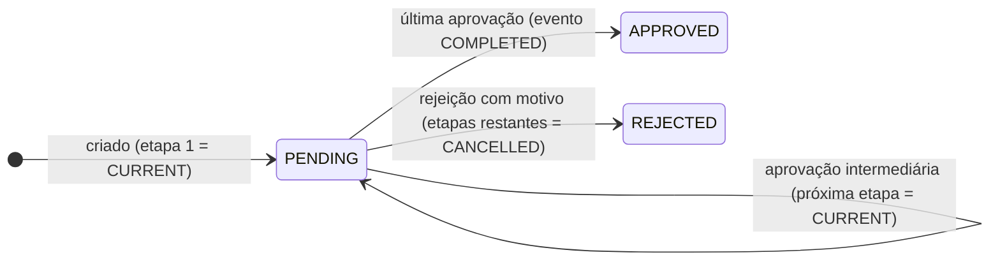

- Só o aprovador da etapa `CURRENT` pode decidir (os outros recebem 403). Aprovar marca a etapa como `APPROVED` e passa a vez para a seguinte; a última aprovação conclui o pedido.
- Rejeição exige motivo (validado no front, no DTO e por um `CHECK` no banco), marca a etapa como `REJECTED`, cancela as restantes e encerra o fluxo.
- `PurchaseOrderEvent` é *append-only* (a API nunca altera nem apaga eventos), com quem, quando, motivo e metadados. A ordem usa uma coluna `sequence` (já que eventos da mesma transação podem ter o mesmo `createdAt`).

#### Valores sem regra aplicável

Se nenhuma faixa da obra cobre o total (obra sem faixas, ou valor acima do maior limite):

- **no front**, o resumo mostra "Nenhuma regra cobre este valor" com link para as regras, e o botão de envio fica bloqueado;
- **na API**, a criação responde **422** com a mesma explicação, e nada é salvo;
- **na tela de regras**, avisos indicam obras sem faixas e valores que ficariam descobertos.

### Como o front-end se comunica com o back-end

- **REST + JSON** sob `/api`, documentado com **Swagger** em `/api/docs` (gerado dos DTOs e comentários).
- Em desenvolvimento, o **proxy do Vite** encaminha `/api` para a porta 3000. Assim, o cookie de sessão funciona sem configurar CORS.
- **Sessão:** `POST /api/session` com o id do usuário grava um cookie **assinado** (`cookie-parser` + `COOKIE_SECRET`), `httpOnly` e `SameSite=Lax`.
- **Toda rota de pedidos exige sessão** e responde só com os pedidos do usuário logado (regra abaixo). O front não envia "quem sou eu" em parâmetros: o servidor lê do cookie. **Toda escrita exige sessão** também (faixas, obras, usuários, fornecedores); só as leituras de cadastros e regras são abertas, porque a tela de escolha de usuário precisa delas.
- **Dinheiro e quantidades trafegam como texto decimal**, para não perder precisão em JSON. Valores em dinheiro saem sempre com duas casas (`"10000.00"`, `"12.50"`); quantidades saem na forma natural (`"12.5"`).
- **Erros** seguem um formato único (`statusCode`, `message`), com mensagens em português. Em erros de validação (400), `message` é uma lista com o campo e o problema (`"items.0.quantity: use um número decimal..."`). O cliente HTTP do front transforma falhas em `ApiError` com uma mensagem pronta para a tela.
- **TanStack Query** cuida de cache, loading e erro. Só repete automaticamente erros de rede e 5xx (um 404 não muda com retry). Depois de uma decisão, invalida a lista e o detalhe.

| Método | Rota | Uso |
|---|---|---|
| `POST` / `GET` / `DELETE` | `/session` | Escolher usuário, ver quem está logado, sair |
| `GET` | `/construction-sites`, `/users`, `/suppliers` | Cadastros base |
| `POST` | `/construction-sites`, `/users`, `/suppliers` | Cadastrar (exige sessão; o CNPJ do fornecedor tem os dígitos verificadores conferidos) |
| `GET` / `POST` | `/construction-sites/:id/approval-tiers` | Listar (com limite inferior derivado) e criar faixas |
| `GET` / `PUT` / `DELETE` | `/approval-tiers/:id` | Consultar uma faixa, editar (substitui aprovadores na ordem enviada) e remover |
| `GET` | `/construction-sites/:id/approval-chain?amount=` | Prévia da cadeia para um valor |
| `GET` | `/purchase-orders?status&siteId&awaitingMe&sort&page` | Lista paginada dos pedidos do usuário, com a cadeia de cada um (`awaitingMe=true`: só os que estão na vez dele; `sort`: `date_desc` (padrão), `date_asc`, `site` ou `supplier`) |
| `POST` | `/purchase-orders` | Criar pedido (`Idempotency-Key` opcional) |
| `GET` | `/purchase-orders/:id` | Detalhes: itens, etapas e histórico |
| `POST` | `/purchase-orders/:id/approve` e `/reject` | Decidir, enviando a `version` vista na tela |

**Códigos de resposta:** 400 payload inválido · 401 sem sessão · 403 não é a vez do usuário · 404 não existe (ou o usuário não participa do pedido) · 409 conflito de estado (pedido já finalizado ou alterado, limite de faixa repetido) · 422 payload válido que viola regra de negócio (sem faixa, total zero ou acima do máximo) · 503 banco indisponível (`/api/health`).

#### Principais payloads

Exemplos completos (com todos os campos e respostas) estão no Swagger, em `/api/docs`.

```http
POST /api/session
{ "userId": "c0a8...-uuid" }
```

```http
POST /api/purchase-orders
Idempotency-Key: 4f6c1b9e-2d1a-4c7e-9a51-0b3f7e2c9d10

{
  "siteId": "uuid-da-obra",
  "supplierId": "uuid-do-fornecedor",
  "orderDate": "2026-10-26",
  "notes": "Reposição para a laje do 3º pavimento.",
  "items": [
    { "description": "Cimento CP-II 50 kg", "quantity": "160", "unit": "un", "unitPrice": "38.90" },
    { "description": "Areia média lavada", "quantity": "12.5", "unit": "m³", "unitPrice": "145.00" }
  ]
}
```

Resposta `201`, resumida (o detalhe traz também obra, fornecedor, solicitante e histórico):

```json
{
  "id": "uuid", "number": 9, "status": "PENDING", "currentStep": 1, "version": 0,
  "total": "8036.50",
  "items": [{ "position": 1, "description": "Cimento CP-II 50 kg", "quantity": "160", "unit": "un", "unitPrice": "38.90", "total": "6224.00" }],
  "steps": [{ "position": 1, "status": "CURRENT", "approver": { "id": "uuid", "name": "João Silva" } }],
  "events": [{ "type": "CREATED", "metadata": { "tierMaxAmount": "10000", "total": "8036.5" } }]
}
```

```http
POST /api/purchase-orders/:id/approve
{ "version": 0 }

POST /api/purchase-orders/:id/reject
{ "version": 1, "reason": "Preço acima do contrato vigente." }
```

```http
POST /api/construction-sites/:id/approval-tiers     (PUT /api/approval-tiers/:id usa o mesmo corpo)
{ "maxAmount": "10000.00", "approverIds": ["uuid-do-joao", "uuid-da-amanda"] }
```

`maxAmount: null` cria a faixa "sem limite superior". Valores vão como texto, com ponto decimal: `"10000.00"`, não `10000` nem `"10.000,00"`.

#### Acesso aos pedidos

Um pedido é visível para **quem o criou e para os aprovadores da sua cadeia**. A regra fica em uma função só (`visibleTo(userId)` em `purchase-orders.service.ts`), aplicada no `WHERE` de toda leitura: lista, detalhes e a busca do pedido dentro da transação de aprovar/rejeitar.

- Quem não participa recebe **404**, igual a um pedido inexistente: a API não confirma que o pedido existe.
- Como o filtro está na própria consulta, não há caminho que carregue o pedido e "esqueça" de checar a permissão depois.
- Quem participa mas não está na vez continua recebendo 403 ao tentar decidir.

**Por que não Row Level Security (RLS) do PostgreSQL agora:** com Prisma, RLS exige abrir uma transação por requisição para definir o usuário (`set_config`), um papel de banco sem privilégio de superusuário e cuidado extra com o seed e com as transações que já existem. Para um único ponto de acesso (esta API), o filtro centralizado dá a mesma garantia com bem menos peças. RLS entra como segunda camada em produção (veja abaixo).

### Consistência e integridade dos dados

**O servidor é a fonte da verdade.** O front valida para dar feedback imediato, mas a API valida tudo de novo, calcula totais e resolve a alçada sozinha.

| Risco | Proteção |
|---|---|
| Pedido salvo pela metade | Cabeçalho, itens, cadeia e evento são gravados em uma transação. Faixa resolvida dentro da mesma transação. |
| Duas decisões ao mesmo tempo | **Lock otimista**: a decisão é um `UPDATE ... WHERE id = ? AND version = ? AND status = 'PENDING'` que incrementa `version`. O `UPDATE` trava a linha; a segunda decisão espera, reavalia o `WHERE`, atualiza 0 linhas e recebe 409. Testado com aprovar e rejeitar enviados ao mesmo tempo: um 200, um 409. |
| Decisão tomada em tela desatualizada | O cliente envia a `version` que viu; se o pedido mudou, 409 e a tela recarrega. |
| Clique duplo / retry de rede na criação | **`Idempotency-Key`** por formulário: único por solicitante (`UNIQUE (requesterId, idempotencyKey)`). A repetição devolve o pedido já criado (`Idempotent-Replayed: true`); a mesma chave com outro conteúdo (comparado por hash) recebe 422. |
| Clique duplo / retry na decisão | Repetir uma decisão que já foi aplicada devolve 200 com o pedido atual, em vez de erro (aprovações simultâneas do mesmo usuário: todas 200, decisão registrada uma vez). Como cada decisão incrementa `version` em 1 e decide uma etapa em ordem, uma requisição com `version = v` sempre mirou a etapa `v + 1`. Uma rejeição só conta como repetição se o motivo for o mesmo; com outro motivo é 409, para o cliente não achar que o novo texto foi salvo. |
| Erros de arredondamento | `Decimal` na API e `decimal.js` no front, com o mesmo arredondamento; colunas `NUMERIC(14,2)` e `NUMERIC(14,3)`; total acima do que a coluna comporta vira 422, não erro do banco. |
| Dados impossíveis no banco | `CHECK`s (quantidade > 0, preço ≥ 0, limite > 0, posição ≥ 1, rejeição exige motivo), chaves estrangeiras com `RESTRICT` (não dá para apagar um usuário com pedidos ou etapas), índices únicos. |
| Usuário ver ou decidir pedido de outra pessoa | Filtro de acesso no `WHERE` de toda leitura e da decisão; fora dele, 404. |
| Regra mudar e "reescrever" o passado | A cadeia é copiada para o pedido na criação; o histórico é só de inserção. |
| API subir sem banco | O `PrismaService` executa `SELECT 1` na inicialização (com o adapter `pg`, `$connect()` não conecta de verdade); o health responde 503 quando o banco cai. |

### Decisões de produto

- **Quem solicita pode aprovar o próprio pedido** se estiver na cadeia. Bloquear isso exigiria impedir também a configuração de faixas em que o solicitante aparece; fica como possível mudança de produção (segregação de funções).
- **Qualquer usuário com sessão pode editar as regras.** Não há papéis no desafio; em produção, só um perfil administrativo. Sem sessão, a API recusa (401).
- **Pedido de valor zero é recusado.** Um item pode ter preço zero (amostra grátis), mas um pedido que soma R$ 0,00 não tem o que aprovar (422 na API, aviso no formulário).
- **Data do pedido entre 2000 e um ano depois de hoje.** Datas fora disso quase sempre são erro de digitação (`0226`, `2926`).
- **Pedidos não são editáveis depois de criados.** A cadeia foi definida para aquele total; para corrigir, rejeita-se e cria-se outro.
- **Alterações de regra valem só para novos pedidos** (a tela avisa isso).
- **Aprovar pede confirmação**; rejeitar abre um diálogo com motivo obrigatório.
- **Obras, fornecedores e usuários não têm telas de cadastro**. Existem endpoints `POST` na API e os dados vêm do seed.

### Testes

- **API, unitários:** cálculo de totais (arredondamento, soma, limites, total zero), CNPJ, formato do dinheiro e tradução das mensagens de validação.
- **API, ponta a ponta** (`pnpm test:e2e`): compila a API, sobe `dist/main.js` contra um banco próprio (`obraflow_test`, com migrations e dados de demonstração) e faz requisições HTTP reais, como o front. Cobre validações, alçada nos limites de faixa, aprovação na ordem, 403/404/409/422, rejeição, idempotência na criação e na decisão, decisões simultâneas, cópia da cadeia e CRUD de faixas. O nome do banco precisa terminar em `_test` (o seed limpa as tabelas); dá para trocar com `TEST_DATABASE_URL`.
- **Front-end:** totais com **os mesmos casos da API** (tela e servidor concordam em cada centavo), mensagens de validação por campo e por item, cálculo de "de quem é a vez", rótulos de faixa, e um teste de componente que prova que rejeitar sem motivo não envia requisição.

```bash
pnpm --dir api test
pnpm --dir api test:e2e   # precisa do PostgreSQL (docker compose up -d db)
pnpm --dir web test
```

### O que mudaria em produção

- **Autenticação real** (SSO/OIDC) no lugar da escolha de usuário, mantendo a mesma ideia de sessão no servidor; cookie `Secure` atrás de HTTPS e proteção CSRF explícita.
- **Papéis e permissões:** quem pode criar pedidos, aprovar e editar regras; segregação de funções (solicitante fora da própria cadeia); visão ampla para perfis como financeiro e auditoria.
- **Row Level Security no PostgreSQL** como segunda camada do acesso aos pedidos: políticas por usuário nas tabelas de pedido, itens, etapas e histórico, com a API conectando por um papel sem privilégios de superusuário.
- **Histórico das regras:** versionar faixas (quem mudou o quê e quando), além do histórico dos pedidos.
- **Notificações** ao próximo aprovador (e-mail, push), com padrão *outbox* para não perder eventos.
- **Delegação e prazos:** substituto em férias, escalonamento quando uma etapa fica parada.
- **Testes e2e do front** (Playwright) e tudo rodando em CI: lint, build, migrations, testes unitários e os testes ponta a ponta da API.
- **Observabilidade:** logs estruturados, métricas e tracing; alertas no health.
- **Infraestrutura:** imagem da API em dois estágios (sem dependências de desenvolvimento, migrations como passo separado do deploy em vez de no início do container), HTTPS com `NODE_ENV=production` (cookie `Secure`), segredos fora do compose e fora do repositório (o `api/.env` sai do versionamento e entra no `.gitignore`), backups do banco, rate limiting.
- **Idempotência com expiração** das chaves e respostas tipadas no OpenAPI, para gerar o cliente do front automaticamente.
