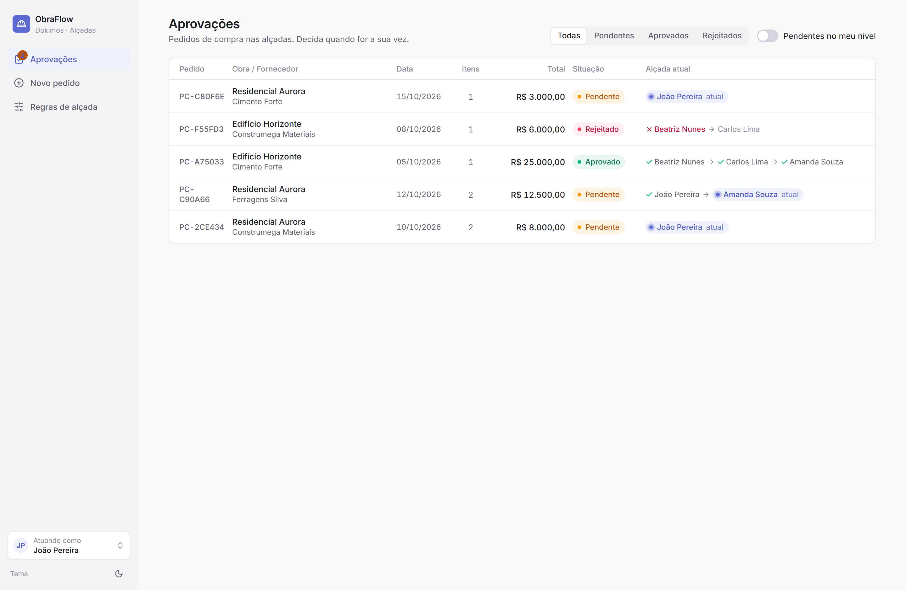
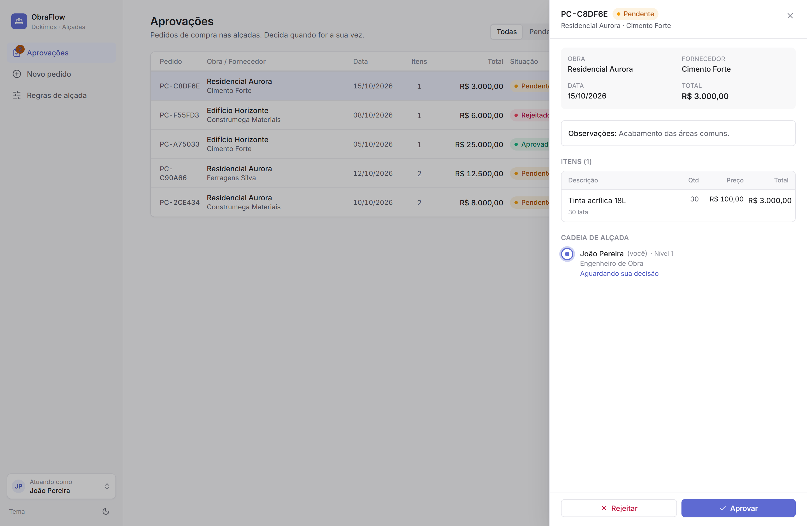
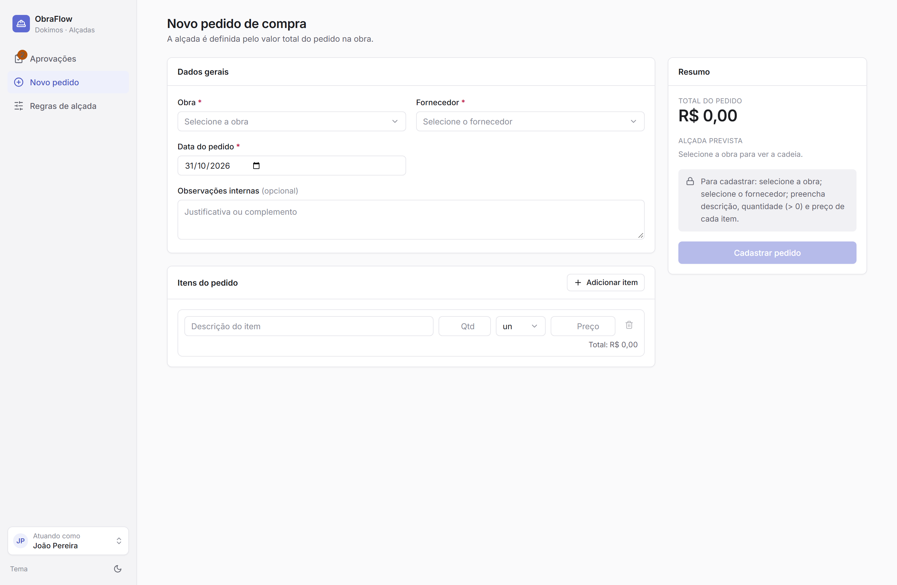
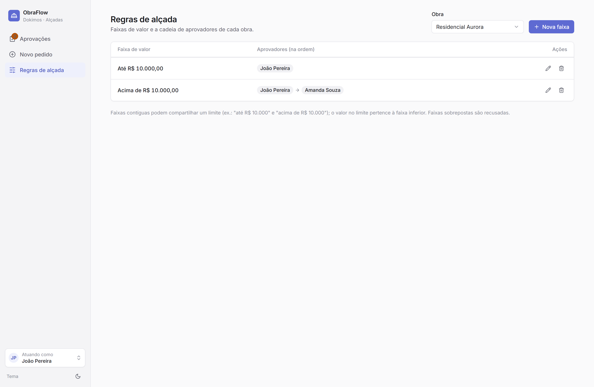
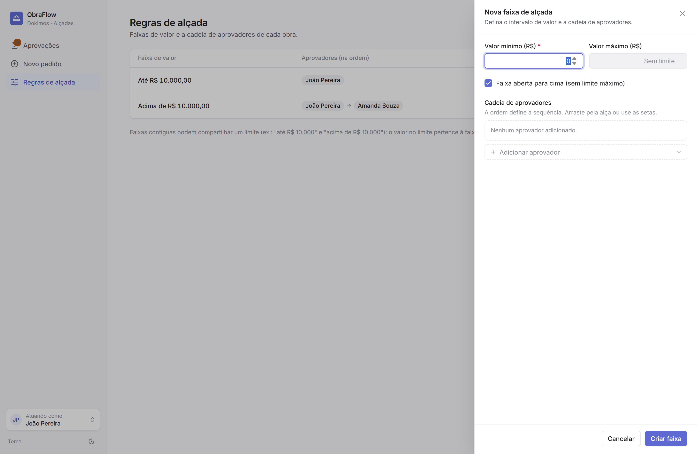
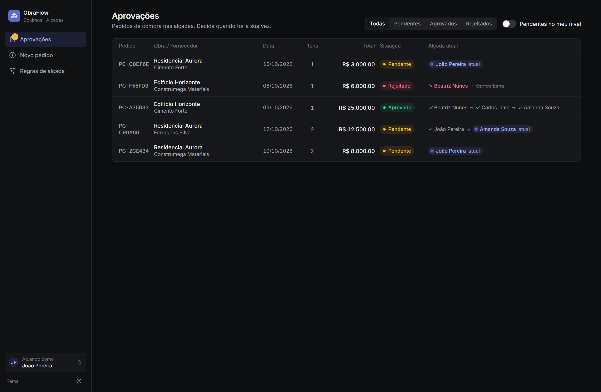
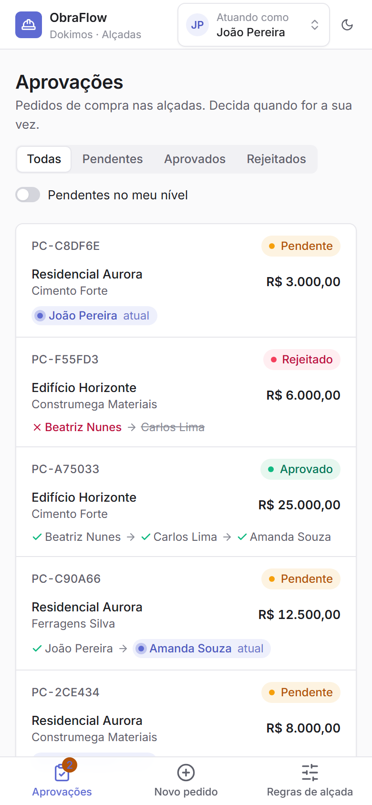

# ObraFlow · Dokimos — Pedidos de Compra com Alçadas

Implementação do desafio full-stack da ObraFlow: um sistema de **pedidos de compra** com **fluxo de aprovação por alçadas** configurável por obra (o serviço "Dokimos"). Faixas de valor por obra definem uma cadeia ordenada de aprovadores; rejeições interrompem o fluxo e exigem justificativa; todas as decisões ficam numa trilha auditável.

O enunciado original está preservado em [`docs/CASE.md`](docs/CASE.md).

> **Rodar com um comando:** `docker compose up --build` → frontend em http://localhost:5173, API em http://localhost:3000. Os dados de demonstração são carregados automaticamente.

---

## Sumário
- [Telas](#telas)
- [Como executar](#como-executar)
- [Stack e por quê](#stack-e-por-quê)
- [Modelagem da alçada: cálculo e persistência](#modelagem-da-alçada-cálculo-e-persistência)
- [Comunicação front-end ↔ back-end](#comunicação-front-end--back-end)
- [Consistência e integridade dos dados](#consistência-e-integridade-dos-dados)
- [API](#api)
- [Testes](#testes)
- [Decisões técnicas](#decisões-técnicas)
- [O que mudaria em produção](#o-que-mudaria-em-produção)

---

## Telas

Design no estilo minimalista, com **tema claro e escuro** e layout responsivo.

### 1. Aprovações (dashboard)
Lista de pedidos com obra, fornecedor, data, nº de itens, valor total, situação e a **alçada atual** (aprovadores concluídos → atual → próximos). Filtro por situação e por "pendentes no meu nível". No detalhe: itens, histórico de decisões e as ações aprovar/rejeitar.




### 2. Cadastro de pedido de compra
Itens dinâmicos, total por linha e total do pedido calculados ao vivo, **prévia da cadeia de alçada** conforme o valor, validação por campo e botão habilitado só quando tudo é válido.



### 3. Regras de alçada
Faixas de valor por obra e cadeia ordenada de aprovadores, com criar/editar/remover faixa e **reordenar aprovadores** (drag-and-drop ou setas).




### Tema escuro e responsivo



---

## Como executar

### Opção A — Docker (recomendada, um comando)
Pré-requisito: Docker + Docker Compose.
```bash
docker compose up --build
```
Sobe três serviços: **Postgres**, **backend** (aplica migrations e, se o banco estiver vazio, roda o seed) e **frontend** (build estático servido por nginx).
- Frontend: http://localhost:5173
- API: http://localhost:3000

### Dados de demonstração
O seed cria **4 usuários**, **3 fornecedores**, **2 obras**, **5 faixas de alçada** e **5 pedidos** em estados variados: pendente no 1º nível, pendente no 2º nível (1º já aprovou), aprovado (3 níveis) e rejeitado com motivo.

Como o case não exige autenticação, o app tem um seletor **"Atuando como…"** no cabeçalho que define quem está decidindo — é esse usuário que assina as decisões e alimenta o filtro "pendentes no meu nível". A regra de *ordem* da alçada é garantida pelo back-end; o seletor apenas simula a identidade do ator.

---

## Stack

| Camada | Escolha | Motivo |
|---|---|---|
| Back-end | **NestJS + TypeScript** | Estrutura modular (módulos, services, DTOs, injeção de dependência) que mantém o domínio organizado e testável. |
| ORM / DB | **Prisma + PostgreSQL** | Schema declarativo, migrations versionadas, tipos gerados e transações expressivas. Postgres pela robustez transacional, importante para a trilha de aprovação. Fixei o Prisma na versão estável (6.x). |
| Front-end | **React + Vite + TypeScript** | Build rápido e ecossistema maduro; **Tailwind** + componentes no estilo **shadcn/ui** para implementar fielmente o design (tema claro/escuro via CSS variables). |
| Formulários | **React Hook Form** | Validação por campo com mensagens específicas e baixo custo de re-render. |
| Infra | **Docker Compose** | Sobe banco + API + front com um comando. |

---

## Modelagem e Calculo

### Entidades ([`backend/prisma/schema.prisma`](backend/prisma/schema.prisma))
- **Project** (obra), **User** (aprovador), **Supplier** (fornecedor — `document`/CNPJ único).
- **ApprovalRange**: faixa de valor de uma obra (`minValue`, `maxValue` nulo = aberto para cima).
- **ApprovalRangeStep**: aprovador da faixa com `position` (a ordem do fluxo).
- **PurchaseOrder**: cabeçalho + `totalValue`, `status` (`PENDING`/`APPROVED`/`REJECTED`), `currentStep` e `version`.
- **PurchaseOrderItem**: itens com `lineTotal` persistido.
- **OrderApprovalStep**: **snapshot** da cadeia do pedido + trilha de auditoria (decisão, motivo, data por nível).

### Cálculo — motor de alçadasd
O motor é **lógica pura, sem dependência de framework ou banco** ([`backend/src/purchase-orders/approval-engine.ts`](backend/src/purchase-orders/approval-engine.ts)) — por isso é testado em milissegundos:
1. `computeOrderTotal(items)` soma `quantidade × preço` por item, arredondando a 2 casas.
2. `selectRange(ranges, total)` escolhe a faixa que cobre o total. Limites inclusivos; **no empate exato vence a faixa de menor teto** (ex.: R$ 10.000 cai em "até R$ 10.000").
3. `resolveChain` transforma a faixa na cadeia ordenada de aprovadores. Sem faixa aplicável → lança `NoMatchingRangeError` (traduzido para HTTP 422 no serviço).
4. `decide(state, actingUser, ação, motivo)` valida e calcula o efeito de cada decisão.

### Persistência e fluxo
- Ao criar o pedido, total, itens e a **cadeia "congelada" (snapshot)** são gravados numa transação. Congelar a cadeia garante que **editar regras depois não altera pedidos em andamento** — a auditoria fica estável.
- Aprovar avança `currentStep`; ao fim, `status = APPROVED`. Rejeitar exige motivo, grava no histórico e `status = REJECTED` (interrompe o fluxo).
- **Decisões fora de ordem são bloqueadas**: só o aprovador de `currentStep` decide, e só enquanto `PENDING`.
- **Valor sem faixa** → criação recusada com **422** e mensagem clara (evita aprovação silenciosa num ERP).

---

## Comunicação front-end ↔ back-end
- API **REST/JSON**. O front usa um cliente `fetch` tipado ([`frontend/src/lib/api.ts`](frontend/src/lib/api.ts)) + hooks do TanStack Query.
- Respostas de erro têm formato consistente (`{ statusCode, error, message, path, timestamp }`) via filtro global; o cliente normaliza a mensagem para toasts e estados de erro.
- `Prisma.Decimal` é serializado como `number` por um interceptor, simplificando o consumo no front.
- CORS habilitado para a origem do front (`CORS_ORIGIN`).

---

## Consistência e integridade dos dados
- **Transações** envolvem operações compostas (criação do pedido; registro da decisão + avanço de estado; reescrita da cadeia de uma faixa).
- **Optimistic locking**: `PurchaseOrder.version` é verificada e incrementada na mesma operação da decisão. Duas decisões concorrentes no mesmo nível → só a primeira vence; a segunda recebe **409**.
- **Integridade referencial** por foreign keys (`onDelete: Restrict` em entidades em uso, `Cascade` em itens/steps).
- **Unicidade**: `(orderId, position)` e `(rangeId, position)` evitam cadeias inconsistentes; `email` e `document` únicos.
- **Validação em duas frentes**: DTOs com `class-validator` no back (fonte de verdade) + validação por campo no front. Faixas sobrepostas são recusadas ao salvar.

---

## API
Base: `http://localhost:3000`

| Método | Rota | Descrição |
|---|---|---|
| GET/POST/PATCH/DELETE | `/projects`, `/suppliers`, `/users` | CRUD de obras, fornecedores e usuários. |
| GET | `/projects/:id/approval-ranges` | Faixas de alçada da obra. |
| POST | `/projects/:id/approval-ranges` | Cria faixa `{ minValue, maxValue, approverUserIds[] }`. |
| PATCH/DELETE | `/approval-ranges/:id` | Edita (inclui reordenar via `approverUserIds`) / remove faixa. |
| POST | `/purchase-orders` | Cria pedido; calcula total e resolve a cadeia. |
| GET | `/purchase-orders?status=&currentApproverId=` | Lista com filtros. |
| GET | `/purchase-orders/:id` | Detalhe com itens e histórico. |
| POST | `/purchase-orders/:id/approve` | `{ actingUserId }`. |
| POST | `/purchase-orders/:id/reject` | `{ actingUserId, reason }`. |

Exemplo de criação:
```bash
curl -X POST http://localhost:3000/purchase-orders \
  -H 'Content-Type: application/json' \
  -d '{
    "projectId": "<id-da-obra>",
    "supplierId": "<id-do-fornecedor>",
    "orderDate": "2026-10-20",
    "items": [{ "description": "Aço CA-50", "quantity": 500, "unit": "kg", "unitPrice": 9 }]
  }'
```

---

## Testes
Testes unitários (Vitest) do motor de alçadas — o núcleo do case: seleção de faixa, limites, snapshot da cadeia, avanço de nível, aprovação final, rejeição com/sem motivo, decisão fora de ordem e valor sem faixa.
```bash
cd backend && npm test
```

---

## Decisões técnicas

- **Motor de alçadas como lógica pura.** Separar as regras (seleção de faixa, ordem, transições) de Prisma/Nest deixa o coração do sistema testável e fácil de raciocinar; o serviço só orquestra persistência e transações.
- **Snapshot da cadeia no pedido.** Recalcular a cadeia a cada leitura corromperia pedidos em andamento quando as regras mudassem. Congelar a cadeia preserva a auditoria.
- **`currentStep` + `OrderApprovalStep` persistidos.** O "nível atual" é estado explícito no banco (não derivado em runtime), atendendo ao requisito de que a fila de pendentes reflita o nível calculado e persistido.
- **Limites de faixa inclusivos com desempate determinístico.** Faixas contíguas podem compartilhar um limite; o valor no limite pertence à faixa inferior. Sobreposição real é recusada ao salvar.
- **Valor sem faixa → bloqueia a criação (422).** Num ERP financeiro, aprovar algo "sem alçada" silenciosamente é arriscado; melhor exigir configuração explícita.
- **Decimal no banco, `number` na borda.** Precisão de 2 casas no Postgres; conversão para `number` só na resposta da API.
- **Seletor "Atuando como" em vez de login.** O case não pede autenticação; simular o ator mantém o foco no fluxo de alçadas. A autorização de *ordem* continua no back-end.
- **Front-end fiel a um design system.** Tokens (cores, tipografia, espaçamento), componentes e estados vieram de um handoff de design; implementados com Tailwind + CSS variables para suportar tema claro/escuro sem duplicar estilos.
- **Prisma fixado na versão estável.** Evitei um *release candidate* que o `latest` apontava, por previsibilidade e para não puxar dependências com vulnerabilidades.

---

## O que mudaria em produção
- **Autenticação e autorização reais** (JWT/OIDC) no lugar do seletor "Atuando como"; decisões assinadas pelo usuário autenticado e RBAC por obra.
- **Dinheiro ponta a ponta em Decimal/inteiro de centavos**, sem converter para `number` na borda, evitando limites do `double` em valores muito altos.
- **Notificações** (e-mail/push) ao chegar a vez de um aprovador e ao concluir/rejeitar.
- **Auditoria ampliada** (quem criou/alterou regras, IP, carimbo imutável) e soft-delete em vez de delete físico.
- **Paginação, busca e índices** na listagem de pedidos; **observabilidade** (logs estruturados, métricas, tracing) e health/readiness probes.
- **CI/CD** com testes (incl. e2e) e imagens multi-stage enxutas; opcionalmente um ambiente de demonstração hospedado.
