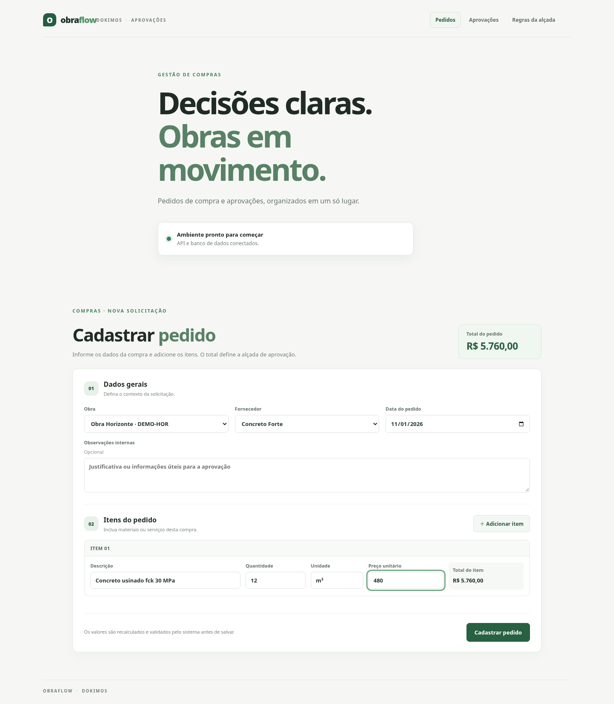
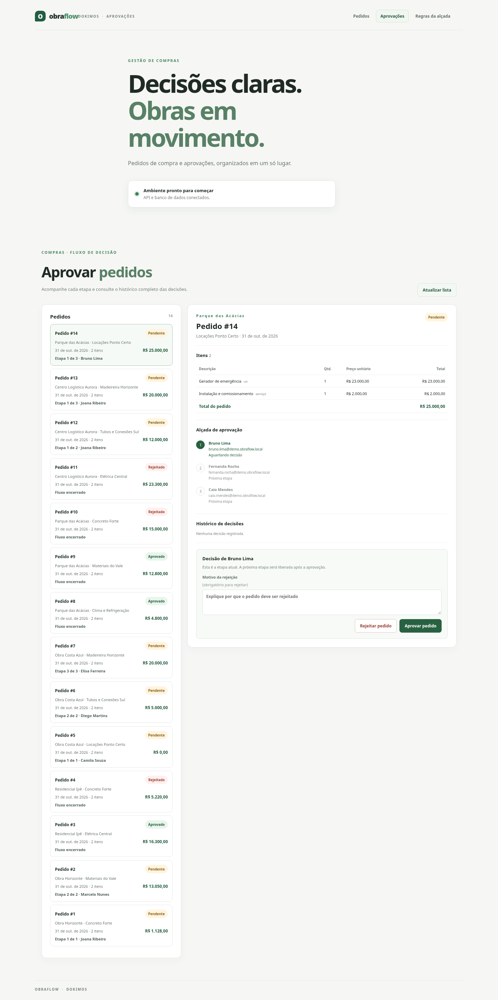
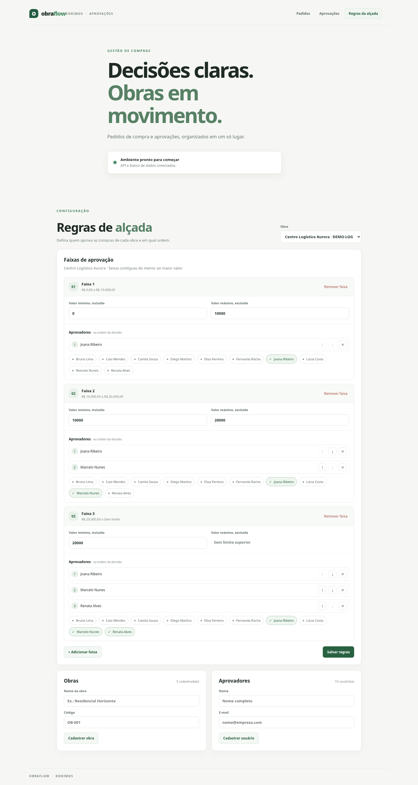
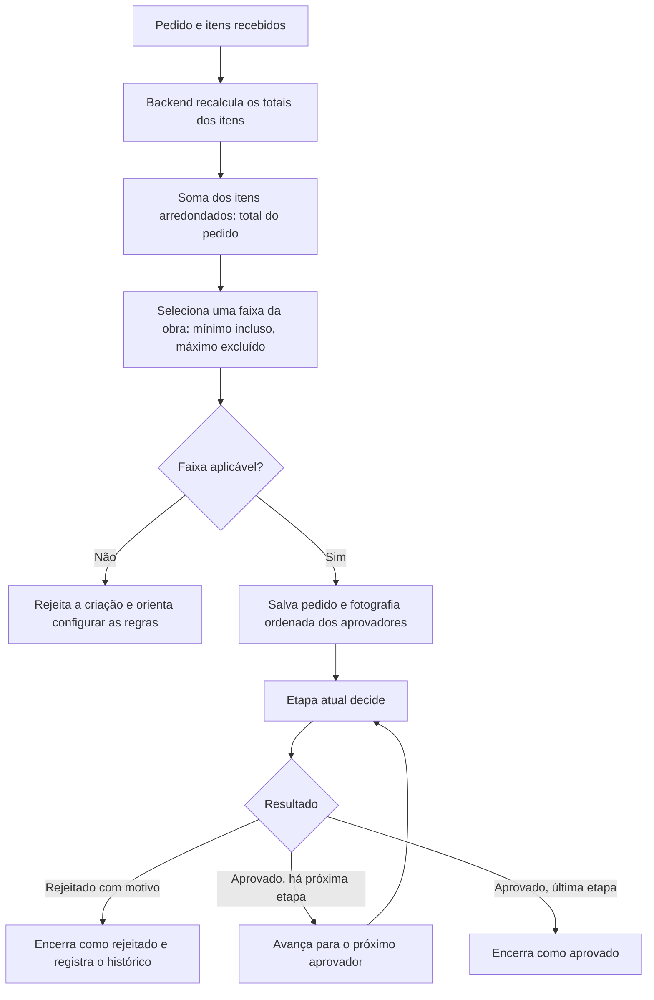

# ObraFlow · Dokimos

Plataforma full-stack para cadastro de pedidos de compra e aprovação por alçada. A solução reúne execução local, cadastros de referência, regras de alçada por obra, pedidos com itens e um fluxo de aprovação ordenado com histórico. A carga de demonstração fornece dados reproduzíveis para avaliar as telas e os diferentes estados.

As instruções originais do processo seletivo estão em [DESAFIO-INSTRUCOES.md](DESAFIO-INSTRUCOES.md).

## Executar a aplicação

### Requisitos

- Git;
- Docker Engine com Docker Compose v2;
- acesso à internet na primeira execução para baixar as imagens e dependências.

O fluxo com Docker não exige Java nem Node.js instalados na máquina.

### Subir banco, API e frontend

Na raiz do repositório:

```bash
cp .env.example .env
docker compose up --build
```

A primeira execução constrói as imagens do backend e do frontend, inicia o PostgreSQL e aplica as migrações Flyway. Aguarde os serviços iniciarem e acesse:

- Aplicação: <http://localhost:5173>
- API: <http://localhost:8080>
- Saúde da API e do banco: <http://localhost:8080/api/health>
- Saúde operacional: <http://localhost:8080/actuator/health>

A aplicação exibe o estado de conexão da API e do banco e oferece o cadastro de pedidos e a configuração das regras de alçada.

### Popular dados de demonstração

Com os serviços iniciados, carregue os dados de demonstração no PostgreSQL local:

```bash
docker compose run --build --rm backend --spring.profiles.active=demo-data
```

A carga é opt-in e pode ser executada novamente: obras, usuários e fornecedores usam identificadores naturais estáveis, e os pedidos de demonstração são reconhecidos por marcadores próprios nas observações. Ela não apaga nem altera pedidos existentes. A amostra inclui cinco obras, dez usuários/aprovadores, sete fornecedores, treze faixas de alçada e quatorze pedidos com 28 itens. As três novas obras usam três níveis de valor e cadeias de até três aprovadores. Os pedidos cobrem total zero, valores exatamente nos limites das faixas, pendências em níveis diferentes, aprovações de uma e duas etapas e rejeições no primeiro, segundo e terceiro níveis.

Se o volume já contiver a amostra anterior, execute o comando novamente: ele acrescenta os novos exemplos e preserva os dados existentes. O `--build` garante que o comando use a versão atual do backend.

Para começar de novo, remova o volume do PostgreSQL local com `docker compose down -v`, suba os serviços novamente com `docker compose up --build` e execute a carga acima. Esse procedimento remove os dados do banco local mantido pelo Compose.

Para encerrar os serviços, use `Ctrl+C` ou, em outro terminal:

```bash
docker compose down
```

Os dados do PostgreSQL permanecem no volume `obraflow-postgres-data`. Para remover também esse volume e reiniciar com um banco vazio:

```bash
docker compose down -v
```

### Desenvolvimento com serviços locais

Também é possível executar frontend e backend no host. Requer Java 21, Node.js 22.12 ou superior, npm e Docker Compose. Inicie somente o banco:

```bash
cp .env.example .env
docker compose up -d db
```

Em um terminal, carregue as variáveis e inicie a API:

```bash
set -a; source .env; set +a
./mvnw -f backend/pom.xml spring-boot:run
```

Em outro terminal, instale as dependências e inicie o Vite:

```bash
cd frontend
npm ci
npm run dev
```

Para encerrar o banco, execute `docker compose down` na raiz do projeto.

## Testes e build

Backend:

```bash
./mvnw -f backend/pom.xml test
```

Os testes de integração do backend usam Testcontainers para iniciar PostgreSQL descartável. Eles verificam cadastro e consulta dos dados de referência, persistência e substituição das regras por obra, garantias transacionais de pedidos e a idempotência da carga de demonstração. Mantenha o Docker Engine em execução ao rodar a suíte completa.

Frontend:

```bash
cd frontend
npm ci
npm test
npm run build
```

## Tecnologias

- **Java 21, Spring Boot 4 e Maven:** API REST organizada em controllers, services, repositories JDBC e DTOs validados. O Java oferece tipagem estática e integração direta com as ferramentas de teste e execução do Spring.
- **Vue 3, TypeScript, Vite e npm:** interface reativa com componentes por fluxo, tipagem nas integrações e servidor de desenvolvimento com atualização rápida.
- **PostgreSQL 17, JDBC e Flyway:** persistência relacional para manter vínculos entre pedidos, itens, faixas e histórico; migrações versionadas permitem evoluir o esquema de forma reproduzível.
- **Docker Compose:** inicia banco, API e interface em conjunto sem exigir Java ou Node.js instalados no host. O Maven Wrapper e o `package-lock.json` fixam as ferramentas e dependências do projeto.

## Estrutura

```text
backend/
  src/main/java/com/obraflow/
    demo/                 carga explícita de dados de demonstração
    health/               verificação da API e do banco
    orders/               pedidos, cálculo e decisões de aprovação
      controller/         endpoints HTTP
      dto/                contratos de entrada e saída
      repository/         consultas e persistência JDBC
      service/            casos de uso e transações
    reference/            obras, usuários, fornecedores e regras
      controller/
      dto/
      repository/
      service/
    rules/                modelo e validação das faixas
    shared/error/         respostas consistentes para erros da API
  src/main/resources/db/migration/  migrações Flyway
  src/test/                         testes unitários e de integração

frontend/
  src/
    features/             pedidos, aprovações, saúde e regras de alçada
    shared/api/           cliente HTTP e tratamento de erros
    App.vue               navegação entre as telas
    RulesView.vue         configuração de faixas e aprovadores
    style.css             estilos e regras responsivas
  package.json            scripts e dependências
  vite.config.ts          configuração do Vite

docker-compose.yml        banco, API e frontend
```

O backend mantém as regras de negócio e a persistência; o frontend consome os endpoints HTTP JSON.
O backend inicia na porta `8080`, o frontend na `5173` e o PostgreSQL na `5432` por padrão. As portas e credenciais de desenvolvimento podem ser configuradas no `.env`, criado a partir de `.env.example`. Os valores incluídos são locais e fictícios; não são necessários serviços pagos ou credenciais externas.

O Vue consulta `GET /api/health` para exibir o estado dos serviços. A API verifica a conexão ao PostgreSQL e responde com o estado da aplicação e do banco. Flyway aplica as migrações versionadas na inicialização. Os dados de demonstração são carregados somente quando o perfil `demo-data` é ativado explicitamente.

## Capturas de tela

As imagens abaixo foram capturadas com Playwright no Google Chrome instalado localmente, usando os dados de demonstração. O formulário foi preenchido sem enviar um pedido.

### Cadastro de pedido



### Aprovações



### Regras da alçada



## API resumida

A API usa JSON e está disponível em `http://localhost:8080` no Compose. Os endpoints de leitura retornam `200 OK`; criações retornam `201 Created`; a substituição das regras retorna a lista salva. `GET /api/health` informa a saúde da API e do banco.

| Método | Endpoint | Uso |
|---|---|---|
| `GET`, `POST` | `/api/works` | Listar e cadastrar obras (`name`, `code`) |
| `GET`, `POST` | `/api/users` | Listar e cadastrar aprovadores (`name`, `email`) |
| `GET`, `POST` | `/api/suppliers` | Listar e cadastrar fornecedores (`name`, `taxId`) |
| `GET`, `PUT` | `/api/works/{workId}/approval-bands` | Consultar e substituir as faixas completas da obra |
| `GET` | `/api/orders` | Listar pedidos, totais, estados, cadeia e histórico |
| `GET` | `/api/orders/{id}` | Consultar um pedido e seus detalhes |
| `POST` | `/api/orders` | Criar pedido, itens e fotografia da alçada |
| `POST` | `/api/orders/{id}/decisions` | Aprovar ou rejeitar na etapa atual |

Exemplo para substituir as regras de uma obra com `PUT /api/works/1/approval-bands`:

```json
[
  { "minAmount": 0, "maxAmount": 10000, "approverIds": [1] },
  { "minAmount": 10000, "maxAmount": null, "approverIds": [1, 2] }
]
```

Exemplo de `POST /api/orders`:

```json
{
  "workId": 1,
  "supplierId": 1,
  "orderDate": "2026-11-01",
  "items": [
    { "description": "Cimento CP-II", "quantity": 20, "unit": "sc", "unitPrice": 38.9 }
  ]
}
```

Exemplo de decisão:

```json
{ "approverId": 1, "outcome": "APPROVED" }
```

O retorno dos endpoints de pedido inclui itens e totais calculados, estado, faixa aplicada, aprovadores ordenados e decisões registradas. Para rejeitar, envie `outcome: "REJECTED"` e um `reason` não vazio. O backend confere se `approverId` corresponde ao aprovador atual. Uma requisição inválida retorna `400` com Problem Details, por exemplo `{"title":"Requisição inválida","status":400,"detail":"Adicione pelo menos um item ao pedido."}`. Recursos inexistentes retornam `404`, conflitos de unicidade `409`, e erros inesperados `500` com uma mensagem genérica. Os detalhes técnicos permanecem nos logs do servidor.

## Decisões técnicas

### Modelagem e cálculo da alçada

Cada obra tem uma sequência ordenada de faixas de valor. As faixas usam o intervalo `[mínimo, máximo)`: incluem o limite mínimo e excluem o máximo. A configuração começa em R$ 0,00, não permite lacunas nem sobreposições e termina com limite superior aberto (`maxAmount: null`). Assim, qualquer total não negativo corresponde a uma única faixa; um total exatamente igual ao limite passa para a faixa seguinte. A faixa precisa ter ao menos um aprovador ativo, e as posições determinam a ordem de decisão.

O backend calcula o total do pedido somando os itens já arredondados para centavos com `HALF_UP`; a quantidade aceita até três casas decimais e o preço unitário até duas. O total consolidado seleciona a faixa para a obra informada. O cliente não envia totais nem escolhe a alçada. Se a obra não tiver faixa aplicável, a API rejeita a criação com `400` e uma mensagem para configurar as regras.



Ao criar o pedido, o backend persiste em uma transação o cabeçalho, os itens, a faixa escolhida e uma fotografia ordenada dos IDs, nomes e e-mails dos aprovadores. Alterações futuras nas regras afetam somente pedidos novos. A aprovação bloqueia a linha do pedido durante a transação, valida o ator e a posição atual, grava a decisão e avança ou encerra o fluxo. Rejeições exigem motivo e terminam a cadeia.

### Comunicação entre frontend e backend

O Vue usa HTTP com JSON e os endpoints descritos na seção de API deste README. A URL da API no frontend é configurável por `VITE_API_BASE_URL` (no Compose, por padrão, `http://localhost:8080`). O backend limita CORS à origem configurada em `FRONTEND_ORIGIN`. Respostas de erro seguem Problem Details com `title`, `status` e `detail`; detalhes internos de exceções não são enviados ao cliente.

### Consistência e integridade

O PostgreSQL mantém chaves estrangeiras, restrições únicas e tipos decimais para os dados persistidos. Flyway aplica as migrações numeradas na inicialização. A substituição das regras ocorre atomicamente, e pedidos/itens/fotografia da alçada são gravados na mesma transação. Decisões também atualizam estado e histórico na mesma transação, com bloqueio do pedido para serializar atualizações concorrentes. Validações de formato e regras de negócio são repetidas no backend; o frontend complementa essas validações para orientar o preenchimento.

### O que mudaria em produção

- Versionaria as regras de alçada: cada alteração registraria autor, data e mudanças, e cada pedido apontaria para a versão usada. Isso permitiria explicar como a aprovação foi definida.
- Notificaria o próximo aprovador por e-mail ou dentro do sistema e enviaria lembretes para pedidos parados, reduzindo a necessidade de consultar a lista manualmente.
- Adicionaria paginação e filtros à API de pedidos — por estado, obra, período e aprovador atual — para manter as consultas rápidas conforme o histórico cresce.
- Cobriria os fluxos de criar, aprovar e rejeitar com testes ponta a ponta; uma pipeline executaria testes e build a cada alteração antes da publicação.
- Associaria cada decisão à identidade autenticada, removendo o `approverId` informado pela interface demonstrativa, e aplicaria autorização por obra e papel.
- Manteria credenciais fora do código, usaria conexões protegidas por TLS e limitaria as permissões no banco para reduzir vazamentos e o impacto de acessos indevidos.
