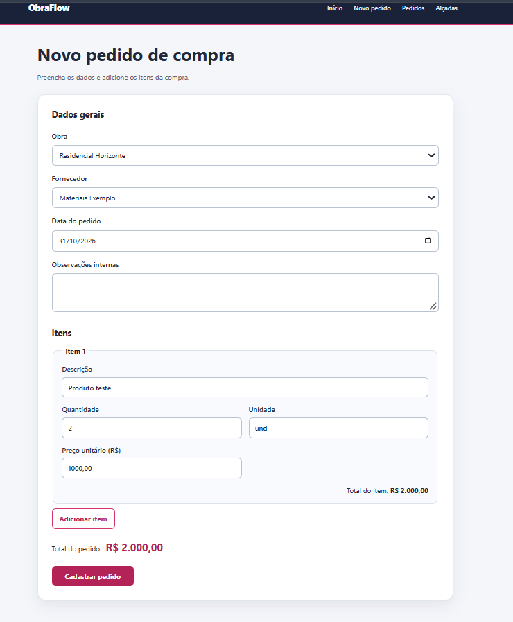
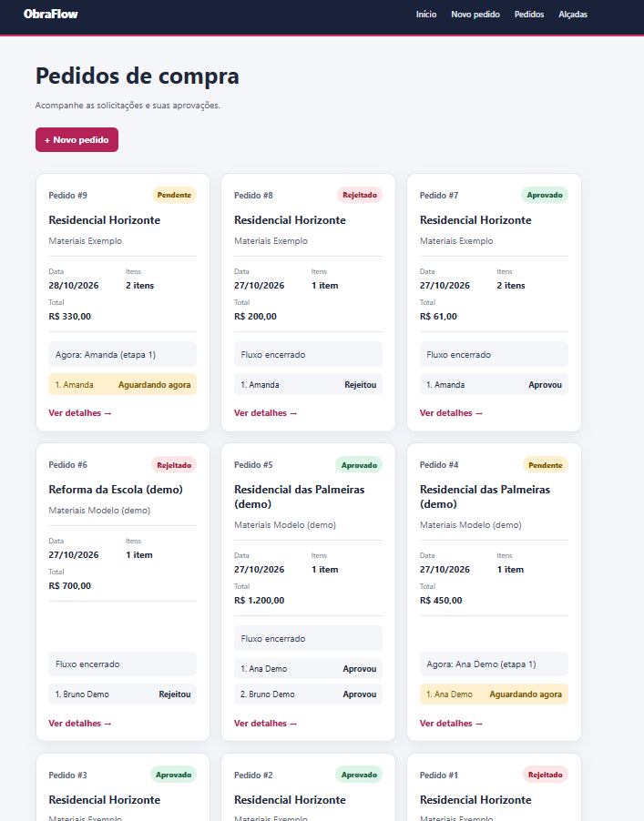
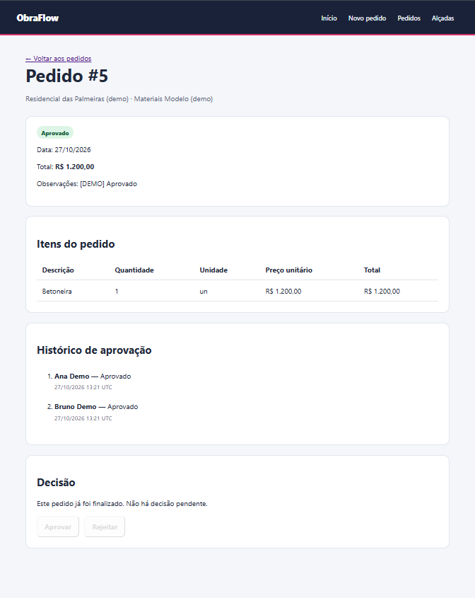
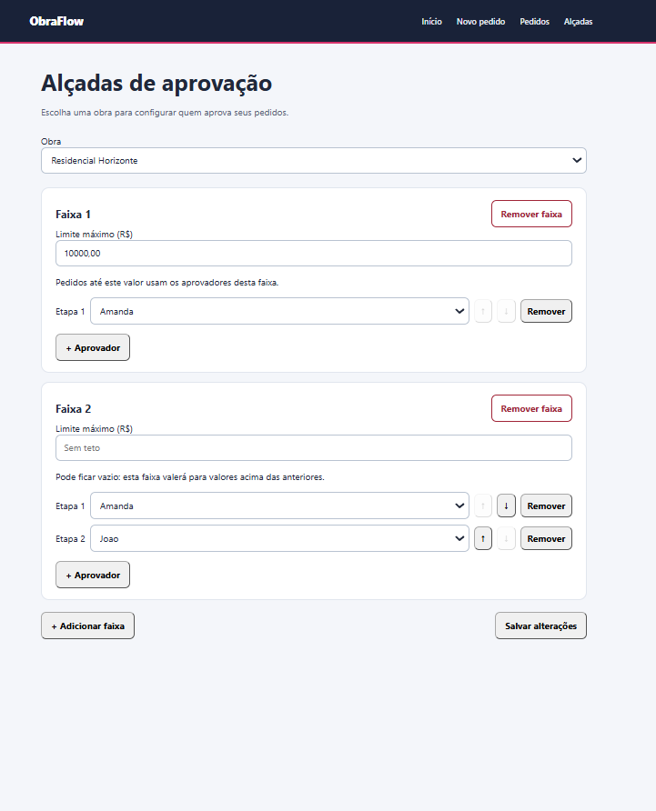

# ObraFlow — Pedidos de compra

Implementação do desafio técnico da ObraFlow.

A aplicação oferece três telas: cadastro de pedidos, acompanhamento das
aprovações e configuração das alçadas por obra. Uma API em FastAPI sustenta
essas telas e permite cadastrar fornecedores, obras e usuários. O backend
calcula os totais, escolhe a regra aplicável e registra cada decisão em
sequência, com persistência em SQLite e testes automatizados.

O enunciado original está em [DESAFIO.md](DESAFIO.md).

## Tecnologias

- Python 3.12+
- FastAPI e Uvicorn
- SQLAlchemy e SQLite
- Jinja2 para renderizar os templates HTML
- CSS e JavaScript sem framework para a interface
- pytest, HTTPX e Ruff

## Como executar

Pré-requisitos: Python 3.12 ou superior e uv instalado.

Na raiz do projeto, instale as dependências:

```bash
uv sync
```

Crie as tabelas e carregue os dados de demonstração:

```bash
uv run python -m scripts.seed_demo
```

O script cria duas obras, um fornecedor, dois usuários, regras de alçada e
pedidos pendente, aprovado e rejeitado. Uma segunda execução não duplica os
dados de demonstração. Para criar somente as tabelas, sem dados, use
`uv run python -c 'from app.database import engine; from app.models import Base; Base.metadata.create_all(engine)'`.

Inicie o servidor:

```bash
uv run uvicorn app.main:app --reload
```

- Página inicial: http://127.0.0.1:8000
- Novo pedido: http://127.0.0.1:8000/pedidos/novo
- Lista de pedidos: http://127.0.0.1:8000/pedidos
- Configuração de alçadas: http://127.0.0.1:8000/alcadas
- Documentação interativa da API: http://127.0.0.1:8000/docs

O banco é armazenado no arquivo local `obraflow.db`.
A configuração pode ser alterada pela variável `DATABASE_URL`,
conforme o arquivo `.env.example`.

## Fluxo pela interface

Na tela **Novo pedido**, selecione obra e fornecedor, informe a data e adicione
um ou mais itens. O total é mostrado enquanto os valores são preenchidos e
recalculado pelo servidor ao cadastrar. Quantidade aceita até três casas
decimais; preço unitário, até duas.

Em **Pedidos**, cada cartão mostra o estado e a cadeia de aprovadores. Abra um
pedido pendente para aprovar a etapa atual ou rejeitá-la com um motivo. A tela
de detalhes também mostra os itens e o histórico de decisões. Em **Alçadas**,
selecione uma obra para criar, alterar ou remover faixas de valor e definir os
aprovadores na ordem desejada.

## Capturas de tela

| Novo pedido | Pedidos |
|---|---|
|  |  |

| Detalhes do pedido | Alçadas de aprovação |
|---|---|
|  |  |

## API disponível

| Método | Rota | Operação |
|---|---|---|
| POST | `/api/fornecedores` | Cadastrar fornecedor |
| GET | `/api/fornecedores` | Listar fornecedores |
| POST | `/api/obras` | Cadastrar obra |
| GET | `/api/obras` | Listar obras |
| POST | `/api/usuarios` | Cadastrar usuário |
| GET | `/api/usuarios` | Listar usuários |
| GET | `/api/obras/{id_obra}/alcadas` | Consultar faixas e aprovadores da obra |
| PUT | `/api/obras/{id_obra}/alcadas` | Substituir a configuração de alçadas da obra |
| POST | `/api/pedidos` | Criar pedido com itens e calcular o total |
| GET | `/api/pedidos` | Listar pedidos, quantidade de itens e etapas de aprovação |
| GET | `/api/pedidos/{id_pedido}` | Consultar itens e histórico de aprovação |
| POST | `/api/pedidos/{id_pedido}/decisoes` | Aprovar ou rejeitar a etapa atual |

Exemplo de corpo para cadastro de fornecedor:

```json
{
  "nome_fornecedor": "Materiais Exemplo",
  "cnpj": "00000000000001",
  "rua": "Rua Principal, 100",
  "cidade": "Salvador"
}
```

O cadastro de fornecedor retorna 201 quando realizado, 422 para dados inválidos
e 409 quando o CNPJ já está cadastrado.

A validação do CNPJ verifica o formato de 14 dígitos,
sem calcular os dígitos verificadores.

Para cadastrar uma obra, envie `{"nome_obra": "Residencial Horizonte"}`
para `POST /api/obras`. O nome é obrigatório, tem até 200 caracteres
e espaços nas extremidades são removidos.

Para cadastrar um usuário, envie `{"nome_usuario": "Amanda"}`
para `POST /api/usuarios`. O nome é obrigatório e tem até 150 caracteres.

Para configurar as alçadas, envie um PUT para
`/api/obras/{id_obra}/alcadas` com os IDs dos usuários cadastrados:

```json
{
  "faixas": [
    {"limite_superior_centavos": 1000000, "aprovadores": [1]},
    {"limite_superior_centavos": null, "aprovadores": [1, 2]}
  ]
}
```

Nesse exemplo, pedidos até R$ 10.000,00 exigirão o usuário 1; acima desse
valor, o usuário 1 aprovará antes do usuário 2. O limite `null` indica a
última faixa, sem valor máximo. A ordem dos IDs define a ordem de aprovação.
O PUT substitui todas as faixas anteriores da obra em uma transação;
`{"faixas": []}` remove todas. O GET devolve a configuração salva.
Obra inexistente retorna 404; limites repetidos, fora de ordem ou
usuários inexistentes retornam 422.

Exemplo de criação de pedido:

```json
{
  "id_obra": 1,
  "id_fornecedor": 1,
  "data_pedido": "2026-10-27",
  "itens": [
    {
      "descricao": "Tinta",
      "quantidade": "1.5",
      "unidade": "l",
      "preco_unitario": "20.00"
    }
  ]
}
```

O backend calcula e salva o total em centavos, identifica a faixa aplicável
ao valor completo do pedido e copia seus aprovadores para as etapas do pedido.
Uma obra sem faixa aplicável impede a criação com resposta 422. O GET de
detalhes mostra itens, etapas, decisões e motivo de rejeição; a listagem
mostra toda a cadeia, incluindo o aprovador atual dos pedidos pendentes.

Para decidir uma etapa, envie, por exemplo,
`{"id_usuario": 1, "acao": "APROVAR"}` para
`POST /api/pedidos/{id_pedido}/decisoes`. Para rejeitar, use
`"acao": "REJEITAR"` e informe `"motivo"`. O sistema exige que o ID
informado corresponda ao aprovador da etapa atual, impede decisões fora de
ordem e encerra o fluxo após rejeição ou aprovação da última etapa.
Nesta versão de demonstração, o ID é informado pelo cliente; não há
autenticação de usuários.

## Testes

```bash
uv run pytest
```

Os testes utilizam um banco temporário separado para cada cenário.

Para verificar o código e sua formatação:

```bash
uv run ruff check app tests scripts
uv run ruff format --check app tests scripts
```

## Decisões técnicas

- SQLite simplifica a execução local, dispensando um servidor de banco.
- Rotas, serviços e repositórios separam a comunicação HTTP,
  as regras de negócio e o acesso aos dados.
- Jinja2 renderiza as páginas e um cabeçalho compartilhado no servidor;
  JavaScript usa `fetch` para consultar e enviar JSON à API sem recarregar
  as telas de cadastro, listagem e configuração.
- A validação dos dados ocorre nos schemas; o banco também impõe
  restrições de formato e unicidade do CNPJ.
- Faixas de alçada pertencem a uma obra e têm limites crescentes em centavos.
  Os aprovadores são vinculados por ID e sua posição define a ordem.
- A configuração completa é substituída em uma transação SQLite iniciada
  antes das leituras de validação, evitando alterações parciais ou misturadas.
- Valores são calculados com `Decimal` e salvos em centavos. A criação do
  pedido salva cabeçalho, itens e etapas na mesma transação.
- Os aprovadores são copiados para o pedido no momento da criação; editar a
  alçada da obra não altera a sequência dos pedidos já existentes.
- Cada decisão atualiza a etapa e o pedido na mesma transação. O próximo
  aprovador só pode decidir após a aprovação da etapa anterior.
- A criação inicial das tabelas usa `create_all`, que não substitui
  migrations para alterações futuras de estrutura.

## O que mudaria em produção

- Telas para cadastrar e gerenciar obras, fornecedores e usuários, que hoje
  são cadastrados pela API.
- Busca, filtros e paginação na lista de pedidos, além de melhorias de
  acessibilidade e mensagens mais claras nos formulários.
- O usuário autenticado definiria quem está decidindo. A escolha de um ID na
  tela serve apenas para demonstrar o fluxo e não comprova a identidade.
- Migrações versionadas substituiriam `create_all` para evoluir o esquema.
- Um banco com suporte a múltiplos processos, como PostgreSQL, substituiria
  o arquivo SQLite se houvesse uso simultâneo em produção.

## Reaproveitamento

A estrutura inicial de FastAPI e SQLAlchemy e o cadastro de fornecedores foram
adaptados da branch `feat/api-fastapi` do projeto
[licitacoes-db-lab](https://github.com/Iagooreis/licitacoes-db-lab). As regras
de alçada, os pedidos, o fluxo de aprovação e as telas foram desenvolvidos
para este desafio.
