# ObraFlow — aprovações por alçada

Pedidos de compra que percorrem uma **cadeia de aprovadores definida pela alçada da obra**: faixas
de valor, cada uma com os seus aprovadores em ordem. O total do pedido escolhe a faixa; a faixa
escolhe quem assina e em que sequência; e só o aprovador da vez decide.

Resposta ao [enunciado do case](https://github.com/ObraFlow/obraflow-case/blob/main/README.md).

| | |
|---|---|
| **Stack** | Next.js 16 (App Router) · React 19 · TypeScript · Prisma 7 · SQLite · Tailwind v4 · Vitest |
| **Como roda** | `npm install && npx prisma migrate dev && npm run seed && npm run dev` |
| **Telas** | 1 · Cadastro de pedido · 2 · Aprovação · 3 · Regras da alçada · e o painel da administração (`/admin`) |
| **Dados de demonstração** | 3 obras, 6 usuários, 4 fornecedores, 3 faixas e **8 pedidos**, um em cada ponto do ciclo |
| **Entrada** | sem senha, atrás da flag `DEMO_MODE` — troca de usuário em um clique |
| **Documentação completa** | <https://carolbalbs.github.io/obraflow-case/> — o mesmo conteúdo deste README, em páginas, com os diagramas |

---

## Sumário

- [As três telas](#as-três-telas)
- [Como rodar](#como-rodar)
- [Quem entrar como](#quem-entrar-como)
- [O que o seed cria](#o-que-o-seed-cria)
- [Roteiro de avaliação em 5 minutos](#roteiro-de-avaliação-em-5-minutos)
- [Verificação por `curl`](#verificação-por-curl)
- [Decisões técnicas](#decisões-técnicas)
  - [Tecnologias, e por que cada uma](#tecnologias-e-por-que-cada-uma)
  - [Como a alçada é modelada, calculada e persistida](#como-a-alçada-é-modelada-calculada-e-persistida)
  - [Como o front-end conversa com o back-end](#como-o-front-end-conversa-com-o-back-end)
  - [Consistência, integridade e concorrência](#consistência-integridade-e-concorrência)
  - [O que cada papel vê e pode fazer](#o-que-cada-papel-vê-e-pode-fazer)
  - [Estados, validações e responsividade](#estados-validações-e-responsividade)
  - [Divergências deliberadas do mockup](#divergências-deliberadas-do-mockup)
  - [O que mudaria em produção](#o-que-mudaria-em-produção)
  - [Diagramas](#diagramas)
- [Testes e verificações](#testes-e-verificações)
- [Onde está cada coisa](#onde-está-cada-coisa)

---

## As três telas

Todas as capturas abaixo saem do estado do seed, sem nenhum cadastro manual. Para recapturá-las
depois de mexer em tela: `node scripts/capturar-telas.mjs docs/screenshots` com o servidor no ar.

### 1 · Cadastro de pedido

O rascunho `#1001`, retomado. Obra, fornecedor e **data do pedido** são obrigatórios, como o
enunciado pede. O total de cada item é calculado (`quantidade × preço unitário`) e o total do
pedido é a soma — nenhum dos dois é digitável, e nenhum dos dois é lido do corpo da requisição.

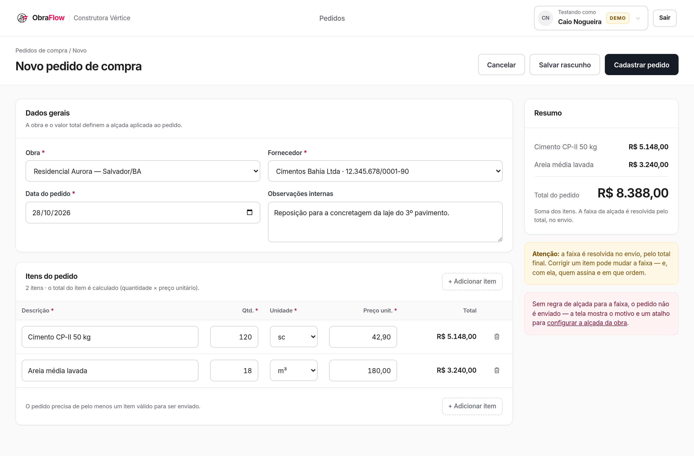

Vazio, com um item em branco e o botão de envio bloqueado enquanto falta dado:

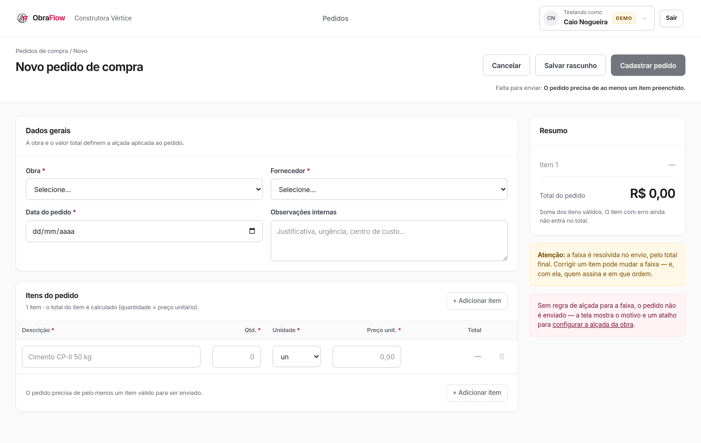

### 2 · Aprovação

As nove informações que o enunciado pede, por pedido: identificador, obra, fornecedor, data,
quantidade de itens, total, situação, **alçada atual** (etapas concluídas, etapa da vez e as
seguintes) e ações.

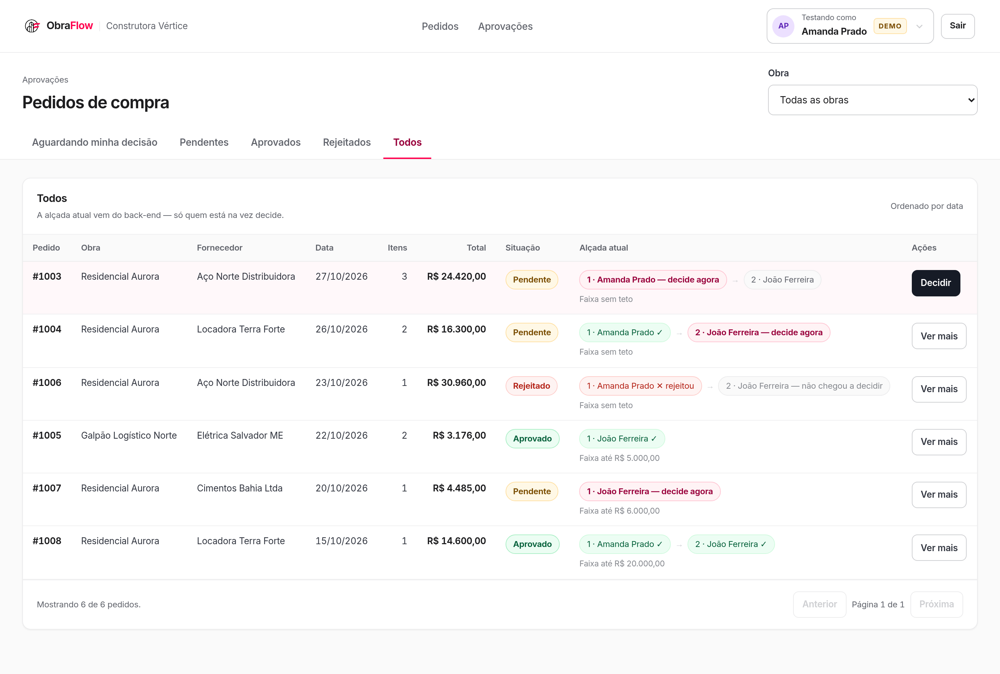

A mesma tela, aberta por quem decide, já **filtrada em "aguardando minha decisão"** — o filtro é
removível, e o aviso diz que ele está ligado. É esta lista que muda quando se troca de usuário:

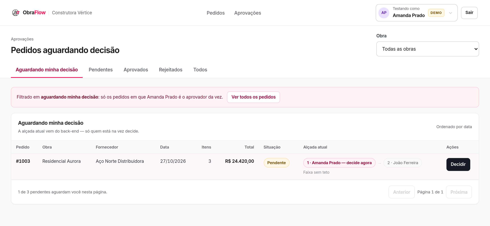

O detalhe, com os itens, a regra aplicada, a cadeia e o histórico auditável:

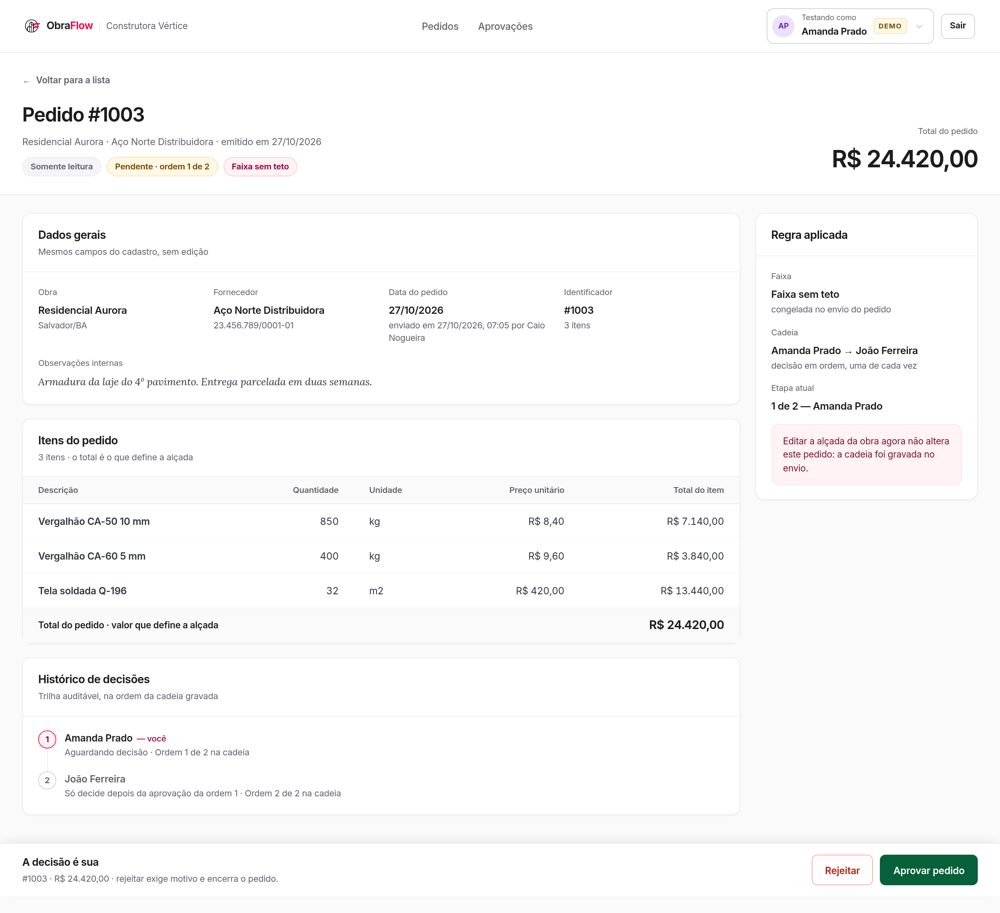

### 3 · Regras da alçada

Seletor de obra, faixas com os aprovadores na ordem do fluxo, criar, editar, reordenar e remover.
O intervalo inferior (`R$ 0,01 — R$ 10.000,00`) é **derivado** da faixa anterior, nunca
armazenado.

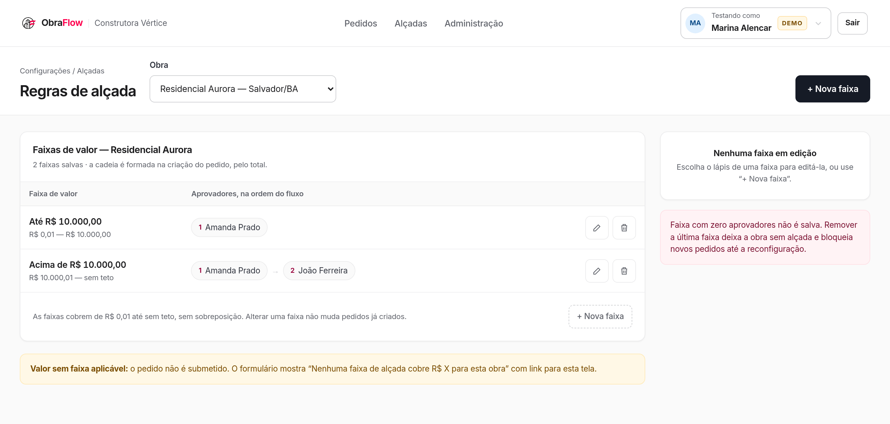

### Administração · painel do admin

Fora das três telas do enunciado, só para o papel `admin`, no item "Administração" do menu.
Responde onde a cadeia de aprovação trava: cinco KPIs do período (7, 30 ou 90 dias, comparados
com o período anterior de mesmo tamanho), valor aprovado por semana e por obra, corte por faixa
(pelo **snapshot** de cada pedido, não pela alçada de hoje), tempo de decisão por aprovador, a fila
de pedidos parados há mais de 24 h e a contagem de pedidos por situação. O filtro de obra recorta
tudo. Os números saem de `src/domain/painel.ts`, que tem 18 casos de teste.

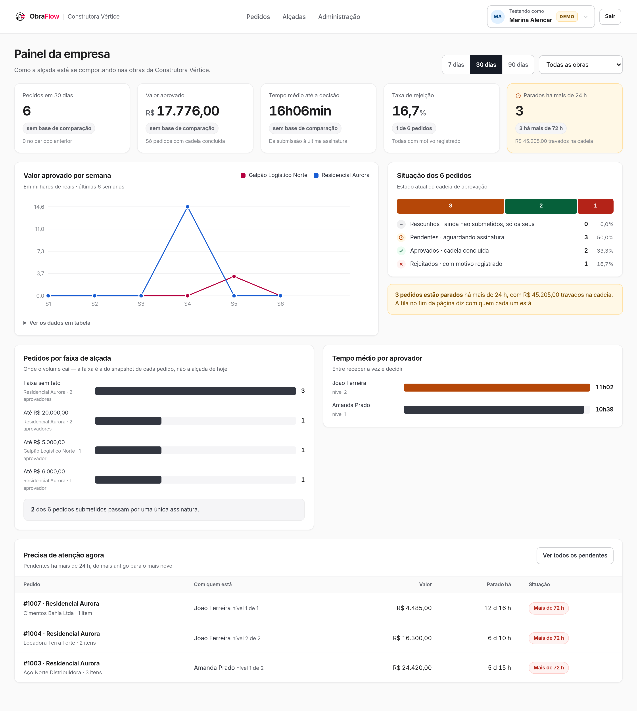

### Empresa · cadastro de obras e fornecedores

Também só para o `admin`, no item "Empresa" do menu (artboard `Empresa`). Duas abas: **Obras**,
com a cidade, quantas faixas a alçada tem e quantos pedidos submetidos — a obra sem faixa aparece
marcada, com o atalho para criar a primeira — e **Fornecedores**, com CNPJ e pedidos submetidos.
"+ Nova obra" e "+ Novo fornecedor" abrem o cadastro, validado pelo mesmo schema da rota; o que é
cadastrado aparece na hora no seletor do cadastro de pedido. Uma obra nova ainda não tem alçada:
o pedido dela é bloqueado na submissão até a primeira faixa existir.

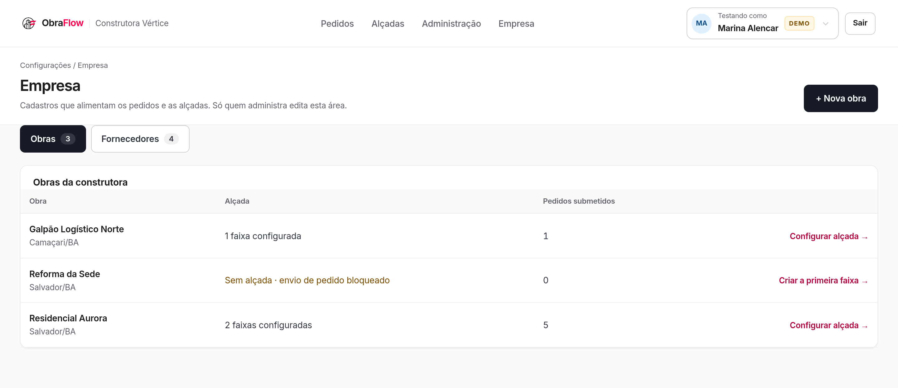

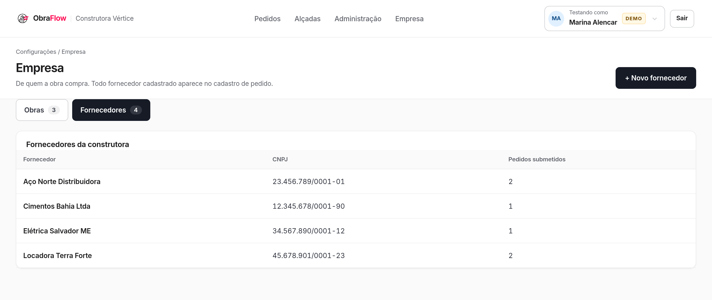

### A prova visual do snapshot

O pedido `#1007` foi submetido quando a faixa da obra era **"até R$ 6.000,00 → João Ferreira"**.
Depois disso a faixa foi editada e hoje é **"até R$ 10.000,00 → Amanda Prado"** (veja a tela 3
acima). O pedido continua exibindo a regra sob a qual foi submetido, e quem decide continua sendo
João. Editar a alçada **não reescreve** pedido em andamento:

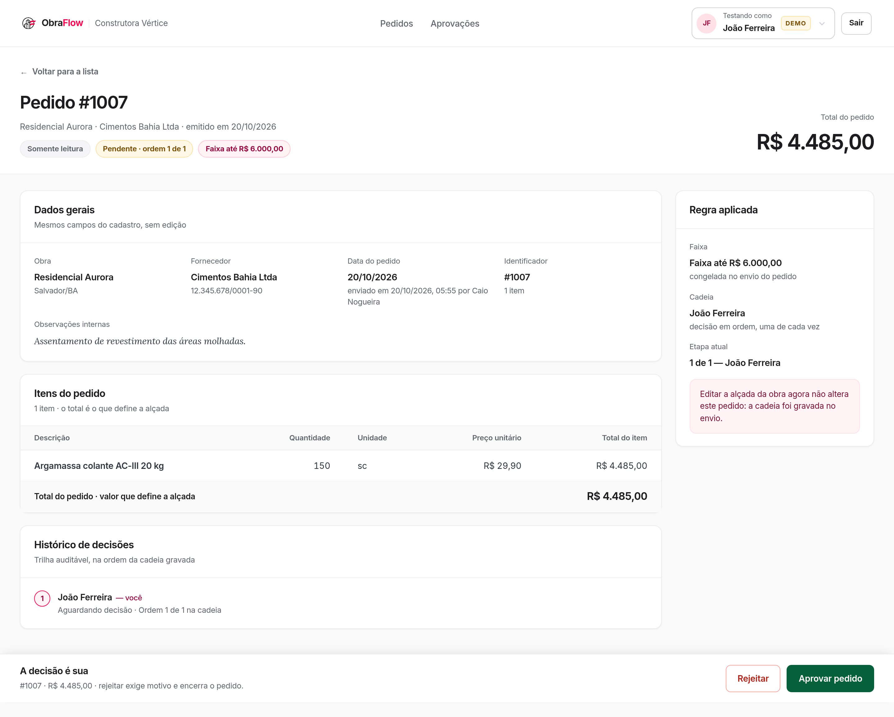

### Entrada e tela estreita

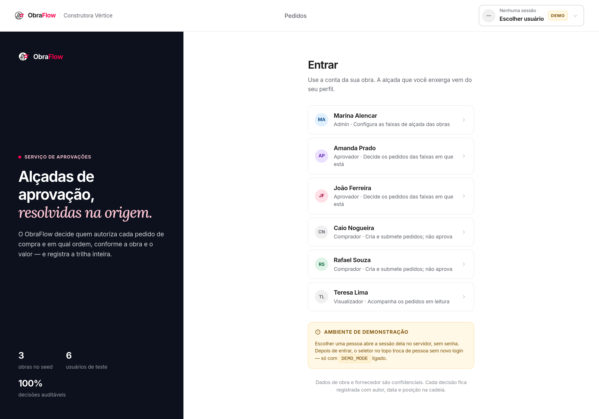

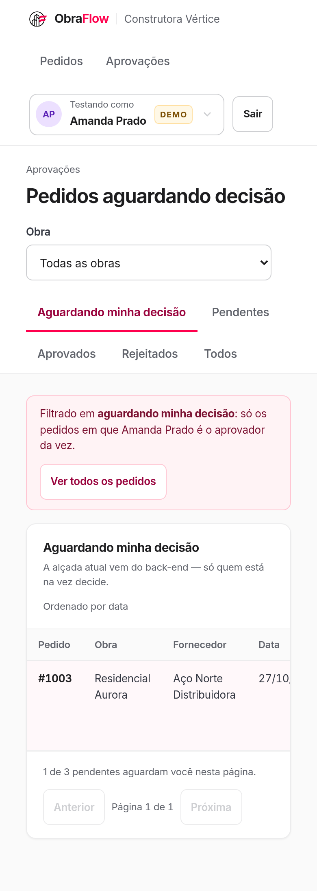

---

## Como rodar

Pré-requisitos: **Node.js 20 ou mais novo** e `npm`. Nada além disso — o banco é um arquivo SQLite
criado localmente, e não há serviço externo, credencial ou container.

```bash
git clone -b resolucao-obraflow https://github.com/Carolbalbs/obraflow-case.git
cd obraflow-case
npm install
cp .env.example .env          # DATABASE_URL e DEMO_MODE
npx prisma migrate dev        # cria dev.db e aplica as migrations
npm run seed                  # popula a demonstração inteira
npm run dev                   # http://localhost:3000
```

Abra <http://localhost:3000>. Sem sessão, a aplicação leva para `/entrar`, onde se escolhe quem
entrar como — **sem senha**, porque a autenticação está declarada fora de escopo
([ADR 0005](adr/0005-sessao-de-demonstracao-sem-senha.md)). Daí em diante, o seletor no canto
superior direito troca de usuário sem sair da tela.

### Os comandos

| Comando | O que faz |
|---|---|
| `npm run dev` | Servidor de desenvolvimento em <http://localhost:3000> |
| `npm run seed` | Repopula a demonstração. Apaga o que havia e reescreve o mesmo estado |
| `npm run db:reset` | `prisma migrate reset --force` — recria o banco do zero e roda o seed |
| `npm run build` / `npm start` | Build e execução em modo produção |
| `npm test` | Suíte Vitest (58 casos) |
| `npm run lint` / `npx tsc --noEmit` | Lint e verificação de tipos |
| `./scripts/verificar.sh` | Prova por `curl` das recusas 403, 409 e 422 |

### O `.env`

```ini
DATABASE_URL="file:./dev.db"
DEMO_MODE="true"
```

`DEMO_MODE` liga a entrada sem senha e a troca de usuário. **Desligada, as rotas de sessão
respondem 404** — não 403, para que um servidor sem a flag não anuncie que existe uma porta sem
senha. É a única coisa que separa esta demonstração de um sistema que exigiria login de verdade.

---

## Quem entrar como

Os seis usuários do seed cobrem os quatro papéis. Os ids são literais e aparecem em
`prisma/seed.ts`, no `scripts/verificar.sh` e nas URLs — não são gerados.

| Nome | Papel | Para que serve na avaliação |
|---|---|---|
| **Marina Alencar** | `admin` | Configura a alçada. É a única que abre a tela 3 |
| **Amanda Prado** | `aprovador` | 1ª etapa da cadeia da obra Residencial Aurora |
| **João Ferreira** | `aprovador` | 2ª etapa da mesma cadeia, e único aprovador do Galpão |
| **Caio Nogueira** | `comprador` | Criou 7 dos 8 pedidos. Cria e submete |
| **Rafael Souza** | `comprador` | Dono do rascunho `#1002` — existe para mostrar que rascunho alheio não aparece |
| **Teresa Lima** | `visualizador` | Lê tudo que foi submetido e não pode decidir nem criar |

---

## O que o seed cria

Um comando (`npm run seed`) e a demonstração inteira está de pé: **nada precisa ser cadastrado à
mão**. Todos os ids e **todas as datas são literais**, de modo que `npm run db:reset` seguido de
`npm run seed` reproduz exatamente o mesmo estado — as capturas acima não envelhecem.

**3 obras · 6 usuários · 4 fornecedores · 3 faixas em 2 obras · 8 pedidos.**

### A alçada

| Obra | Faixas |
|---|---|
| **Residencial Aurora** | Até R$ 10.000,00 → Amanda · **Acima de R$ 10.000,00** (faixa aberta) → Amanda → João |
| **Galpão Logístico Norte** | Até R$ 5.000,00 → João — e **nada acima disso** |
| **Reforma da Sede** | Nenhuma faixa |

As duas últimas linhas não são descuido. O Galpão **não tem faixa aberta**: um pedido acima de
R$ 5.000,00 nessa obra não encontra regra, e é assim que o estado `SEM_REGRA_APLICAVEL` fica
alcançável sem preparar nada. A Reforma da Sede é a outra ponta: obra sem alçada nenhuma, que é o
estado vazio da tela 3.

### Os oito pedidos

| # | Total | Situação | O que ele demonstra |
|---|---|---|---|
| **1001** | R$ 8.388,00 | rascunho | Rascunho completo de Caio, pronto para submeter. 2 itens |
| **1002** | R$ 0,00 | rascunho | Rascunho **incompleto** de Rafael, sem fornecedor e sem preço. Caio pede `/api/pedidos/1002` e recebe **404**: rascunho é privado de quem o criou |
| **1003** | R$ 24.420,00 | pendente | Pendente na **1ª etapa**: está na fila de Amanda. João decidindo antes recebe **409** |
| **1004** | R$ 16.300,00 | pendente | Pendente na **2ª etapa**, com a 1ª já aprovada: está na fila de João |
| **1005** | R$ 3.176,00 | aprovado | Aprovado por inteiro, no Galpão, sob a faixa até R$ 5.000,00 |
| **1006** | R$ 30.960,00 | rejeitado | Rejeitado na 1ª etapa **com motivo** no histórico. A 2ª etapa nunca se torna decidível |
| **1007** | R$ 4.485,00 | pendente | **Faixa editada depois da submissão.** A cadeia gravada (João) difere da faixa atual da obra (Amanda) |
| **1008** | R$ 14.600,00 | aprovado | **Faixa apagada depois da submissão.** `faixaId` é nulo e `faixaLimiteCentavos` continua R$ 20.000,00 |

Os dois últimos são a razão de o seed escrever o estado diretamente em vez de encená-lo pelas
rotas: nenhuma sequência de chamadas produz "faixa editada **depois** de um pedido já ter sido
submetido sob ela" sem um segundo passo manual. O que importa demonstrar é o estado — e ele é
exatamente o que o [ADR 0001](adr/0001-cadeia-de-aprovacao-e-snapshot.md) promete.

### Filas diferentes, sem editar nada

| Entrando como | `/pedidos` mostra, em "aguardando minha decisão" |
|---|---|
| **Amanda Prado** | `#1003` |
| **João Ferreira** | `#1004` e `#1007` |

É o mesmo endereço, e a lista muda porque a **vez** é calculada no servidor a partir das etapas
gravadas — não por um filtro da tela.

---

## Roteiro de avaliação em 5 minutos

1. **Entre como Amanda.** `/pedidos` abre filtrada em "aguardando minha decisão", com `#1003`.
2. **Troque para João** pelo seletor do cabeçalho. A mesma URL passa a mostrar `#1004` e `#1007`.
3. **Abra `#1003` como João** e repare que não há ação de decidir: a vez é de Amanda. Pela API, o
   mesmo pedido responde `409 NAO_E_SUA_VEZ`.
4. **Abra `#1007`.** A regra aplicada diz "até R$ 6.000,00 · congelada no envio".
5. **Troque para Marina** e abra `/alcadas` → Residencial Aurora. A faixa de mesmo id hoje é "até
   R$ 10.000,00 → Amanda". O `#1007` não mudou. Ainda como Marina, **Administração** (`/admin`)
   mostra o painel: os três pendentes do seed aparecem na fila de parados há mais de 24 h.
6. **Troque para Caio** e abra `/pedidos/novo`. Monte um pedido do **Galpão** acima de R$ 5.000,00
   e tente enviar: a submissão é bloqueada com "sem regra aplicável", e o rascunho continua lá.
7. **Rode `./scripts/verificar.sh`** para ver as mesmas recusas em `curl`, com os códigos HTTP.

---

## Verificação por `curl`

```bash
npm run dev          # num terminal
npm run seed         # devolve o banco ao estado da demonstração
./scripts/verificar.sh
```

O script prova as quatro recusas que sustentam o produto, imprime o status HTTP e o código de erro
de cada chamada, e **sai com 0 somente quando todos os status esperados ocorreram**. Se o servidor
não estiver no ar, ou se o banco não estiver semeado, ele falha cedo dizendo qual comando rodar.

| Bloco | O que prova | Esperado |
|---|---|---|
| 1 | Decisão **fora de ordem**: João tentando decidir antes de Amanda | `409 NAO_E_SUA_VEZ` |
| 2 | **Papel imposto no servidor**: aprovador em `PUT /api/faixas/{id}` | `403 SEM_PERMISSAO` — e `200` para o admin |
| 3 | **Sem regra aplicável**: submissão acima do teto da obra | `422 SEM_REGRA_APLICAVEL`, rascunho preservado |
| 4 | **Corrida**: dois `POST` paralelos na mesma etapa | exatamente um `200` e um `409`, e **uma** etapa decidida no banco |

O bloco 4 cria o próprio pedido, para o script ser repetível. Ele é o único que deixa rastro —
pedido submetido é imutável e não tem como ser apagado. `npm run seed` devolve o banco ao estado
da demonstração.

---

## Decisões técnicas

### Tecnologias, e por que cada uma

| Camada | Escolha | Por quê |
|---|---|---|
| Front + back | **Next.js 16, App Router** | Um único projeto, um único `npm run dev`, sem orquestrar dois servidores. O enunciado pede execução local simples, e duas aplicações separadas custariam um `docker compose` que ele dispensa |
| Linguagem | **TypeScript**, `strict` | O domínio é feito de tipos estreitos (`Centavos`, `Milesimos`, `Ordem`). Trocar centavos por reais numa chamada é erro de compilação, não bug de produção |
| Mutações | **Route Handlers**, sem Server Actions | Porque o contrato precisa ser inspecionável por `curl` — é o que torna o `scripts/verificar.sh` possível ([ADR 0003](adr/0003-route-handlers-sem-server-actions.md)) |
| Persistência | **SQLite + Prisma 7.10.1** (pinado) | Roda local sem serviço externo; o schema é um arquivo legível; e o cliente tipado fecha o ciclo com o TypeScript. A versão é pinada sem `^` porque o Prisma 7 mudou a configuração, e um minor automático quebraria a instalação de quem clonar |
| Estilo | **Tailwind v4**, com tokens de marca | Os tokens saem de `site/assets/css/obraflow.css`, o tema do próprio ObraFlow. Nenhum hexadecimal cru na tela: a cor sempre tem nome |
| Testes | **Vitest** sobre `src/domain/` | O domínio é puro — não importa `next/*`, não toca em banco. Isso o torna testável sem subir servidor, e é por isso que a regra de alçada mora lá e não dentro das rotas |
| Validação | **Zod 4** | Um único schema por contrato, rodado nas **duas** pontas: o formulário valida antes de enviar e a rota revalida ao receber. Mensagem e chave de campo saem do mesmo lugar |

O que **não** entrou, e por quê: sem autenticação com senha ou SSO, sem entidade `Empresa`, sem
tela de cadastro de usuário, sem anexo, sem notificação, sem edição de pedido
submetido, sem aprovação em paralelo. Cada ausência é deliberada.

### Como a alçada é modelada, calculada e persistida

**Modelada.** Uma `Faixa` guarda **apenas o limite superior**, e ele é **inclusivo**:

```prisma
model Faixa {
  id             String @id
  obraId         String
  limiteCentavos Int?              // nulo = faixa aberta, sem teto
  aprovadores    FaixaAprovador[]  // @@unique([faixaId, ordem])
}
```

Não há coluna de valor mínimo. O mínimo é **derivado**: é o limite da faixa anterior mais um
centavo, e a tela o mostra recalculado. A ausência é a invariante — sem um mínimo editável à
parte, **buraco e sobreposição entre faixas deixam de ser representáveis**. Não existe estado
inválido a validar, porque não existe forma de escrevê-lo
([ADR 0002](adr/0002-faixa-por-limite-superior.md)).

A ordem dos aprovadores é coluna, com índice único `(faixaId, ordem)`: duas pessoas na mesma
posição são impossíveis no banco, não só improváveis no código.

**Calculada.** A faixa aplicável sai do **total do pedido**, nunca do valor de um item isolado. A
regra inteira cabe em duas funções puras de `src/domain/`:

```ts
// src/domain/alcada.ts — o limite superior é inclusivo. Esta linha é a regra.
export function comporta(faixa: Faixa, total: Centavos): boolean {
  return faixa.limiteCentavos === null || total <= faixa.limiteCentavos
}
```

`resolverFaixa` ordena as faixas pelo limite (a aberta sempre por último) e devolve a primeira que
comporta o total — ou falha com `SEM_REGRA_APLICAVEL`, que é **estado tratado e não erro
genérico**: a submissão é bloqueada com mensagem própria e o rascunho continua existindo para ser
corrigido. `montarCadeia` então transforma os aprovadores da faixa em etapas numeradas.

**Persistida.** O instante em que isso acontece é a **submissão**, uma vez só, e o resultado é
gravado como **snapshot** ([ADR 0001](adr/0001-cadeia-de-aprovacao-e-snapshot.md)):

- as `Etapa` do pedido, com `(pedidoId, ordem)` único e o `usuarioId` de quem assina;
- três colunas no próprio pedido — `faixaId`, `faixaLimiteCentavos`, `faixaSemTeto`.

`faixaId` é `onDelete: SetNull`, e as outras duas são do pedido. **Apagar a faixa não reescreve o
histórico**: é o pedido `#1008` do seed, com `faixaId` nulo e o limite de R$ 20.000,00 ainda
visível. **Editar a faixa também não**: é o `#1007`, cuja cadeia gravada (João) difere da faixa
atual da obra (Amanda). Nenhuma leitura recalcula coisa alguma — `src/domain/cadeia.ts` sequer
recebe a alçada como parâmetro, para que recalcular não seja possível por distração.

O rascunho **não** tem cadeia, de propósito: o total ainda vai mudar, e resolver a faixa ali
gravaria uma decisão derivada de um número provisório.

### Como o front-end conversa com o back-end

`fetch` do navegador contra Route Handlers em `app/api/*`. JSON nos dois sentidos, cookie
`httpOnly` para a identidade, e **nenhuma Server Action**: toda escrita tem um endereço que
`curl` alcança.

O erro tem um envelope só, em toda rota, sem exceção:

```json
{ "error": { "code": "SEM_REGRA_APLICAVEL", "message": "…", "fields": { "itens.0.quantidade": "…" } } }
```

`code` vem de um enum do domínio e o número HTTP sai de um mapa único (`SITUACAO_HTTP`) — nenhuma
rota escolhe status de recusa por conta própria, então a mesma regra nunca responde 400 num lugar
e 422 noutro. `fields` é o que permite ao formulário **ancorar a mensagem no campo certo**, com as
mesmas chaves que o Zod produziu no cliente.

"Sessão" na tabela abaixo é qualquer um dos quatro papéis; sem sessão, toda rota responde
`403 SEM_PERMISSAO`. Obras e fornecedores são listados por qualquer sessão e cadastrados pelo
admin; usuários são só listados, porque vêm do seed.

| Método e rota | Quem pode | O que faz |
|---|---|---|
| `GET POST DELETE /api/sessao` | `DEMO_MODE` | Quem está dentro · entrar como · sair |
| `GET /api/usuarios` | `DEMO_MODE` | A lista da tela de entrada |
| `GET /api/alcada` | admin | Obras e a contagem de faixas de cada uma |
| `GET /api/obras` | sessão | Obras cadastradas — `id`, `nome`, `cidade`, por nome |
| `GET /api/fornecedores` | sessão | Fornecedores cadastrados — `id`, `nome`, `documento`, por nome |
| `GET /api/obras/{id}/faixas` | sessão | Faixas da obra, ordenadas, com os aprovadores na ordem |
| `POST /api/obras` | admin | Cadastra a obra — `{ nome, cidade }` → `201` |
| `POST /api/fornecedores` | admin | Cadastra o fornecedor — `{ nome, documento? }`, CNPJ com ou sem máscara, gravado mascarado → `201` |
| `POST /api/obras/{id}/faixas` | admin | Cria a faixa e os aprovadores numa transação (`201`) |
| `PUT /api/faixas/{id}` | admin | **Substitui a faixa inteira** — limite e lista ordenada |
| `DELETE /api/faixas/{id}` | admin | Remove, e devolve `pedidosAfetados` |
| `GET /api/pedidos` | sessão | Lista paginada, filtros `situacao`, `obraId`, `page`, `perPage` |
| `GET /api/pedidos/resumo` | admin | Contagem por situação (`porSituacao`), filtro `obraId` — o gráfico do painel |
| `GET /api/pedidos/painel` | admin | KPIs, série semanal, cortes por faixa e por aprovador e fila de atenção, de **uma** leitura; `dias=7\|30\|90` (padrão 30), `obraId` |
| `POST /api/pedidos` | comprador | Cria o rascunho (`201`) |
| `GET /api/pedidos/{id}` | sessão | Detalhe com itens, cadeia, histórico, `etapaAtual` e `podeDecidir` |
| `PUT DELETE /api/pedidos/{id}` | criador | Substitui ou apaga o **rascunho** |
| `POST /api/pedidos/{id}/submissao` | comprador | Exige a data do pedido, resolve a faixa, grava a cadeia, carimba `submetidoEm` |
| `POST /api/pedidos/{id}/decisoes` | aprovador | `{"tipo":"aprovar"}` ou `{"tipo":"rejeitar","motivo":"…"}` |

Exemplo completo, do rascunho à decisão:

```bash
C="Cookie: obraflow_sessao=cseedusuariocaio00004"   # Caio, comprador
J="Cookie: obraflow_sessao=cseedusuariojoao00003"   # João, aprovador

# 1. Cria o rascunho. `totalCentavos` não é enviado: o servidor o calcula.
curl -s -X POST localhost:3000/api/pedidos -H "$C" -H 'Content-Type: application/json' -d '{
  "obraId": "cseedobragalpao000002",
  "fornecedorId": "cseedfornecedoreletrica3",
  "dataPedido": "2026-10-31",
  "observacoes": "Quadro de distribuição do mezanino.",
  "itens": [{ "descricao": "Disjuntor bipolar 40 A", "quantidade": "16", "unidade": "un", "precoUnitario": "78,50" }]
}'

# 2. Submete. A rota NÃO lê corpo: ela valida o rascunho que está no banco.
curl -s -X POST localhost:3000/api/pedidos/1009/submissao -H "$C"

# 3. Decide, como o aprovador da vez.
curl -s -X POST localhost:3000/api/pedidos/1009/decisoes -H "$J" \
  -H 'Content-Type: application/json' -d '{"tipo":"aprovar"}'
```

Dois detalhes que valem o comentário. **Número no corpo é centavos; texto é entrada de
formulário** — `"precoUnitario": 7850` e `"precoUnitario": "78,50"` são o mesmo valor, e a
conversão de texto passa pelo parser do domínio, nunca por `z.coerce`. E **o pedido tem duas
datas, com dois donos**: `dataPedido` é a data de emissão que quem compra declara
(`"AAAA-MM-DD"`, obrigatória na submissão, gravada pelo rascunho); `submetidoEm` é o horário do
servidor no instante da submissão — o registro auditável de quando o pedido entrou no fluxo, que
ninguém escolhe. A submissão não lê corpo: valida o rascunho gravado e não toca na `dataPedido`.
Sem data, ela responde `422` com `fields.dataPedido`. Nenhuma regra de data futura ou retroativa
— o enunciado não pede.

### Consistência, integridade e concorrência

**Dinheiro nunca passa por ponto flutuante.** Centavos (`Int`) e quantidades em milésimos (`Int`),
do schema ao JSON. Nenhuma coluna é `Float` ou `Decimal`. Não é preciosismo: um pedido de
R$ 10.000,00 que vira R$ 9.999,99 **cai em outra faixa e é assinado por outra pessoa**. O
arredondamento acontece uma vez só, sobre o produto inteiro — arredondar antes faria a soma dos
itens divergir do total que o aprovador lê.

**O total é sempre do servidor.** Nenhuma rota lê `totalCentavos` do corpo. Ele é recalculado a
cada escrita, a partir dos itens. Um `curl` enviando um total divergente é simplesmente ignorado.

**Integridade pelo banco, não por boa vontade do código.** `@@unique([faixaId, ordem])`,
`@@unique([pedidoId, ordem])` nos itens e nas etapas, `onDelete: Restrict` onde apagar destruiria
história, `onDelete: Cascade` onde os filhos não fazem sentido sozinhos, `onDelete: SetNull` só
onde a ausência é um estado legítimo — que é o caso da faixa apagada.

**Transações onde o meio do caminho não é um estado observável.** Criar faixa com seus
aprovadores, substituir um pedido inteiro, submeter, decidir: tudo ou nada. A alçada é relida
**dentro** da transação da submissão, porque a faixa pode ter sido apagada entre a leitura e a
escrita — se sumiu, o plano falha e nada foi gravado.

**Concorrência: a decisão é um `UPDATE` condicional**
([ADR 0004](adr/0004-decisao-por-update-condicional.md)). Não há leitura seguida de escrita
confiando no que leu. O `where` **é** o contrato:

```ts
{
  pedidoId, ordem, usuarioId,          // é esta etapa, e é desta pessoa
  situacao: 'pendente',                // ainda não foi decidida — duplo clique, corrida
  pedido: {
    situacao: 'pendente',              // o pedido não terminou no meio-tempo
    etapas: { none: { ordem: { lt: ordem }, situacao: 'pendente' } },  // nenhuma anterior ficou para trás
  },
}
```

Zero linhas afetadas é a premissa caída, e vira `409` — não um erro a investigar. Isso faz com que
**decisão fora de ordem, duplo clique e corrida sejam o mesmo mecanismo**, e não três checagens
que podem divergir. O bloco 4 do `scripts/verificar.sh` dispara dois `POST` em paralelo e mostra
um `200`, um `409` e **uma única** etapa decidida no banco.

A submissão usa o mesmo recurso, condicionada a `situacao: 'rascunho'`: dois envios simultâneos do
mesmo pedido produzem uma submissão e um `409 PEDIDO_IMUTAVEL`.

**Privacidade do rascunho é cláusula de consulta, não filtro de tela.** O `where` de
`GET /api/pedidos` tem duas famílias — o submetido, que qualquer sessão vê, e o rascunho, que só o
criador vê. Pedir `?situacao=rascunho` como outra pessoa devolve **os rascunhos dela**, nunca os
alheios. É o que torna a regra impossível de esquecer numa tela nova.

**Identidade vem do cookie, e o papel vem do banco.** O cookie carrega só o id; forjá-lo com outro
id faz o servidor responder como *aquele* usuário, com o papel *dele* — e nunca concede poder a
mais. Nenhum cabeçalho declarado pelo cliente participa da decisão.

### O que cada papel vê e pode fazer

A matriz vive em `src/server/permissao.ts` e é imposta **no servidor**. O menu esconde o que o
papel não usa, mas esconder não é proteger: quem digitar a URL ou chamar a rota por `curl` recebe
`403 SEM_PERMISSAO` — é o bloco 2 do script de verificação.

| | **admin** (Marina) | **aprovador** (Amanda, João) | **comprador** (Caio, Rafael) | **visualizador** (Teresa) |
|---|:---:|:---:|:---:|:---:|
| Ver pedidos submetidos | ✅ | ✅ | ✅ | ✅ |
| Ver os **próprios** rascunhos | — | — | ✅ | — |
| Ver rascunho de outra pessoa | ❌ | ❌ | ❌ | ❌ |
| Criar e editar pedido | ❌ | ❌ | ✅ | ❌ |
| Submeter pedido | ❌ | ❌ | ✅ | ❌ |
| Aprovar ou rejeitar | ❌ | ✅ **na sua vez** | ❌ | ❌ |
| Configurar a alçada (tela 3) | ✅ | ❌ | ❌ | ❌ |
| Painel da administração (`/admin`) | ✅ | ❌ | ❌ | ❌ |
| Cadastrar obra e fornecedor (`/empresa`) | ✅ | ❌ | ❌ | ❌ |
| Item "Aprovações" no menu | — | ✅ | — | — |
| Item "Alçadas" no menu | ✅ | — | — | — |
| Item "Administração" no menu | ✅ | — | — | — |
| Item "Empresa" no menu | ✅ | — | — | — |

Duas leituras importam aqui. **"Na sua vez" é a única linha condicional**: ser aprovador não basta,
é preciso ser o aprovador da etapa pendente mais antiga. E **o admin não aprova nem cria** — quem
escreve a regra não a executa, que é o único resquício de segregação de função neste recorte.
Segregação entre quem pede e quem aprova está declarada fora de escopo: **o criador pode aprovar
o próprio pedido** se a alçada o colocar na cadeia.

### Estados, validações e responsividade

Toda lista nasce com os três estados vindos de um lugar só — `<Recurso>`, em
`src/ui/componentes/estados.tsx` —, que escolhe entre esqueleto, erro **com botão de repetir**,
vazio e conteúdo pela forma do hook. A ordem (esqueleto antes de tudo) é propriedade do
componente, não cuidado de cada tela.

| Situação do enunciado | O que acontece |
|---|---|
| Quantidade ou preço inválido | Erro **no item correspondente**, ancorado pelo nome do campo; nada é enviado. Quantidade precisa ser maior que zero; preço, não negativo — zero é aceito |
| Pedido sem itens | "O pedido precisa de pelo menos um item válido"; envio bloqueado |
| Obra, fornecedor, data do pedido ou descrição vazios | Erro no campo; o botão de envio diz o que falta |
| Nenhuma obra cadastrada | Estado vazio explicando que falta rodar `npm run seed` |
| API fora do ar / 500 | Caixa de erro com "Tentar novamente", que refaz **só** a leitura, sem recarregar a página |
| Rejeitar sem motivo | Validação antes do envio, no próprio diálogo |
| Cadeia concluída | Ações desabilitadas **com explicação**, não em silêncio |
| Carregando | Esqueleto com `aria-busy`, em toda lista |

Abaixo de 768 px as tabelas viram cartões e os botões sobem para alvos de toque de 44 px. Em
390 px nenhuma das cinco telas do fluxo (`/entrar`, `/pedidos`, `/pedidos/{id}`, `/pedidos/novo`,
`/alcadas`) rola na horizontal. No painel `/admin` os KPIs empilham em coluna e só a tabela da
fila de atenção rola, dentro do próprio cartão.

### Divergências deliberadas do mockup

A interface foi desenhada contra artboards próprios, e divergir deles exige justificativa. Nenhuma
diverge do enunciado do case. As que valem para quem avalia:

- **O campo "Valor mínimo" da tela 3 existe, mas é de leitura.** A faixa guarda só o limite
  superior; torná-lo editável criaria uma segunda fonte para o mesmo intervalo, e com ela os
  buracos e sobreposições que o modelo torna irrepresentáveis.
- **A navegação é uma barra superior, não uma coluna lateral.** Dois artboards desenham as duas
  formas; as duas não cabem juntas.
- **O botão "Salvar rascunho"** foi acrescentado entre os dois do mockup: sem ele, gravar um
  rascunho incompleto exigiria chamar a rota por fora da tela.
- **O botão "Sair"** foi acrescentado ao cabeçalho: `DELETE /api/sessao` existe e precisava de um
  controle; sem ele a única saída seria apagar o cookie à mão.
- **A tela Empresa cadastra só o que o modelo tem.** Obra: nome e cidade; fornecedor: nome e CNPJ.
  O artboard desenha também responsável, situação e início da obra, contato, ramo e bloqueio do
  fornecedor, valores dos últimos 90 dias e uma aba Usuários — cada um pediria coluna e regra que
  nenhuma user story pede, e por isso ficaram de fora.
- **Nomes e números dos mockups são ilustrativos.** O que vale é o seed.

### O que mudaria em produção

O que está aqui é o recorte do case executando local. O que mudaria, e por quê:

1. **Autenticação de verdade.** `DEMO_MODE` sai, e com ela a entrada sem senha. A sessão passa a
   ser emitida por um provedor (OIDC/SSO corporativo), com refresh e expiração curta. O resto do
   código **não muda**: `lerSessao(req)` já é o único lugar que decide quem é quem, e a matriz de
   permissão já cobra do servidor.
2. **Postgres no lugar do SQLite.** A troca é de `datasource` e adapter — o domínio não sabe qual
   banco existe. Mas há um ponto que exige atenção: o `UPDATE` condicional da decisão depende de
   atomicidade de linha, que o Postgres dá, e o isolamento passa a precisar de teste explícito
   sob concorrência real (o SQLite serializa as escritas e esconde o caso de duas transações
   lendo o mesmo estado).
3. **Trilha de auditoria imutável.** Hoje a história está nas `Etapa`, que são linhas atualizáveis.
   Em produção, um log append-only de eventos (`PedidoSubmetido`, `EtapaDecidida`) ao lado do
   estado — porque auditoria que pode ser editada pelo mesmo `UPDATE` que escreve o estado não é
   auditoria.
4. **Notificação ao aprovador da vez.** É o que falta para a cadeia andar sozinha: e-mail ou push
   quando a etapa se torna a sua, com digest para quem acumula fila. Fora do case por exigir
   serviço externo.
5. **Atualização ao vivo da fila.** Dois aprovadores na mesma tela hoje só descobrem a decisão do
   outro ao recarregar. SSE ou WebSocket resolveriam — o `409` já protege o dado, o que falta é
   conforto.
6. **Concorrência na edição da faixa.** Dois `PUT` simultâneos na mesma faixa: o último escreve.
   Produção pediria versão otimista (`If-Match` / coluna `versao`), como a decisão já tem.
7. **Observabilidade.** Log estruturado com id de correlação, métrica de tempo por etapa (onde a
   cadeia trava), alerta de pedido parado. Hoje não há nada disso.
8. **Paginação por cursor** na lista, no lugar de `page`/`perPage` por `OFFSET`, que degrada com
   volume.
9. **O que continuaria igual, e é de propósito:** o domínio puro e sem dependência de framework, o
   snapshot da cadeia, o dinheiro inteiro e o envelope único de erro. São as decisões que não
   mudam de resposta quando o sistema cresce.

### Diagramas

Quatro diagramas do sistema como ele está implementado. Saem de um canvas de desenho feito no
planejamento (29/10/2026) e foram **corrigidos contra o código** antes de entrar aqui: os nomes de
função são os de `src/domain` e `src/server`, e os campos são os de `prisma/schema.prisma`.

**Entidades.** As oito tabelas, as relações com a regra de exclusão de cada uma (cascade, restrict
ou set null) e, em cada caixa, as funções puras que aplicam a regra sobre ela — a entidade guarda
dado; a regra mora em `src/domain`.

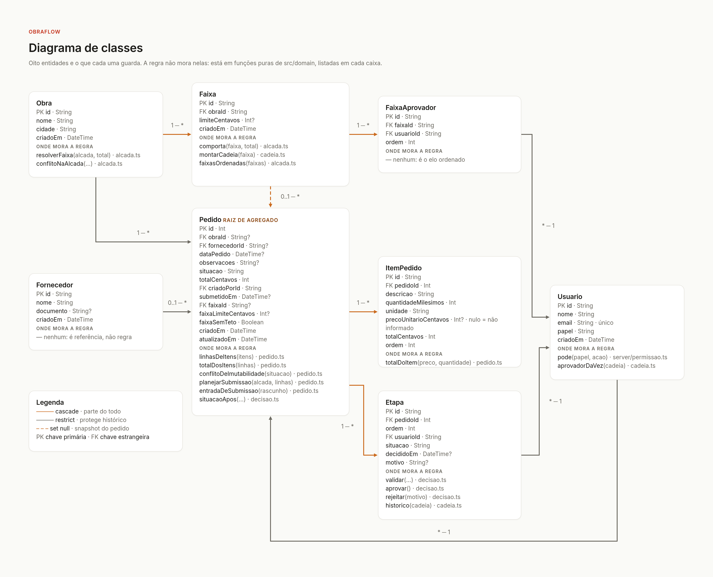

**Estados do pedido.** Rascunho, pendente, aprovado e rejeitado, e o que cada passagem exige.

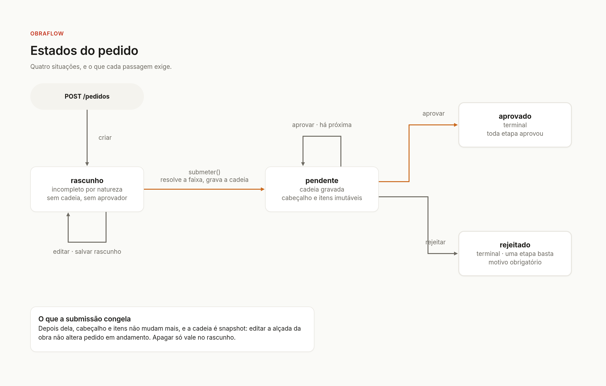

**Submissão e decisão.** Os dois caminhos que mudam um pedido, e onde cada recusa acontece.

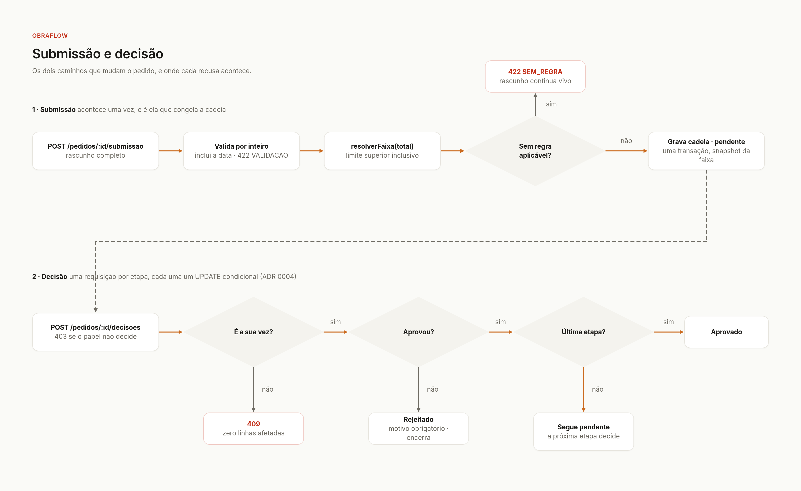

**Operações por camada.** Rotas, servidor e domínio puro: quem chama quem.

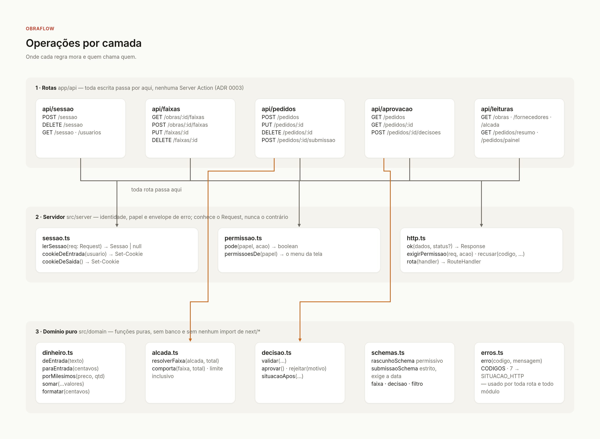

---

## Testes e verificações

```bash
npx tsc --noEmit    # tipos
npm run lint        # ESLint (next/core-web-vitals + react-hooks)
npm test            # 58 casos
```

A suíte cobre o que só leitura não pega e o que não exige servidor:

| Projeto | Casos | O que afirma |
|---|---:|---|
| `dominio` | 49 | Limite inclusivo, faixa aberta, ordenação, sem regra aplicável, montagem e leitura da cadeia, aprovador da vez, rejeição encerrando o fluxo, arredondamento de centavos e milésimos, schemas (data do pedido obrigatória, preço zero aceito, negativo ou ausente recusado) — e, em 18 desses casos, as derivações do painel: quando cada etapa recebeu a vez, "parado há", KPIs contra o período anterior, cortes por faixa e por aprovador, fila de atenção e série semanal |
| `ui` | 8 | Ancoragem de `error.fields` nos campos do formulário — chaves, nunca textos de mensagem —, inclusive o envio bloqueado sem data |
| `api` | 1 | Guarda de configuração do projeto de rota |

O que **não** é testado por unidade é testado por `curl` contra o servidor de verdade, em
`scripts/verificar.sh`: as recusas 403, 409 e 422 e a corrida de decisão. É deliberado — a corrida
só é real contra o banco de verdade, e um mock dela provaria apenas que o mock foi escrito certo.

---

## Onde está cada coisa

```
app/                 rotas do Next: páginas e Route Handlers em app/api/*
src/domain/          regra de negócio pura — não importa next/*, não toca em banco
src/server/          sessão, permissão, envelope de erro, transações
src/ui/              componentes, hooks e as chamadas de API das telas
prisma/              schema, migrations e o seed da demonstração
scripts/             verificar.sh (prova por curl) e capturar-telas.mjs
docs/                PRD, SPEC, ADRs, glossário, progresso e o enunciado original
```

| Tela | Endereço | Quem abre | Página e componente |
|---|---|---|---|
| Entrada | `/entrar` | qualquer um, com `DEMO_MODE` | `app/entrar/page.tsx` |
| 1 · Cadastro de pedido | `/pedidos/novo` (`?rascunho={id}` retoma) | comprador | `app/pedidos/novo/page.tsx` · `FormularioDePedido.tsx` |
| 2 · Aprovação — lista | `/pedidos` (`?aba=para-mim` é a fila) | sessão | `app/pedidos/page.tsx` · `ListaDePedidos.tsx` |
| 2 · Aprovação — detalhe | `/pedidos/{id}` | sessão | `app/pedidos/[id]/page.tsx` · `DetalheDoPedido.tsx` |
| 3 · Regras da alçada | `/alcadas` | admin | `app/alcadas/page.tsx` · `RegrasDaAlcada.tsx` |
| Painel da administração | `/admin` | admin | `app/admin/page.tsx` · `PainelDoAdmin.tsx` |
| Empresa — obras e fornecedores | `/empresa` (`?aba=fornecedores`) | admin | `app/empresa/page.tsx` · `Empresa.tsx` |

Os componentes estão em `src/ui/componentes/`; as rotas de API, em `app/api/`, uma pasta por
endereço da tabela de endpoints.

| Documento | O que é |
|---|---|
| [`docs/adr/`](adr/) | As sete decisões que o resto do código assume |
| [`GLOSSARY.md`](../GLOSSARY.md) | O vocabulário: faixa, cadeia, etapa, alçada, aprovador da vez |

### As sete decisões registradas

| ADR | Assunto | Em uma linha |
|---|---|---|
| [0001](adr/0001-cadeia-de-aprovacao-e-snapshot.md) | Cadeia é snapshot | Gravada na submissão, nunca recalculada |
| [0002](adr/0002-faixa-por-limite-superior.md) | Só o limite superior | Buraco e sobreposição deixam de ser representáveis |
| [0003](adr/0003-route-handlers-sem-server-actions.md) | Route Handlers | O contrato precisa ser inspecionável por `curl` |
| [0004](adr/0004-decisao-por-update-condicional.md) | `UPDATE` condicional | Fora de ordem, duplo clique e corrida, um mecanismo só |
| [0005](adr/0005-sessao-de-demonstracao-sem-senha.md) | Sessão sem senha | Atrás de `DEMO_MODE`; desligada, 404 e não 403 |
| [0006](adr/0006-sem-empresa-no-modelo.md) | Sem `Empresa` | `Obra` é o escopo máximo |
| [0007](adr/0007-dominio-em-portugues.md) | Domínio em português | O código fala a língua de quem usa o produto |
