# Screenshots

Generated by `node scripts/screenshots.mjs`; see that file for how and why.

## login

| Preview | State | Captures |
| --- | --- | --- |
|  | `01-login.png` | [light desktop](light/desktop/login/01-login.png) · [light mobile](light/mobile/login/01-login.png) · [dark desktop](dark/desktop/login/01-login.png) · [dark mobile](dark/mobile/login/01-login.png) |
| 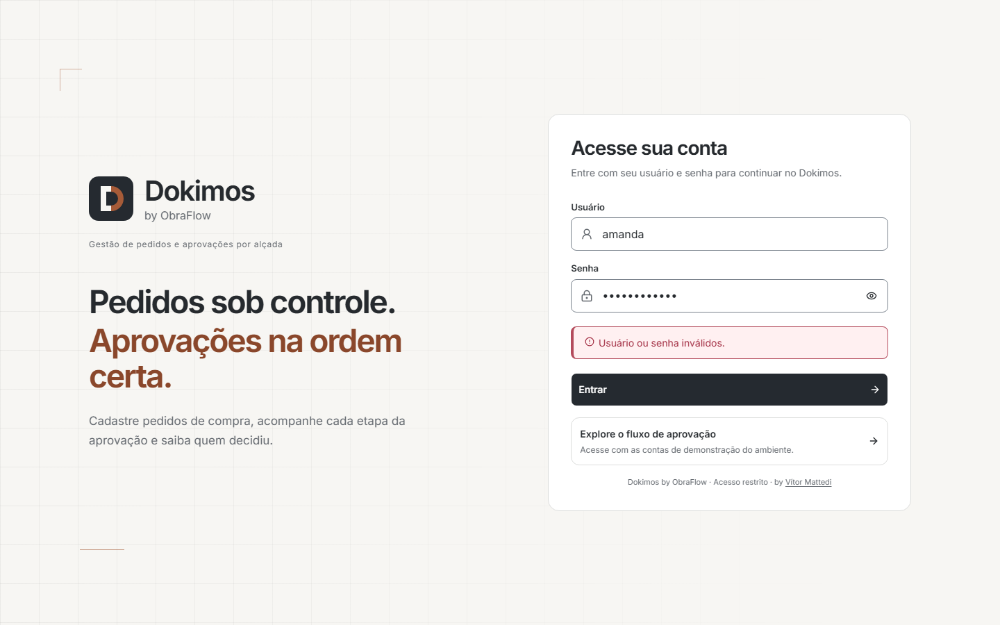 | `02-wrong-password.png` | [light desktop](light/desktop/login/02-wrong-password.png) · [light mobile](light/mobile/login/02-wrong-password.png) · [dark desktop](dark/desktop/login/02-wrong-password.png) · [dark mobile](dark/mobile/login/02-wrong-password.png) |
| 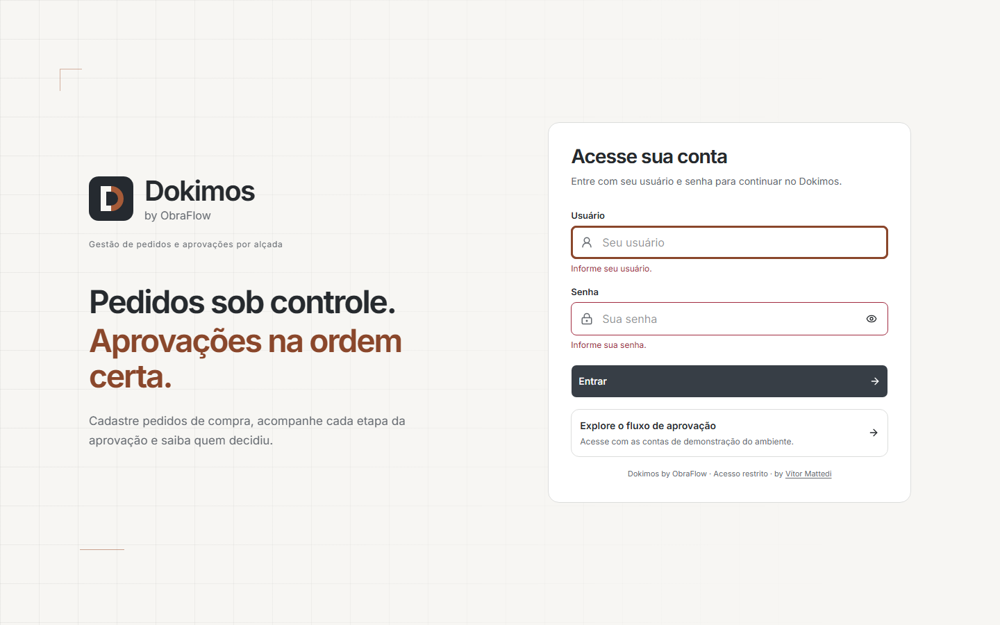 | `03-empty-submit.png` | [light desktop](light/desktop/login/03-empty-submit.png) · [light mobile](light/mobile/login/03-empty-submit.png) · [dark desktop](dark/desktop/login/03-empty-submit.png) · [dark mobile](dark/mobile/login/03-empty-submit.png) |
| 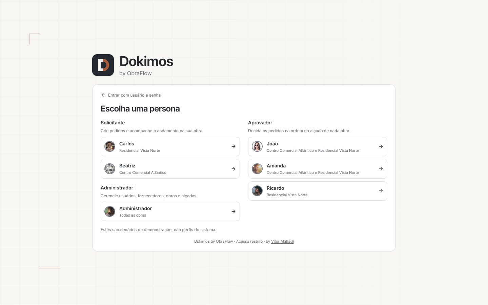 | `04-demo-accounts.png` | [light desktop](light/desktop/login/04-demo-accounts.png) · [light mobile](light/mobile/login/04-demo-accounts.png) · [dark desktop](dark/desktop/login/04-demo-accounts.png) · [dark mobile](dark/mobile/login/04-demo-accounts.png) |

## shell

| Preview | State | Captures |
| --- | --- | --- |
| 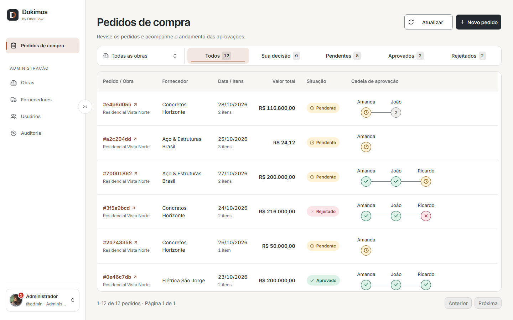 | `01-sidebar--admin.png` | [light desktop](light/desktop/shell/01-sidebar--admin.png) · [dark desktop](dark/desktop/shell/01-sidebar--admin.png) |
| 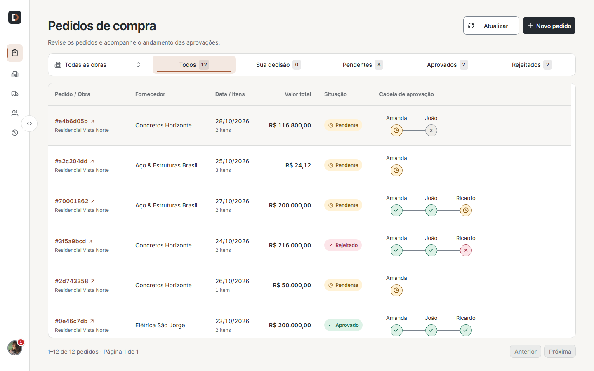 | `02-sidebar-collapsed--admin.png` | [light desktop](light/desktop/shell/02-sidebar-collapsed--admin.png) · [dark desktop](dark/desktop/shell/02-sidebar-collapsed--admin.png) |
| 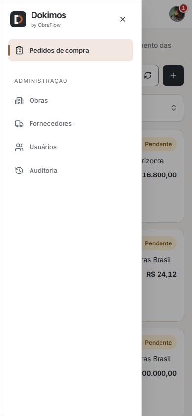 | `03-navigation-drawer--admin.png` | [light mobile](light/mobile/shell/03-navigation-drawer--admin.png) · [dark mobile](dark/mobile/shell/03-navigation-drawer--admin.png) |
| 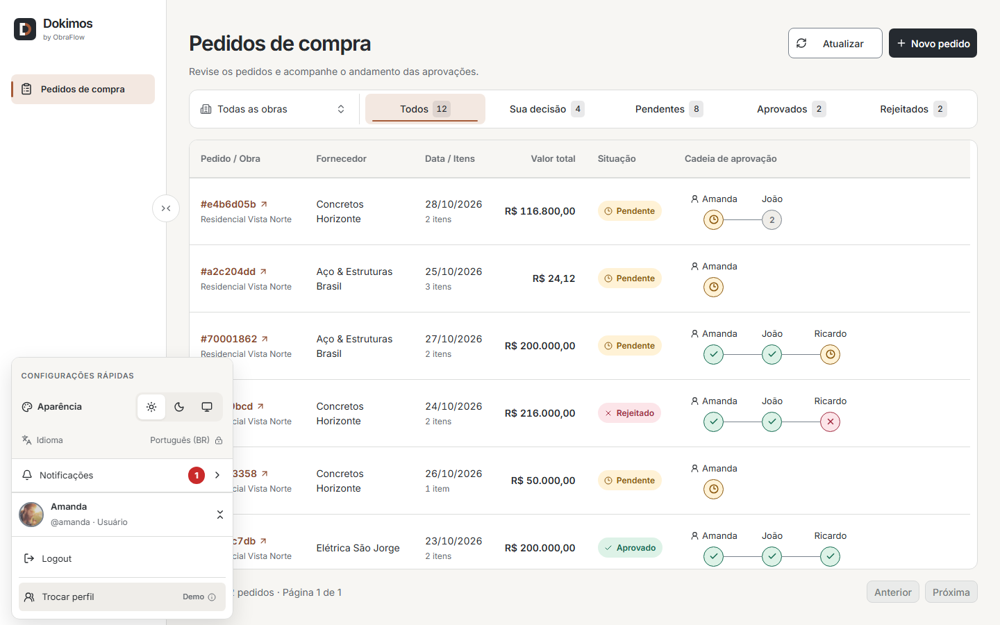 | `04-account-panel--amanda.png` | [light desktop](light/desktop/shell/04-account-panel--amanda.png) · [light mobile](light/mobile/shell/04-account-panel--amanda.png) · [dark desktop](dark/desktop/shell/04-account-panel--amanda.png) · [dark mobile](dark/mobile/shell/04-account-panel--amanda.png) |
| 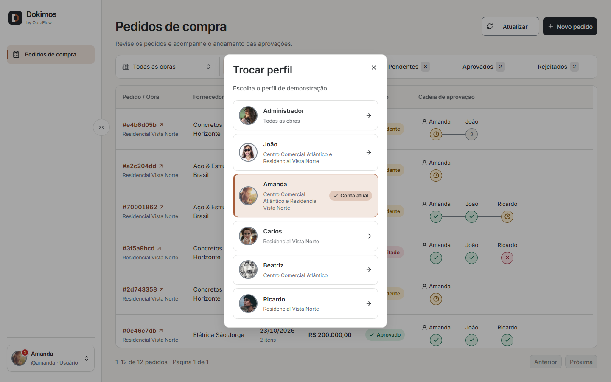 | `05-switch-profile--amanda.png` | [light desktop](light/desktop/shell/05-switch-profile--amanda.png) · [light mobile](light/mobile/shell/05-switch-profile--amanda.png) · [dark desktop](dark/desktop/shell/05-switch-profile--amanda.png) · [dark mobile](dark/mobile/shell/05-switch-profile--amanda.png) |
| 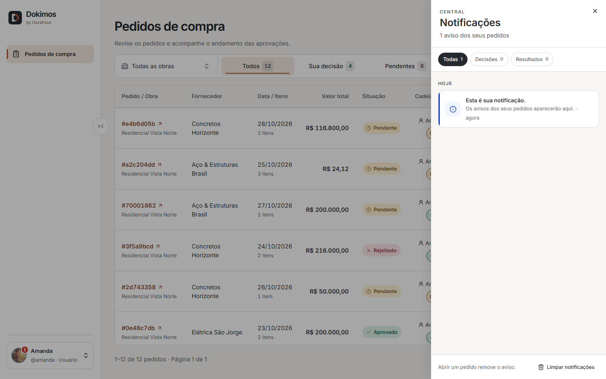 | `06-notifications--amanda.png` | [light desktop](light/desktop/shell/06-notifications--amanda.png) · [light mobile](light/mobile/shell/06-notifications--amanda.png) · [dark desktop](dark/desktop/shell/06-notifications--amanda.png) · [dark mobile](dark/mobile/shell/06-notifications--amanda.png) |

## orders

| Preview | State | Captures |
| --- | --- | --- |
| 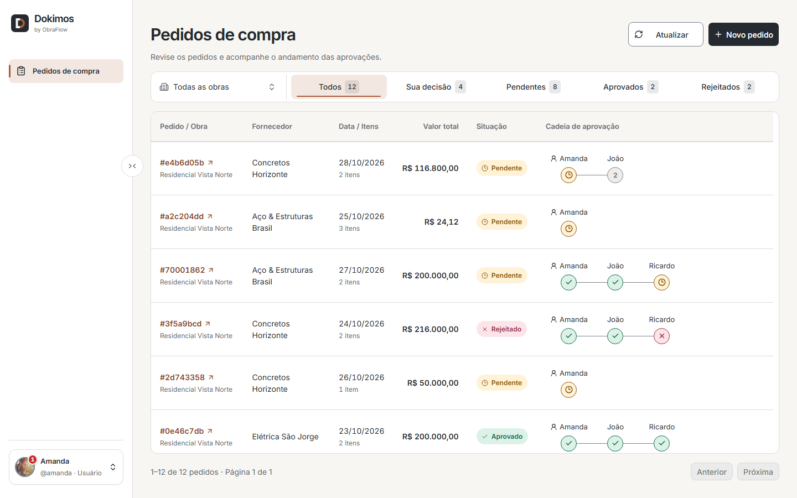 | `01-list--amanda.png` | [light desktop](light/desktop/orders/01-list--amanda.png) · [light mobile](light/mobile/orders/01-list--amanda.png) · [dark desktop](dark/desktop/orders/01-list--amanda.png) · [dark mobile](dark/mobile/orders/01-list--amanda.png) |
| 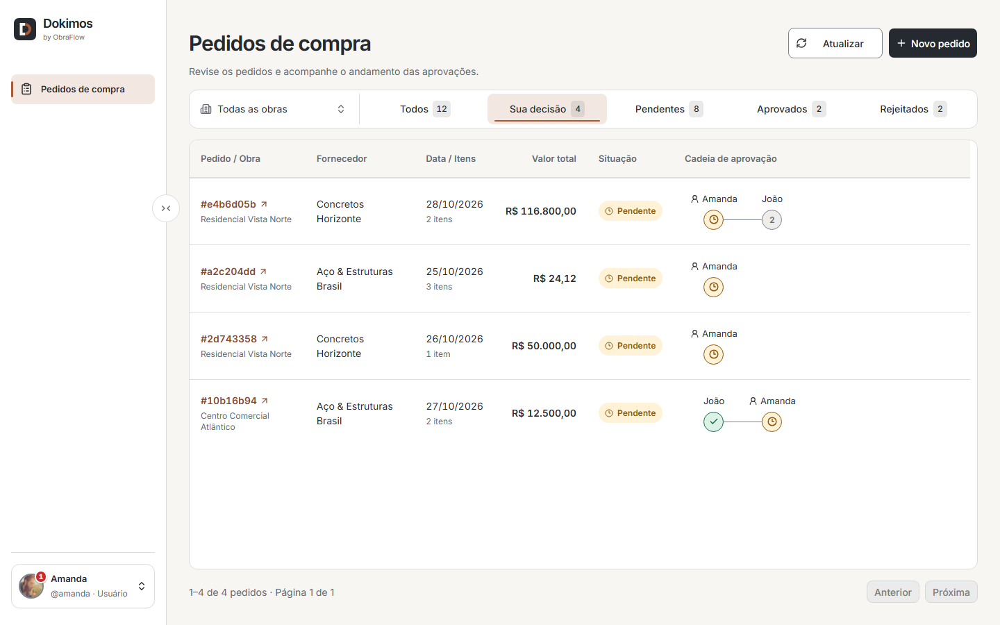 | `02-my-decision--amanda.png` | [light desktop](light/desktop/orders/02-my-decision--amanda.png) · [light mobile](light/mobile/orders/02-my-decision--amanda.png) · [dark desktop](dark/desktop/orders/02-my-decision--amanda.png) · [dark mobile](dark/mobile/orders/02-my-decision--amanda.png) |
| 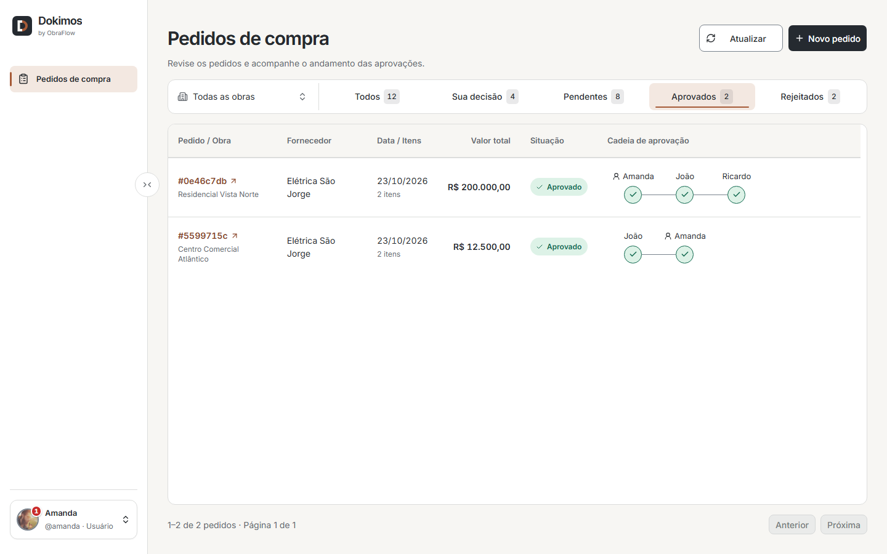 | `03-approved--amanda.png` | [light desktop](light/desktop/orders/03-approved--amanda.png) · [light mobile](light/mobile/orders/03-approved--amanda.png) · [dark desktop](dark/desktop/orders/03-approved--amanda.png) · [dark mobile](dark/mobile/orders/03-approved--amanda.png) |
| 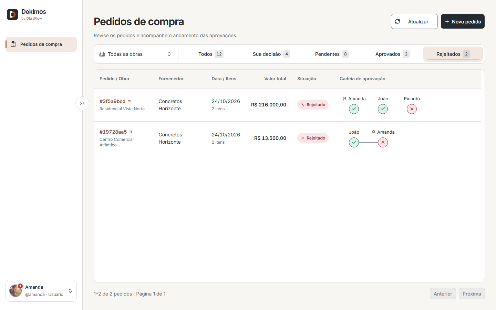 | `04-rejected--amanda.png` | [light desktop](light/desktop/orders/04-rejected--amanda.png) · [light mobile](light/mobile/orders/04-rejected--amanda.png) · [dark desktop](dark/desktop/orders/04-rejected--amanda.png) · [dark mobile](dark/mobile/orders/04-rejected--amanda.png) |
| 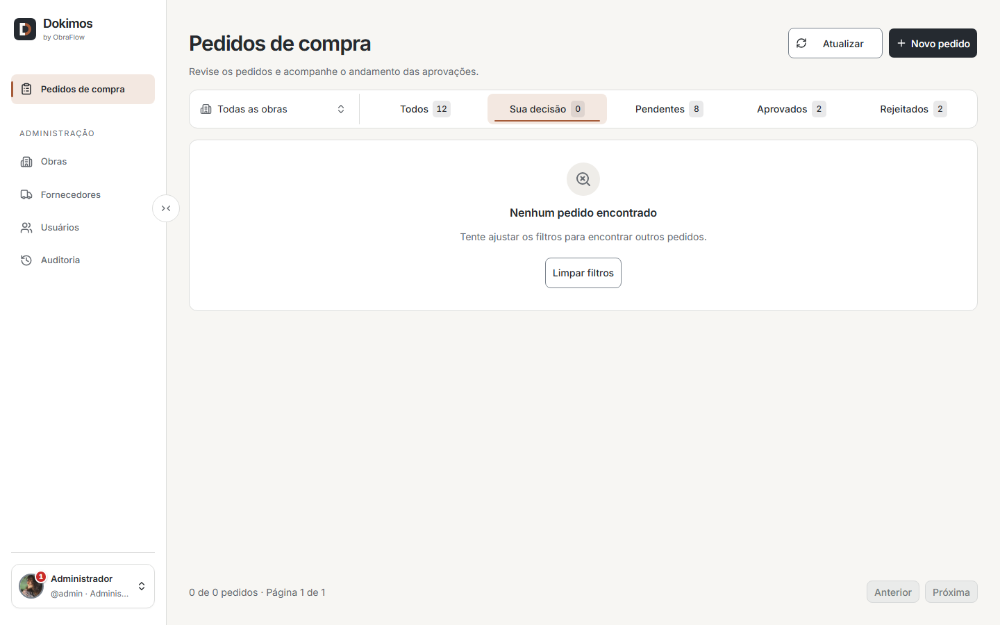 | `05-nothing-to-decide--admin.png` | [light desktop](light/desktop/orders/05-nothing-to-decide--admin.png) · [light mobile](light/mobile/orders/05-nothing-to-decide--admin.png) · [dark desktop](dark/desktop/orders/05-nothing-to-decide--admin.png) · [dark mobile](dark/mobile/orders/05-nothing-to-decide--admin.png) |
| 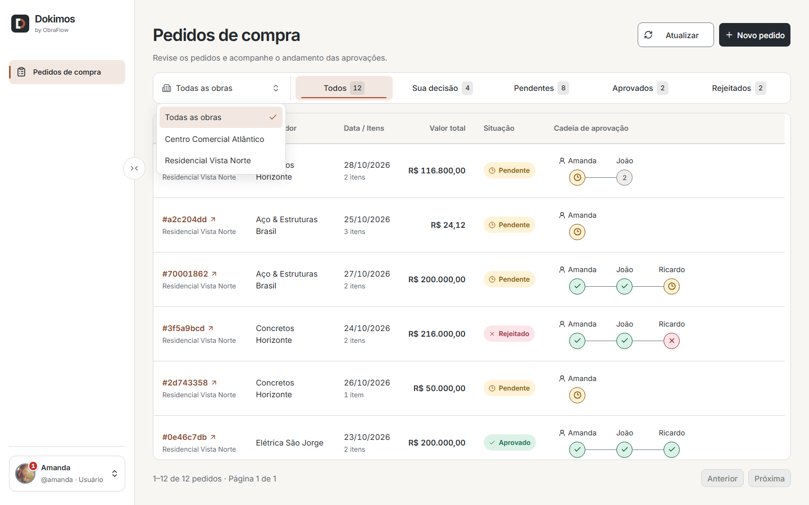 | `06-project-filter--amanda.png` | [light desktop](light/desktop/orders/06-project-filter--amanda.png) · [light mobile](light/mobile/orders/06-project-filter--amanda.png) · [dark desktop](dark/desktop/orders/06-project-filter--amanda.png) · [dark mobile](dark/mobile/orders/06-project-filter--amanda.png) |

## order-detail

| Preview | State | Captures |
| --- | --- | --- |
| 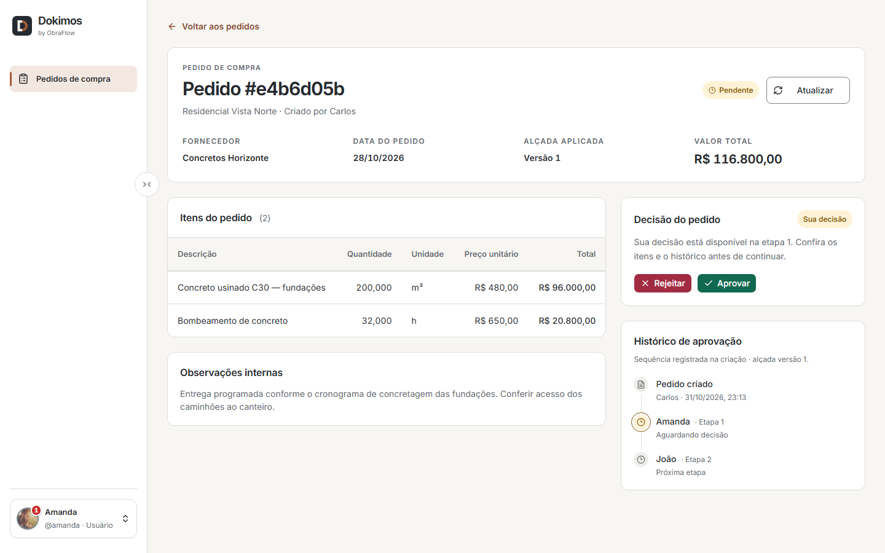 | `01-pending-my-turn--amanda.png` | [light desktop](light/desktop/order-detail/01-pending-my-turn--amanda.png) · [light mobile](light/mobile/order-detail/01-pending-my-turn--amanda.png) · [dark desktop](dark/desktop/order-detail/01-pending-my-turn--amanda.png) · [dark mobile](dark/mobile/order-detail/01-pending-my-turn--amanda.png) |
| 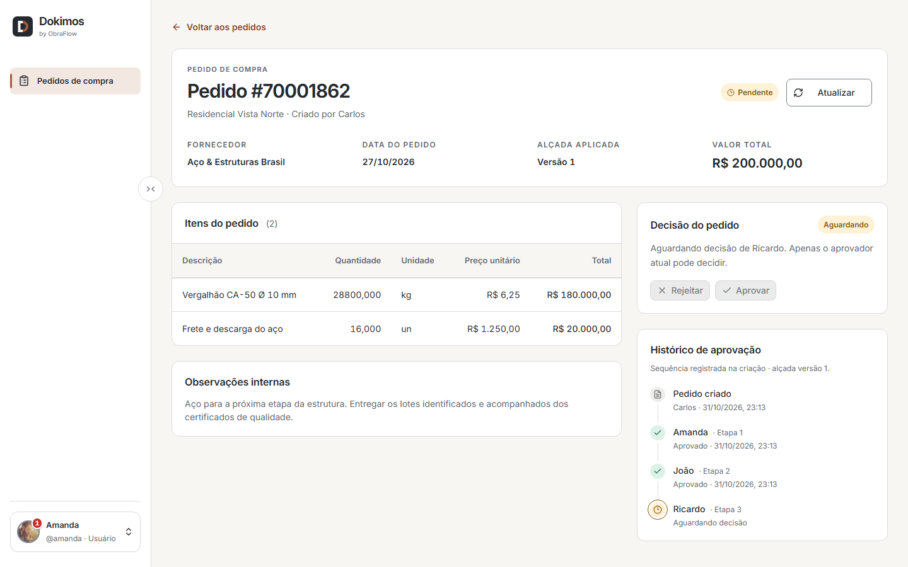 | `02-pending-waiting--amanda.png` | [light desktop](light/desktop/order-detail/02-pending-waiting--amanda.png) · [light mobile](light/mobile/order-detail/02-pending-waiting--amanda.png) · [dark desktop](dark/desktop/order-detail/02-pending-waiting--amanda.png) · [dark mobile](dark/mobile/order-detail/02-pending-waiting--amanda.png) |
| 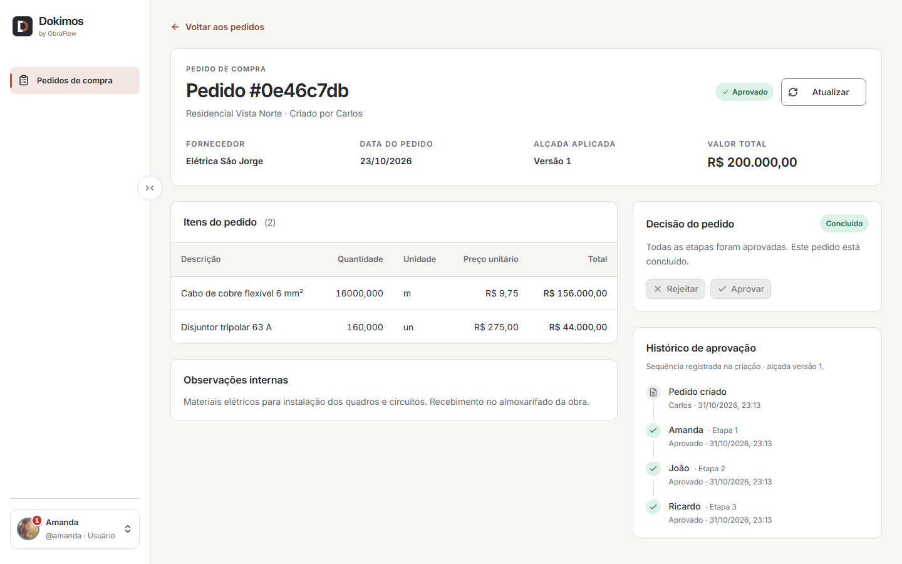 | `03-approved--amanda.png` | [light desktop](light/desktop/order-detail/03-approved--amanda.png) · [light mobile](light/mobile/order-detail/03-approved--amanda.png) · [dark desktop](dark/desktop/order-detail/03-approved--amanda.png) · [dark mobile](dark/mobile/order-detail/03-approved--amanda.png) |
| 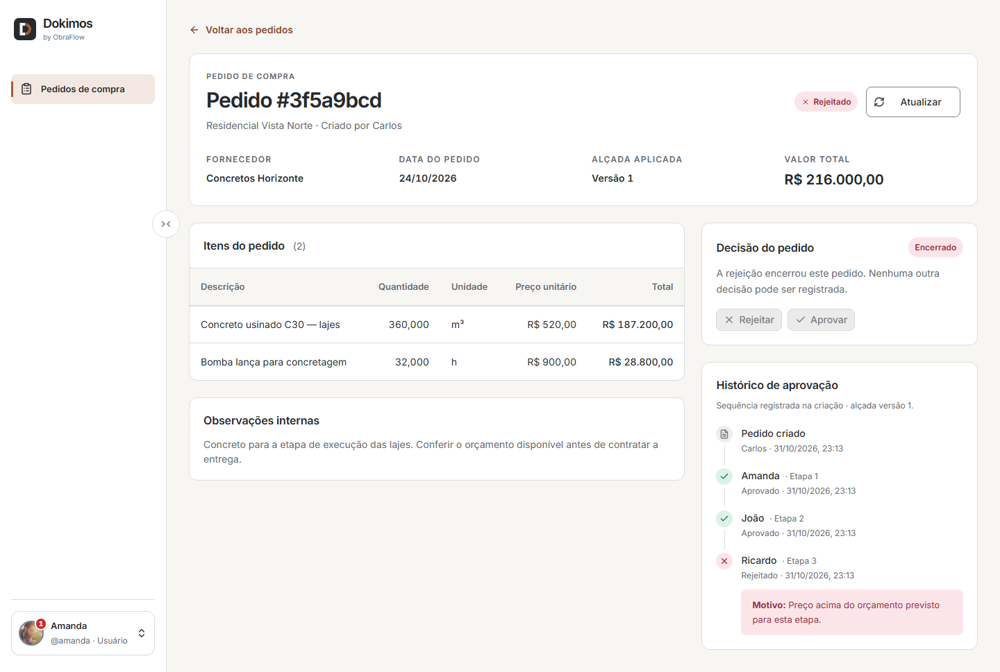 | `04-rejected--amanda.png` | [light desktop](light/desktop/order-detail/04-rejected--amanda.png) · [light mobile](light/mobile/order-detail/04-rejected--amanda.png) · [dark desktop](dark/desktop/order-detail/04-rejected--amanda.png) · [dark mobile](dark/mobile/order-detail/04-rejected--amanda.png) |
| 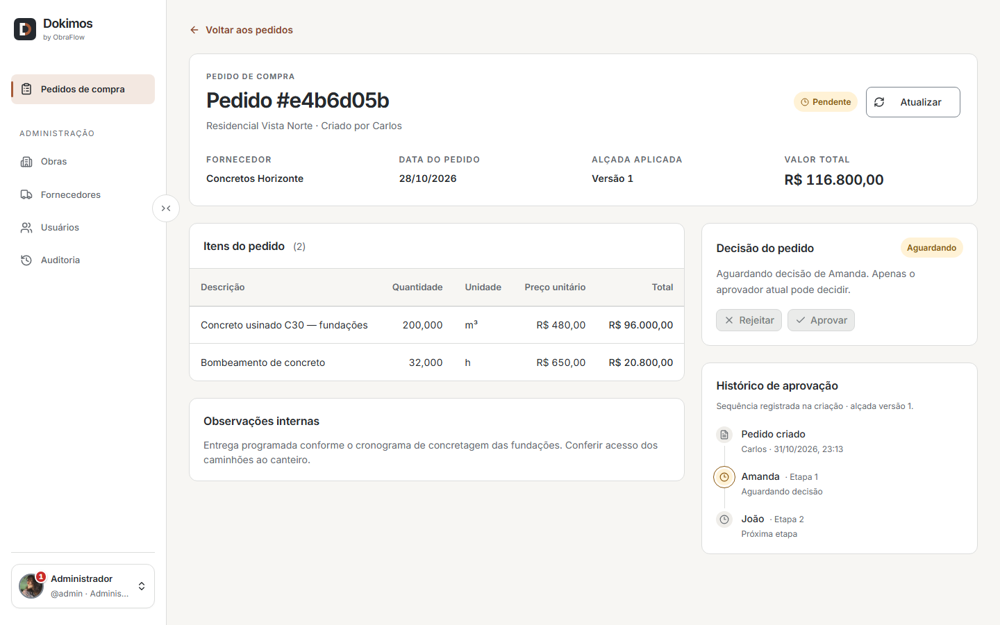 | `05-admin-view--admin.png` | [light desktop](light/desktop/order-detail/05-admin-view--admin.png) · [light mobile](light/mobile/order-detail/05-admin-view--admin.png) · [dark desktop](dark/desktop/order-detail/05-admin-view--admin.png) · [dark mobile](dark/mobile/order-detail/05-admin-view--admin.png) |
| 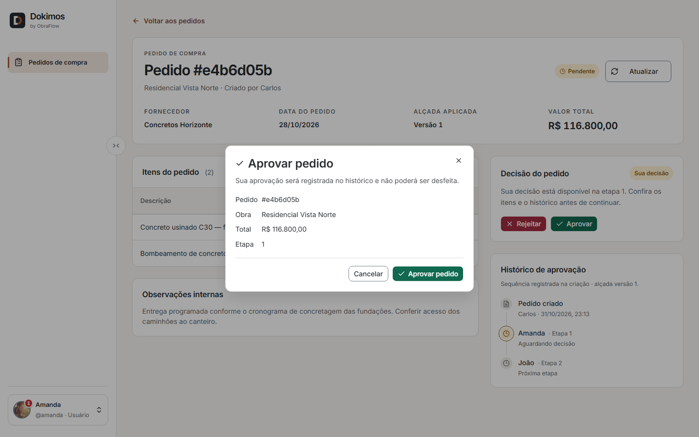 | `06-approve-confirmation--amanda.png` | [light desktop](light/desktop/order-detail/06-approve-confirmation--amanda.png) · [light mobile](light/mobile/order-detail/06-approve-confirmation--amanda.png) · [dark desktop](dark/desktop/order-detail/06-approve-confirmation--amanda.png) · [dark mobile](dark/mobile/order-detail/06-approve-confirmation--amanda.png) |
| 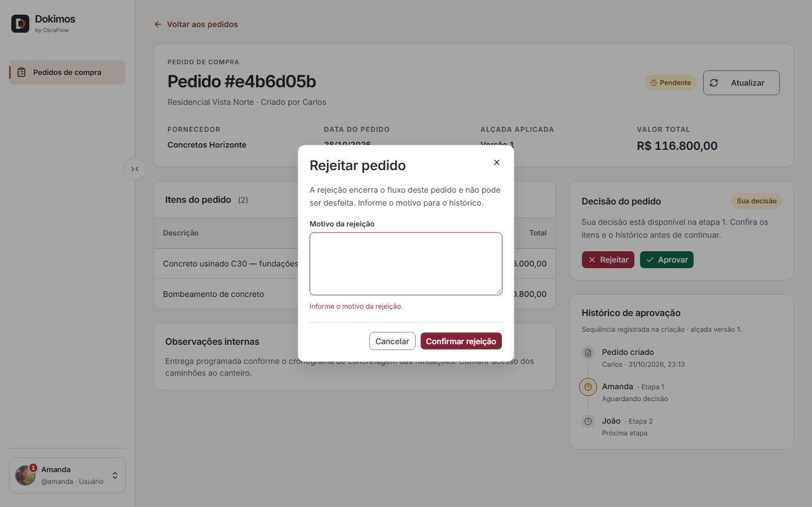 | `07-reject-reason-required--amanda.png` | [light desktop](light/desktop/order-detail/07-reject-reason-required--amanda.png) · [light mobile](light/mobile/order-detail/07-reject-reason-required--amanda.png) · [dark desktop](dark/desktop/order-detail/07-reject-reason-required--amanda.png) · [dark mobile](dark/mobile/order-detail/07-reject-reason-required--amanda.png) |
| 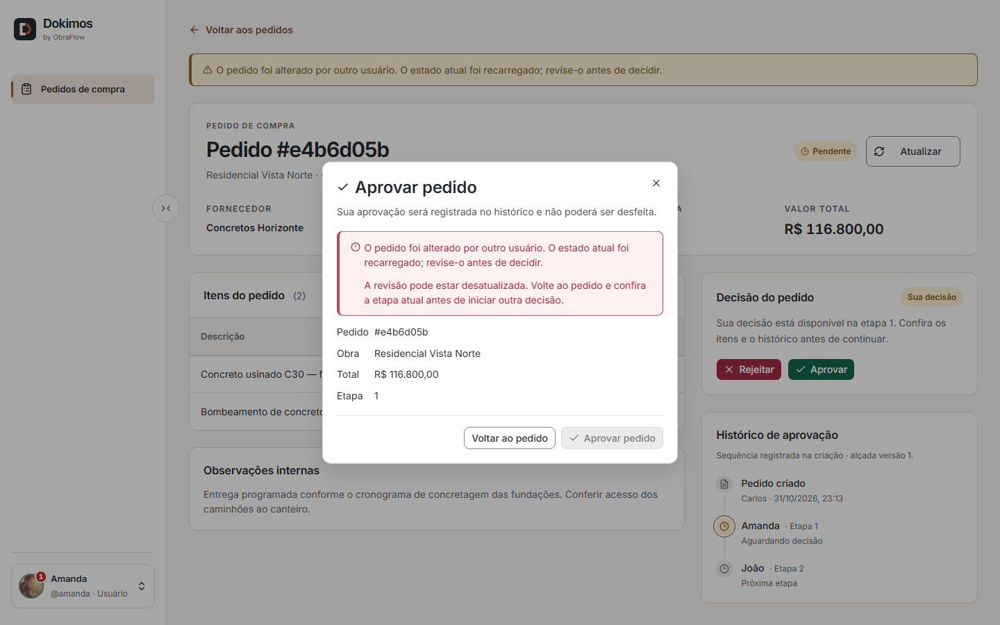 | `08-decision-conflict--amanda.png` | [light desktop](light/desktop/order-detail/08-decision-conflict--amanda.png) · [light mobile](light/mobile/order-detail/08-decision-conflict--amanda.png) · [dark desktop](dark/desktop/order-detail/08-decision-conflict--amanda.png) · [dark mobile](dark/mobile/order-detail/08-decision-conflict--amanda.png) |

## order-create

| Preview | State | Captures |
| --- | --- | --- |
| 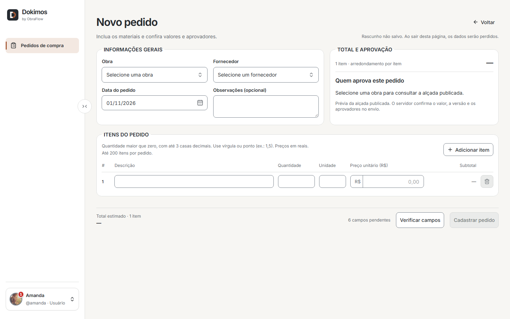 | `01-empty-form--amanda.png` | [light desktop](light/desktop/order-create/01-empty-form--amanda.png) · [light mobile](light/mobile/order-create/01-empty-form--amanda.png) · [dark desktop](dark/desktop/order-create/01-empty-form--amanda.png) · [dark mobile](dark/mobile/order-create/01-empty-form--amanda.png) |
| 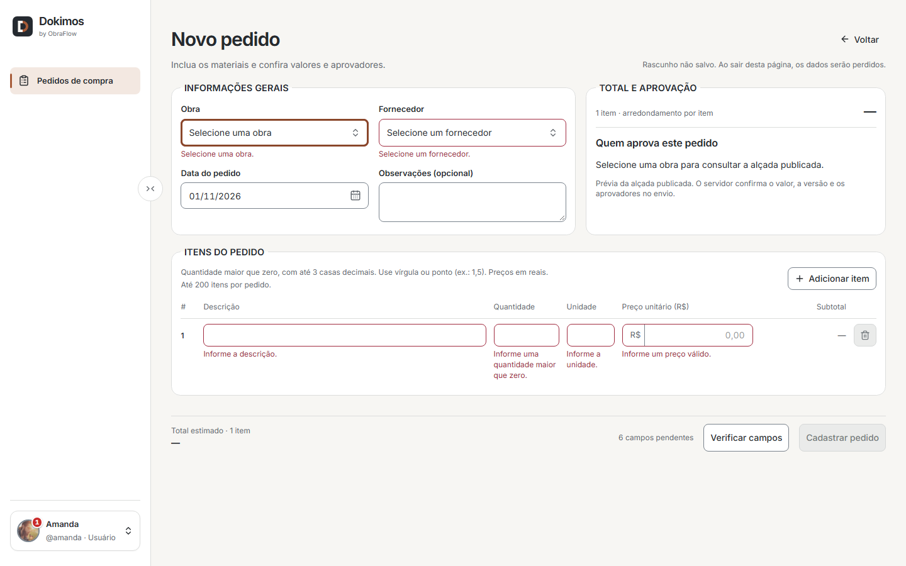 | `02-field-errors--amanda.png` | [light desktop](light/desktop/order-create/02-field-errors--amanda.png) · [light mobile](light/mobile/order-create/02-field-errors--amanda.png) · [dark desktop](dark/desktop/order-create/02-field-errors--amanda.png) · [dark mobile](dark/mobile/order-create/02-field-errors--amanda.png) |
| 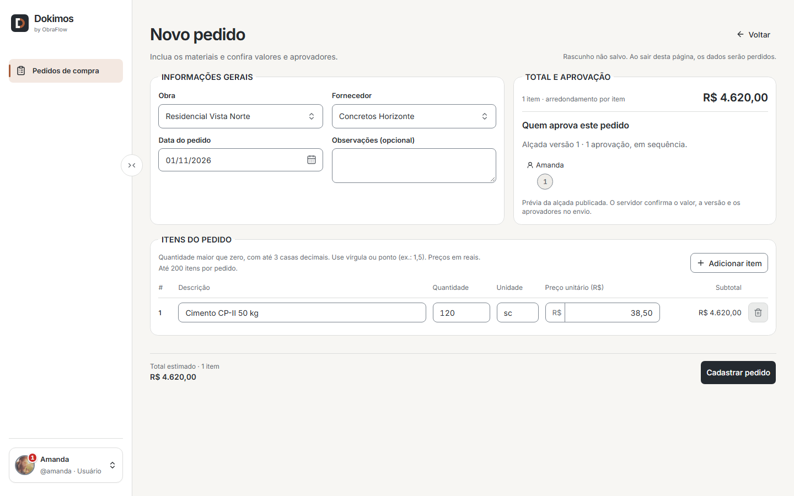 | `03-approval-estimate--amanda.png` | [light desktop](light/desktop/order-create/03-approval-estimate--amanda.png) · [light mobile](light/mobile/order-create/03-approval-estimate--amanda.png) · [dark desktop](dark/desktop/order-create/03-approval-estimate--amanda.png) · [dark mobile](dark/mobile/order-create/03-approval-estimate--amanda.png) |
| 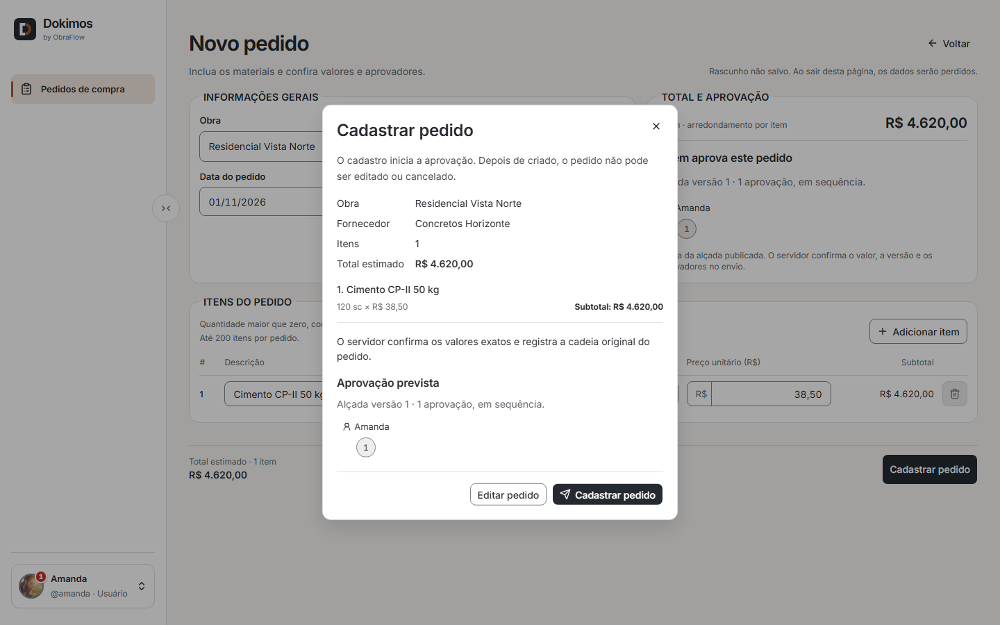 | `04-review--amanda.png` | [light desktop](light/desktop/order-create/04-review--amanda.png) · [light mobile](light/mobile/order-create/04-review--amanda.png) · [dark desktop](dark/desktop/order-create/04-review--amanda.png) · [dark mobile](dark/mobile/order-create/04-review--amanda.png) |
| 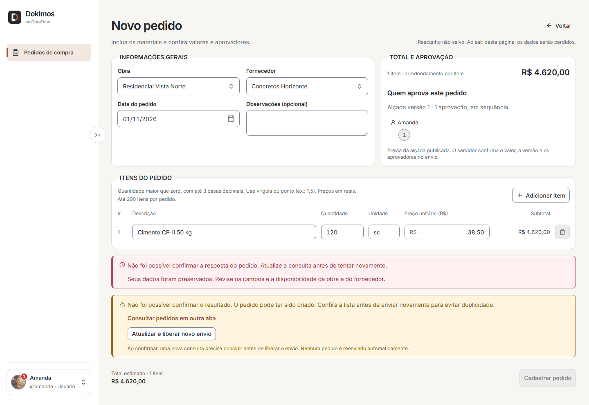 | `05-uncertain-result--amanda.png` | [light desktop](light/desktop/order-create/05-uncertain-result--amanda.png) · [light mobile](light/mobile/order-create/05-uncertain-result--amanda.png) · [dark desktop](dark/desktop/order-create/05-uncertain-result--amanda.png) · [dark mobile](dark/mobile/order-create/05-uncertain-result--amanda.png) |

## projects

| Preview | State | Captures |
| --- | --- | --- |
| 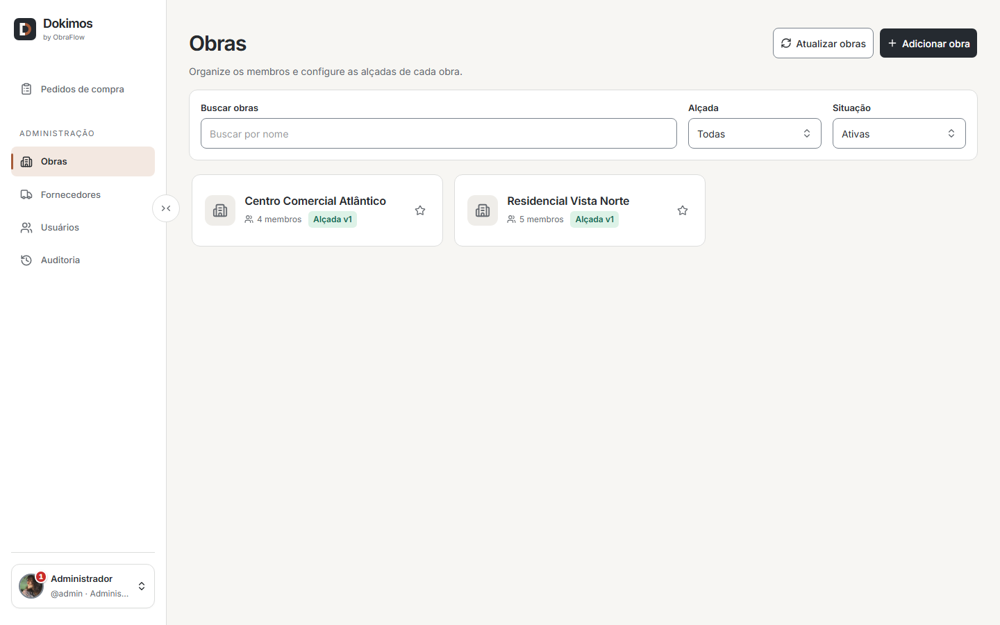 | `01-list--admin.png` | [light desktop](light/desktop/projects/01-list--admin.png) · [light mobile](light/mobile/projects/01-list--admin.png) · [dark desktop](dark/desktop/projects/01-list--admin.png) · [dark mobile](dark/mobile/projects/01-list--admin.png) |
| 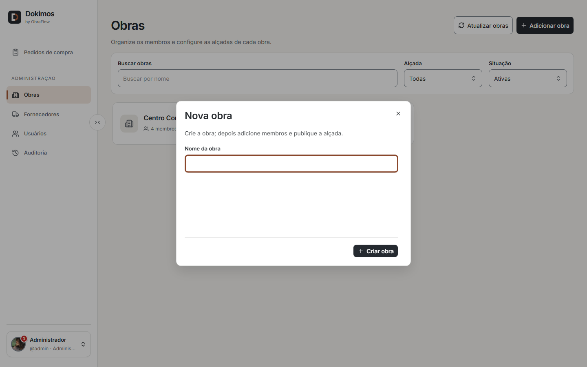 | `02-new-project--admin.png` | [light desktop](light/desktop/projects/02-new-project--admin.png) · [light mobile](light/mobile/projects/02-new-project--admin.png) · [dark desktop](dark/desktop/projects/02-new-project--admin.png) · [dark mobile](dark/mobile/projects/02-new-project--admin.png) |
| 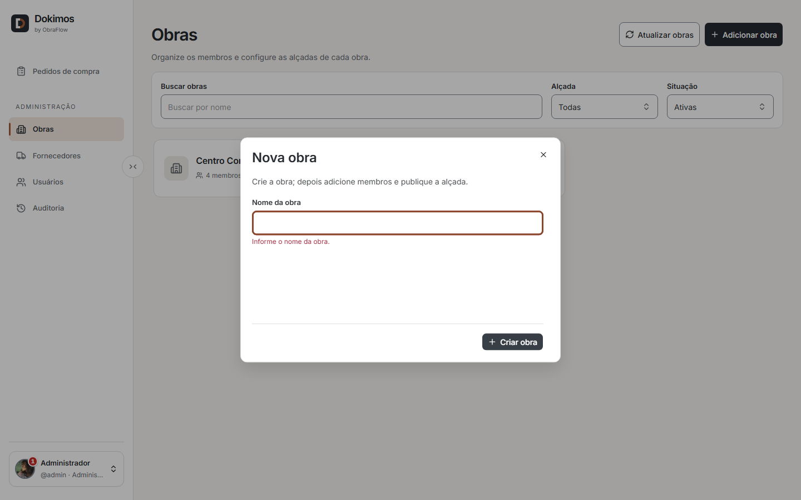 | `03-new-project-errors--admin.png` | [light desktop](light/desktop/projects/03-new-project-errors--admin.png) · [light mobile](light/mobile/projects/03-new-project-errors--admin.png) · [dark desktop](dark/desktop/projects/03-new-project-errors--admin.png) · [dark mobile](dark/mobile/projects/03-new-project-errors--admin.png) |

## project-detail

| Preview | State | Captures |
| --- | --- | --- |
| 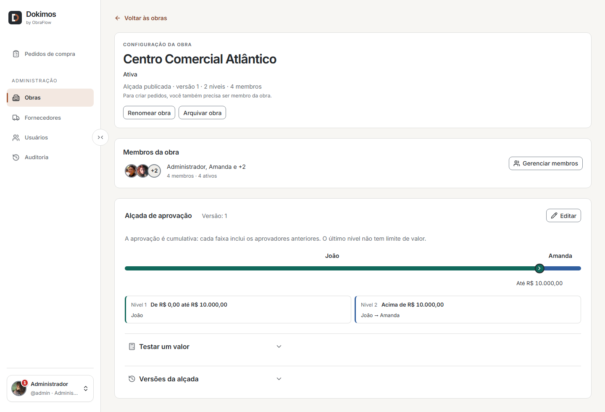 | `01-overview--admin.png` | [light desktop](light/desktop/project-detail/01-overview--admin.png) · [light mobile](light/mobile/project-detail/01-overview--admin.png) · [dark desktop](dark/desktop/project-detail/01-overview--admin.png) · [dark mobile](dark/mobile/project-detail/01-overview--admin.png) |
| 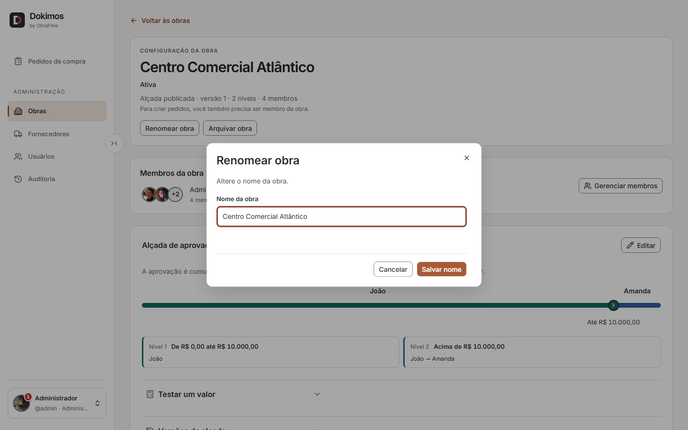 | `02-rename--admin.png` | [light desktop](light/desktop/project-detail/02-rename--admin.png) · [light mobile](light/mobile/project-detail/02-rename--admin.png) · [dark desktop](dark/desktop/project-detail/02-rename--admin.png) · [dark mobile](dark/mobile/project-detail/02-rename--admin.png) |
| 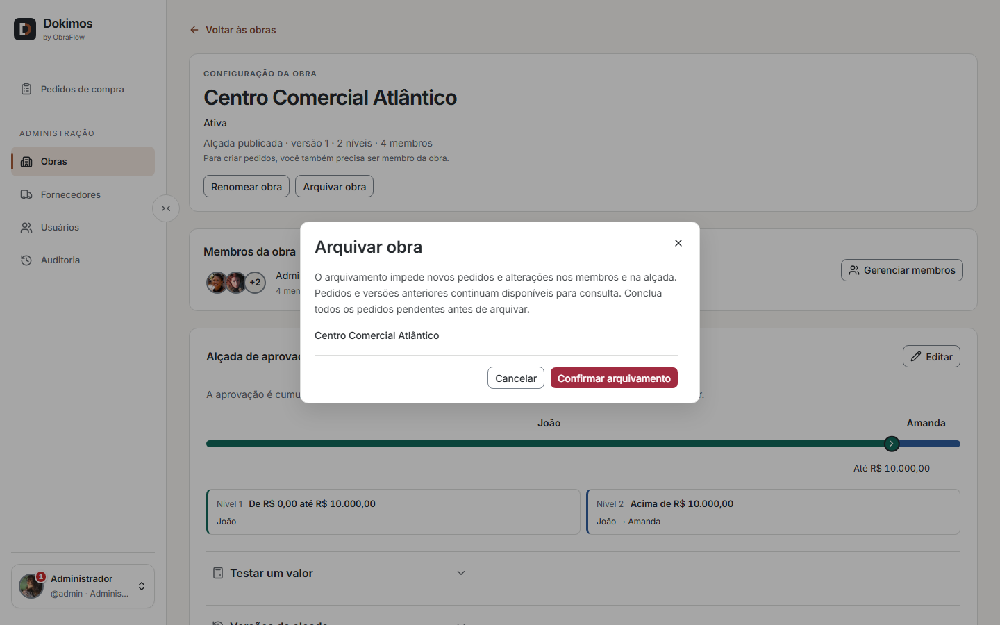 | `03-archive--admin.png` | [light desktop](light/desktop/project-detail/03-archive--admin.png) · [light mobile](light/mobile/project-detail/03-archive--admin.png) · [dark desktop](dark/desktop/project-detail/03-archive--admin.png) · [dark mobile](dark/mobile/project-detail/03-archive--admin.png) |
| 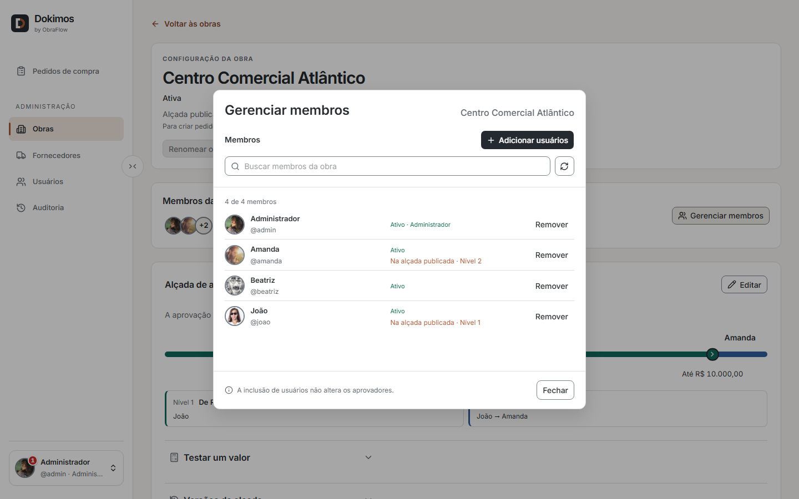 | `04-members--admin.png` | [light desktop](light/desktop/project-detail/04-members--admin.png) · [light mobile](light/mobile/project-detail/04-members--admin.png) · [dark desktop](dark/desktop/project-detail/04-members--admin.png) · [dark mobile](dark/mobile/project-detail/04-members--admin.png) |
| 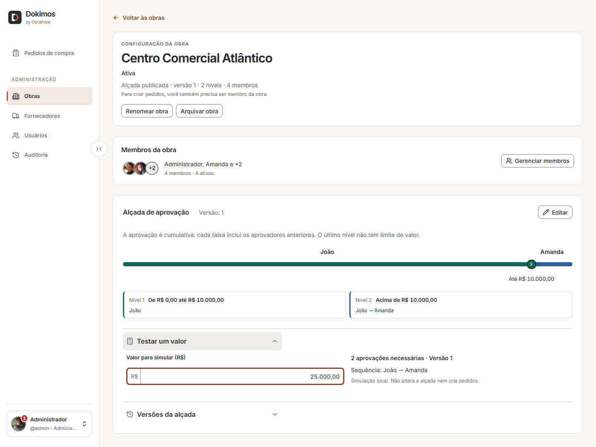 | `05-ladder-simulator--admin.png` | [light desktop](light/desktop/project-detail/05-ladder-simulator--admin.png) · [light mobile](light/mobile/project-detail/05-ladder-simulator--admin.png) · [dark desktop](dark/desktop/project-detail/05-ladder-simulator--admin.png) · [dark mobile](dark/mobile/project-detail/05-ladder-simulator--admin.png) |
| 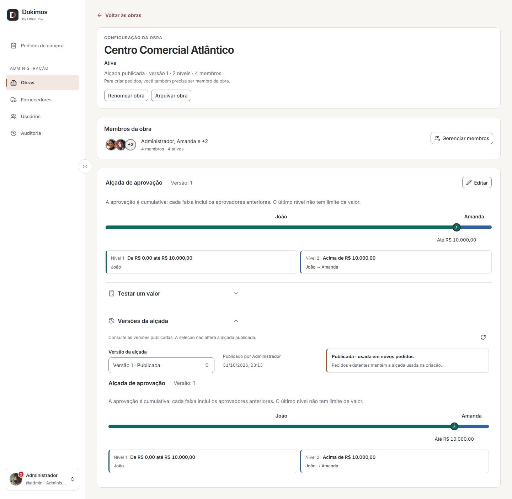 | `06-ladder-versions--admin.png` | [light desktop](light/desktop/project-detail/06-ladder-versions--admin.png) · [light mobile](light/mobile/project-detail/06-ladder-versions--admin.png) · [dark desktop](dark/desktop/project-detail/06-ladder-versions--admin.png) · [dark mobile](dark/mobile/project-detail/06-ladder-versions--admin.png) |
| 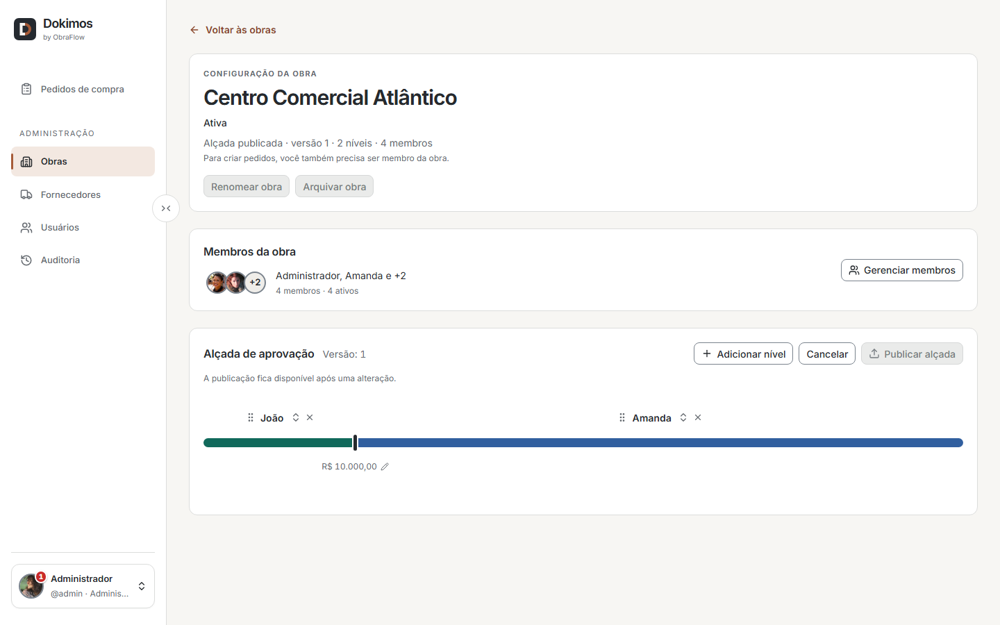 | `07-ladder-editor--admin.png` | [light desktop](light/desktop/project-detail/07-ladder-editor--admin.png) · [light mobile](light/mobile/project-detail/07-ladder-editor--admin.png) · [dark desktop](dark/desktop/project-detail/07-ladder-editor--admin.png) · [dark mobile](dark/mobile/project-detail/07-ladder-editor--admin.png) |
| 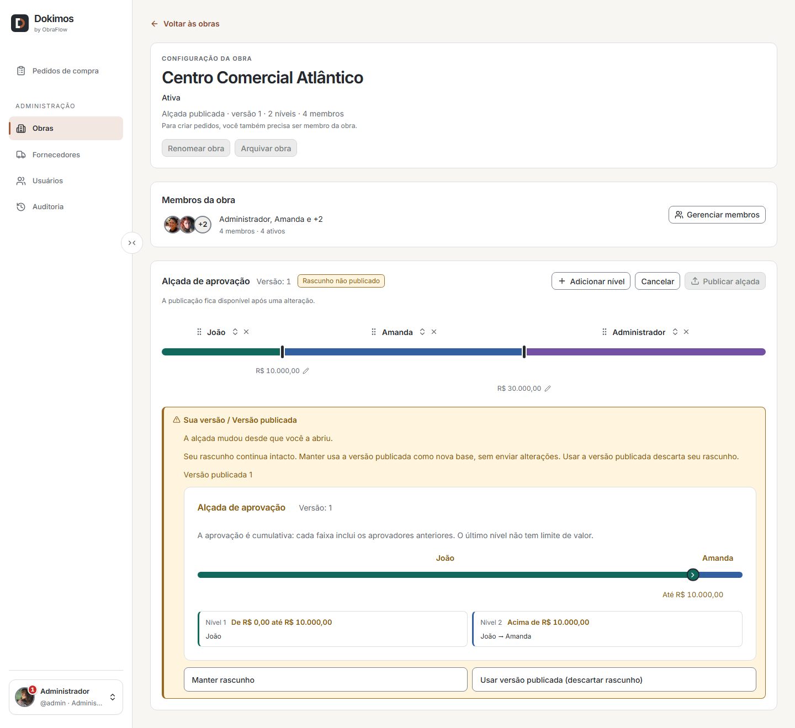 | `08-ladder-publish-conflict--admin.png` | [light desktop](light/desktop/project-detail/08-ladder-publish-conflict--admin.png) · [light mobile](light/mobile/project-detail/08-ladder-publish-conflict--admin.png) · [dark desktop](dark/desktop/project-detail/08-ladder-publish-conflict--admin.png) · [dark mobile](dark/mobile/project-detail/08-ladder-publish-conflict--admin.png) |

## suppliers

| Preview | State | Captures |
| --- | --- | --- |
| 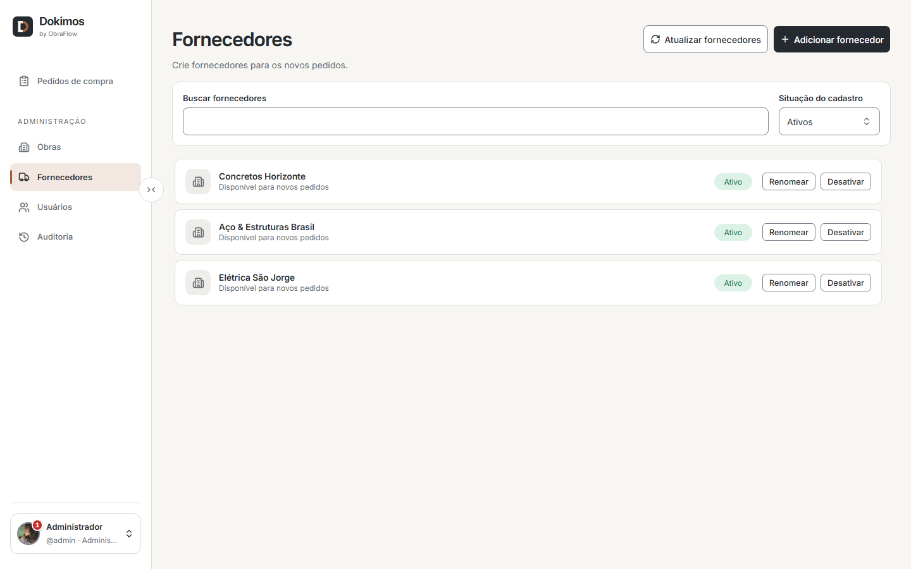 | `01-list--admin.png` | [light desktop](light/desktop/suppliers/01-list--admin.png) · [light mobile](light/mobile/suppliers/01-list--admin.png) · [dark desktop](dark/desktop/suppliers/01-list--admin.png) · [dark mobile](dark/mobile/suppliers/01-list--admin.png) |
| 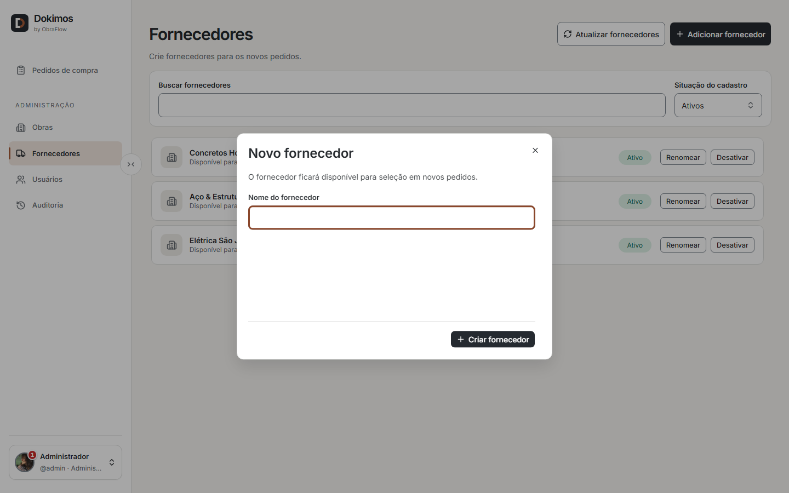 | `02-new-supplier--admin.png` | [light desktop](light/desktop/suppliers/02-new-supplier--admin.png) · [light mobile](light/mobile/suppliers/02-new-supplier--admin.png) · [dark desktop](dark/desktop/suppliers/02-new-supplier--admin.png) · [dark mobile](dark/mobile/suppliers/02-new-supplier--admin.png) |
| 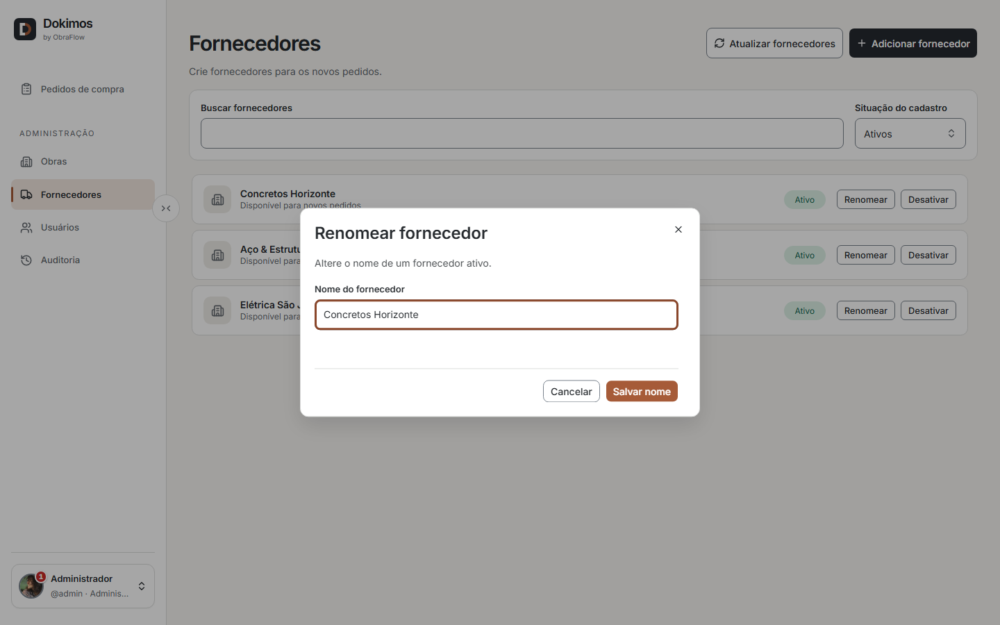 | `03-rename--admin.png` | [light desktop](light/desktop/suppliers/03-rename--admin.png) · [light mobile](light/mobile/suppliers/03-rename--admin.png) · [dark desktop](dark/desktop/suppliers/03-rename--admin.png) · [dark mobile](dark/mobile/suppliers/03-rename--admin.png) |
| 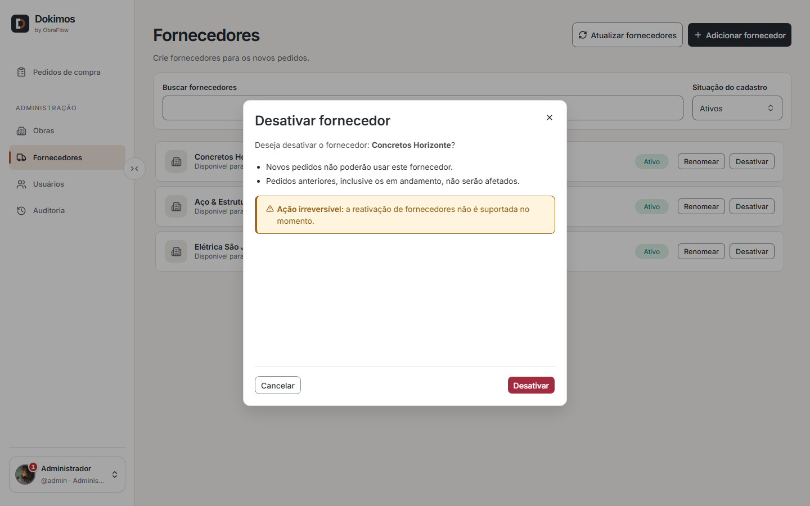 | `04-deactivate--admin.png` | [light desktop](light/desktop/suppliers/04-deactivate--admin.png) · [light mobile](light/mobile/suppliers/04-deactivate--admin.png) · [dark desktop](dark/desktop/suppliers/04-deactivate--admin.png) · [dark mobile](dark/mobile/suppliers/04-deactivate--admin.png) |

## users

| Preview | State | Captures |
| --- | --- | --- |
| 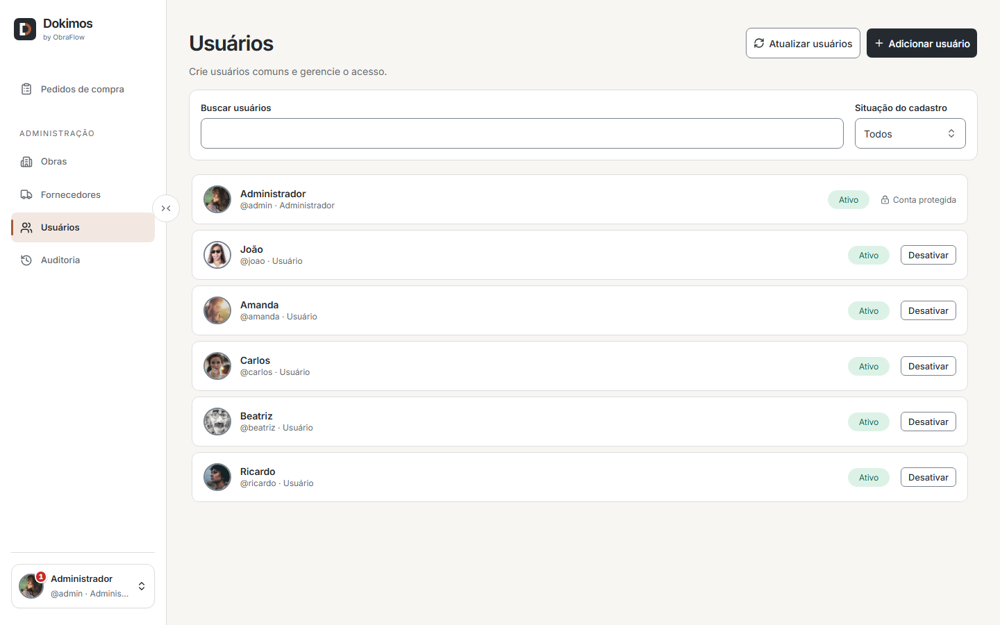 | `01-list--admin.png` | [light desktop](light/desktop/users/01-list--admin.png) · [light mobile](light/mobile/users/01-list--admin.png) · [dark desktop](dark/desktop/users/01-list--admin.png) · [dark mobile](dark/mobile/users/01-list--admin.png) |
| 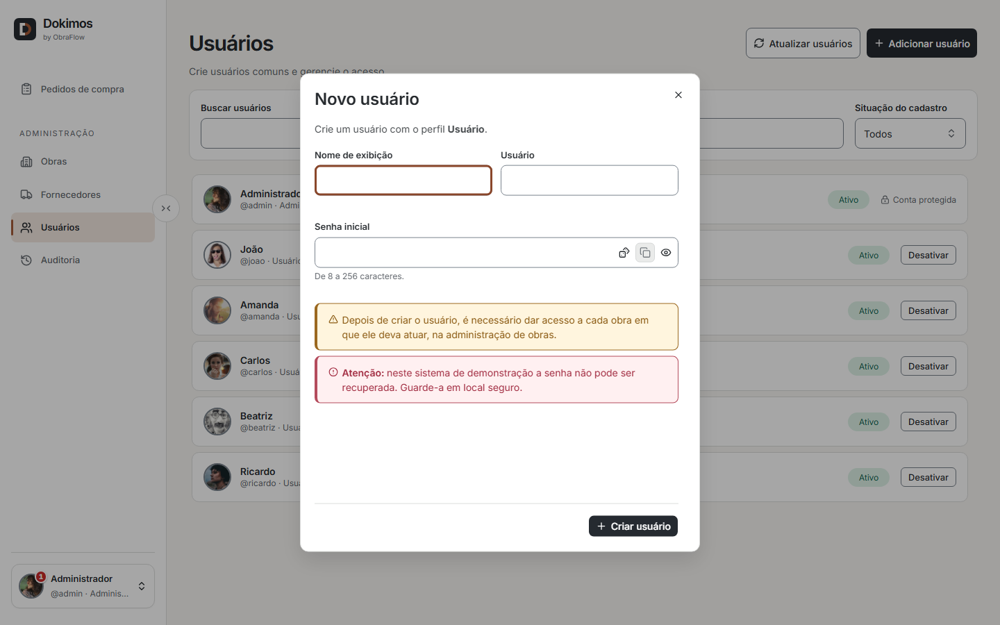 | `02-new-user--admin.png` | [light desktop](light/desktop/users/02-new-user--admin.png) · [light mobile](light/mobile/users/02-new-user--admin.png) · [dark desktop](dark/desktop/users/02-new-user--admin.png) · [dark mobile](dark/mobile/users/02-new-user--admin.png) |
| 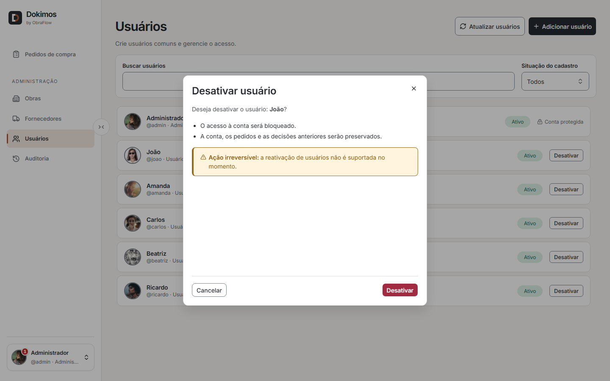 | `03-deactivate--admin.png` | [light desktop](light/desktop/users/03-deactivate--admin.png) · [light mobile](light/mobile/users/03-deactivate--admin.png) · [dark desktop](dark/desktop/users/03-deactivate--admin.png) · [dark mobile](dark/mobile/users/03-deactivate--admin.png) |

## audit

| Preview | State | Captures |
| --- | --- | --- |
| 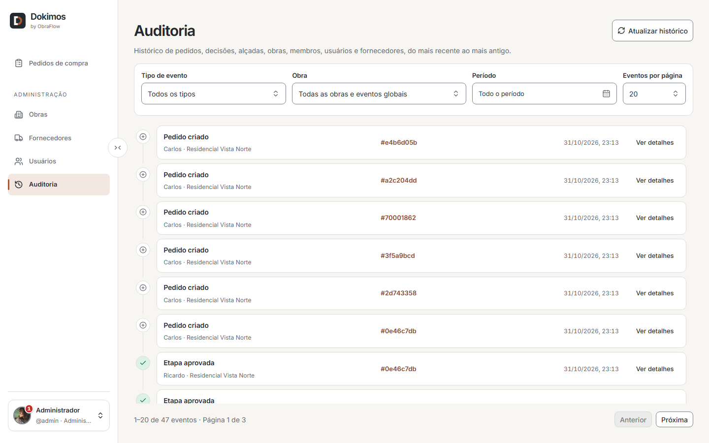 | `01-list--admin.png` | [light desktop](light/desktop/audit/01-list--admin.png) · [light mobile](light/mobile/audit/01-list--admin.png) · [dark desktop](dark/desktop/audit/01-list--admin.png) · [dark mobile](dark/mobile/audit/01-list--admin.png) |
| 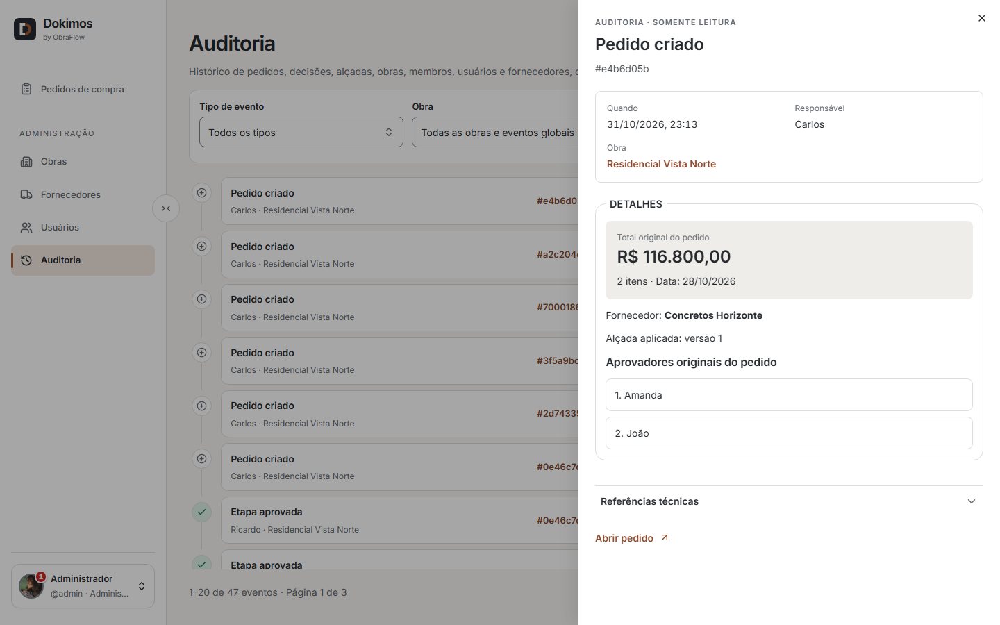 | `02-event-details--admin.png` | [light desktop](light/desktop/audit/02-event-details--admin.png) · [light mobile](light/mobile/audit/02-event-details--admin.png) · [dark desktop](dark/desktop/audit/02-event-details--admin.png) · [dark mobile](dark/mobile/audit/02-event-details--admin.png) |
| 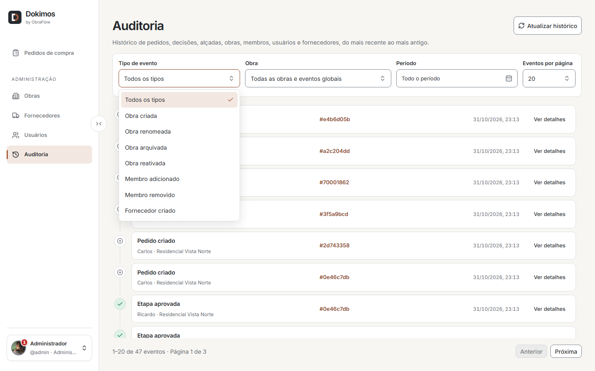 | `03-event-types--admin.png` | [light desktop](light/desktop/audit/03-event-types--admin.png) · [light mobile](light/mobile/audit/03-event-types--admin.png) · [dark desktop](dark/desktop/audit/03-event-types--admin.png) · [dark mobile](dark/mobile/audit/03-event-types--admin.png) |

## states

| Preview | State | Captures |
| --- | --- | --- |
| 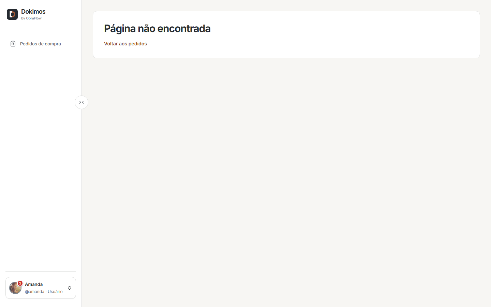 | `01-not-found--amanda.png` | [light desktop](light/desktop/states/01-not-found--amanda.png) · [light mobile](light/mobile/states/01-not-found--amanda.png) · [dark desktop](dark/desktop/states/01-not-found--amanda.png) · [dark mobile](dark/mobile/states/01-not-found--amanda.png) |
|  | `02-admin-not-found--admin.png` | [light desktop](light/desktop/states/02-admin-not-found--admin.png) · [light mobile](light/mobile/states/02-admin-not-found--admin.png) · [dark desktop](dark/desktop/states/02-admin-not-found--admin.png) · [dark mobile](dark/mobile/states/02-admin-not-found--admin.png) |
|  | `03-admin-only--amanda.png` | [light desktop](light/desktop/states/03-admin-only--amanda.png) · [light mobile](light/mobile/states/03-admin-only--amanda.png) · [dark desktop](dark/desktop/states/03-admin-only--amanda.png) · [dark mobile](dark/mobile/states/03-admin-only--amanda.png) |
|  | `04-order-not-found--amanda.png` | [light desktop](light/desktop/states/04-order-not-found--amanda.png) · [light mobile](light/mobile/states/04-order-not-found--amanda.png) · [dark desktop](dark/desktop/states/04-order-not-found--amanda.png) · [dark mobile](dark/mobile/states/04-order-not-found--amanda.png) |
|  | `05-list-loading--amanda.png` | [light desktop](light/desktop/states/05-list-loading--amanda.png) · [light mobile](light/mobile/states/05-list-loading--amanda.png) · [dark desktop](dark/desktop/states/05-list-loading--amanda.png) · [dark mobile](dark/mobile/states/05-list-loading--amanda.png) |
|  | `06-list-failed--amanda.png` | [light desktop](light/desktop/states/06-list-failed--amanda.png) · [light mobile](light/mobile/states/06-list-failed--amanda.png) · [dark desktop](dark/desktop/states/06-list-failed--amanda.png) · [dark mobile](dark/mobile/states/06-list-failed--amanda.png) |
|  | `07-detail-failed--amanda.png` | [light desktop](light/desktop/states/07-detail-failed--amanda.png) · [light mobile](light/mobile/states/07-detail-failed--amanda.png) · [dark desktop](dark/desktop/states/07-detail-failed--amanda.png) · [dark mobile](dark/mobile/states/07-detail-failed--amanda.png) |
|  | `08-session-expired--amanda.png` | [light desktop](light/desktop/states/08-session-expired--amanda.png) · [light mobile](light/mobile/states/08-session-expired--amanda.png) · [dark desktop](dark/desktop/states/08-session-expired--amanda.png) · [dark mobile](dark/mobile/states/08-session-expired--amanda.png) |
